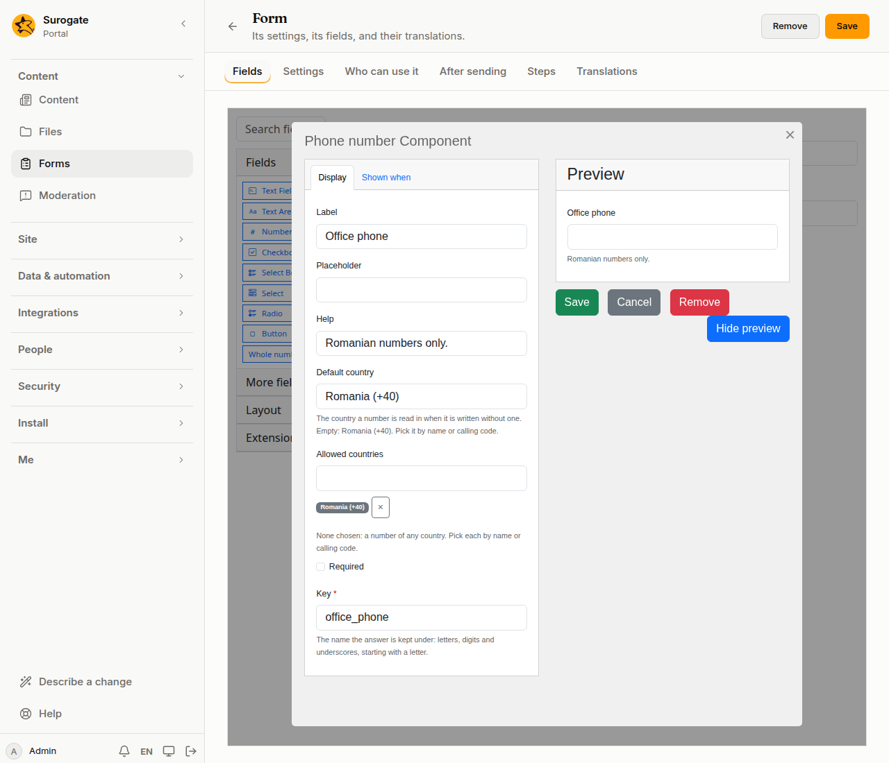
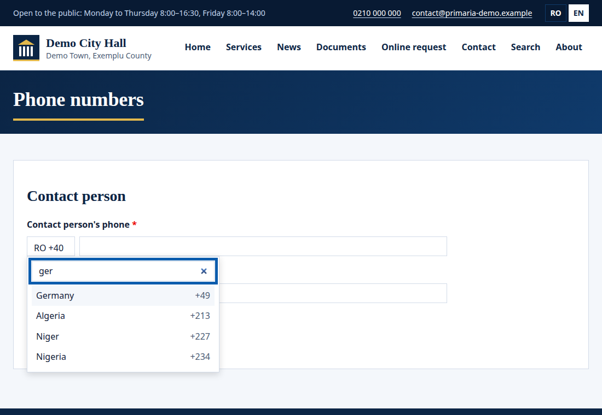
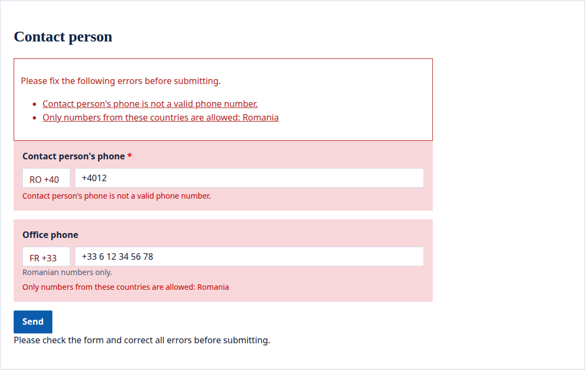
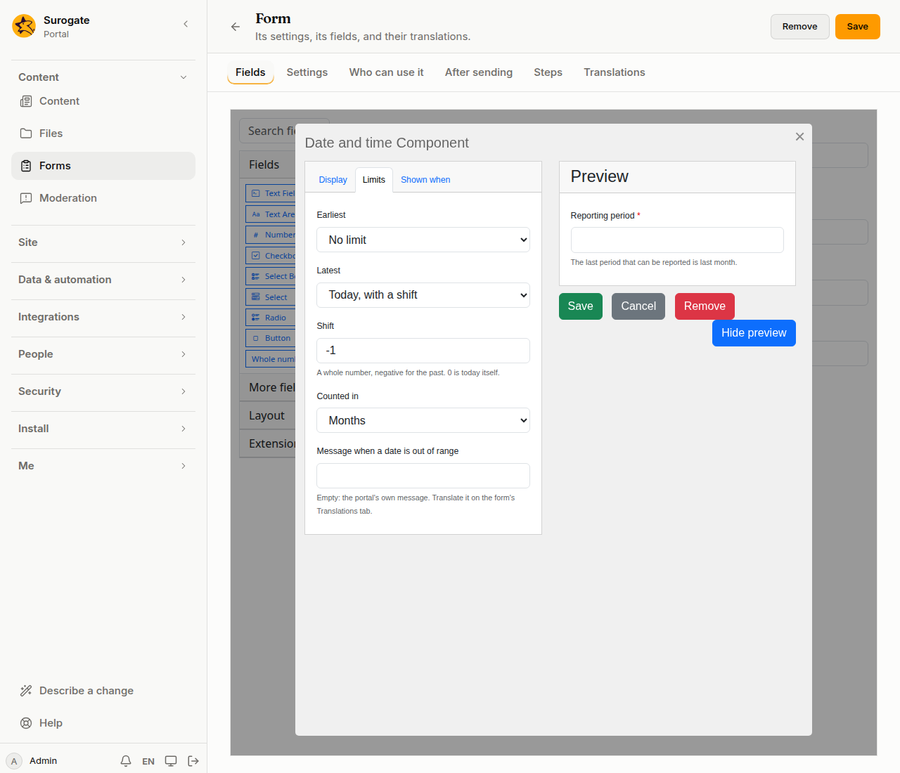
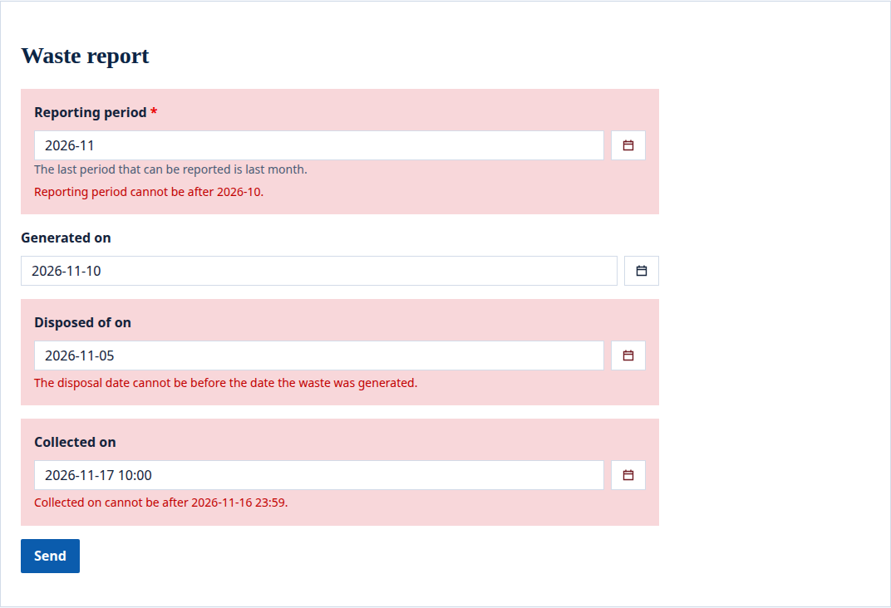

The form builder offers the portal's own fields in its **Fields** and **More fields** groups. Every setting below is a choice in the field's dialog in the builder: no code and no file is needed. Everything the browser checks, the portal checks again when the form is sent.

For the fields the portal's extensions add (barcodes, scanner, IBAN, signature), see [Extension fields](/portal/sites/form-fields/). For how to put a form on a page and who sends it, see [Forms](/portal/sites/forms/).

## Currency

The **Currency** field takes an amount of money and writes it the way you choose: with the currency's symbol or code, before or after the amount, with your country's separators. What the portal keeps is the number, never the text on the screen.

In the form builder, **Currency** is in **More fields**. Open the field to set:

- **Currency**: any currency of the ISO 4217 list. Type its code or its name in the box, such as `GBP` or `pound`, and pick it from the suggestions. Romanian lei (RON) when you pick none. Under it the dialog says **Existing values are not converted**: changing the currency of a field that already has answers does not change those answers, so an answer of 100 stays 100 in the new currency.
- **Show**: **Symbol (lei, €)** or **Code (RON, EUR)**.
- **Position**: **Before the amount**, **Before the amount, with a space**, **After the amount** or **After the amount, with a space**.
- **Decimal separator**: **Comma ( , )** or **Point ( . )**.
- **Thousands separator**: **Point ( . )**, **Comma ( , )**, **Space**, **Narrow space** or **None**.
- **Decimals**: from 0 to 4. Left empty, the currency's own: 2 for lei and euro, 3 for the Kuwaiti dinar, 0 for the yen. A currency without decimals, such as the yen, always has none.
- **Least** and **Most**, on the **Limits** tab. Negative amounts are allowed unless the least rules them out.

The console does not let you save a form whose currency field cannot work: the two separators cannot be the same, the decimals must be from 0 to 4, the least cannot be above the most, and a least or most cannot have more decimals than the field keeps. It says which field and why above the form, and **Save** stays grey.

**What a person filling the form in sees.** The box shows the symbol or code where you put it. The thousands are grouped as the person types, and the box takes no more decimals than the field keeps: a third decimal typed in a field of two is not taken, and neither is a letter. When the person leaves the box, the decimals are filled in. Typing `1234567,5` in a field of lei with a comma and a point gives `1.234.567,50 lei`, and the portal keeps exactly 1234567.5.

An amount outside the least and the most gets a message at its field, and the form is not sent:

The portal checks again when the form is sent, and its rules do not bend: an amount with more decimals than the field keeps is refused, never rounded in silence. Amounts are worked out as decimals, so there are no floating-point surprises: a sum such as 0.1 + 0.2 that is not an amount of cents is refused as well. In a reviewer's CSV export, an amount is written as a plain number, with a point for the decimals and no thousands separator, so that a machine can read it. Developers: see [Developer: Form fields](/portal/developer/form-fields/#currency).

## Phone number

The **Phone number** field takes a number in the international form and keeps it that way, such as `+40723456789`, whatever the person typed.

In the form builder, **Phone number** is in **More fields**; it takes the place of the older phone box, which the builder no longer offers (a form that already has one keeps working). Open the field to set:

- **Default country**: the country a number written without one is read in. Pick it by name or calling code. Romania (+40) when you pick none.
- **Allowed countries**: pick the countries a number may come from, each by name or calling code; **×** takes one away. When you pick none, a number of any country is allowed.
- **Required**.

**What a person filling the form in sees.** A button with the country and its calling code, such as **RO +40**, and the box for the number beside it. The button opens a list of countries with a search: type a name or a calling code, and pick the country. A number typed with a country's code, starting with **+** or **00**, changes the country by itself. Spaces, points, dashes, brackets and a `(0)` are taken out. When the person leaves the box, a valid number is shown in the international form: `0723 456 789` becomes `+40 723 456 789`, and `+33 6 12 34 56 78` switches the country to France.

A number that is not valid for its country, such as `+40 12`, is refused: "Contact person's phone is not a valid phone number." A valid number of a country the field does not allow is refused too, with the countries named: "Only numbers from these countries are allowed: Romania". Nothing is sent until the numbers are right.

The portal checks the number again with the same numbering rules when the form is sent. Something other than a person, such as a program sending the form, must write the number in the international form already: `0723456789` is refused, since nothing says which country it is in. An answer kept before the field was used, which is not in the international form, is shown as it was, and the field says it is not valid until it is corrected. Developers: see [Developer: Form fields](/portal/developer/form-fields/#phone-number).

## Date and time

The **Date and time** field takes a date, a date with a time, or a month and year, and can keep the person inside limits: no date in the past, no date after today, not before another field's date.

In the form builder, **Date and time** is in **More fields**. On the **Display** tab, **What to choose** is **Date**, **Date and time** or **Month and year** (for a reporting period, for example). On the **Limits** tab, **Earliest** and **Latest** each say how the limit is set:

- **No limit**.
- **A fixed date**: **Date**, written `2026-11-16`; for a month `2026-11`; for a date and time `2026-11-16 10:00`, as the clocks of Romania show it.
- **Today, with a shift**: **Shift** is a whole number, negative for the past and 0 for today itself, **Counted in** **Days** or **Months**. A latest of today with a shift of -1 month is the same day last month.
- **The value of another field**: **Field** is a date field of the same form. While that field is empty, this limit is not applied.
- **An expression**: written in CEL, such as `timestamp(form.start) + duration("720h")`. It reads the form's fields as `form.<key>` (a date field's value is a timestamp), the person as `user` and the moment as `now()`, and gives a date or a timestamp.

**Message when a date is out of range** is what the person reads at the field. Left empty, the portal says it in its own words ("Reporting period cannot be after 2026-10."). Translate your own message on the form's **Translations** tab like any other text.

The console does not let you save a form with a fixed earliest after a fixed latest, with an expression that is not valid CEL, or with a limit that reads a field the form does not have. It says which field and why above the form.

**What a person filling the form in sees.** A box to type in and a calendar button beside it. In the Romanian pages the date is typed `zz.ll.aaaa` (and `zz.ll.aaaa hh:mm` for a date and time), in the English pages in the ISO form `2026-11-16` (and `2026-11-16 10:00`). The calendar is the portal's own, with no outside library: the days outside the limits are grey and cannot be chosen. A month field shows the months of a year instead, and a date and time adds hour and minute boxes under the days. The arrow keys move between days, **Enter** chooses one, **Page up** and **Page down** change the month, and **Esc** closes the calendar.

On the 16th of November 2026, a reporting period that can be at most last month has November and December greyed, and October the last month that can be chosen:

A date that cannot be before another field's gets the days before it greyed. Here the field Generated on holds 2026-11-10, and the days up to the 9th of the month are grey:

A date typed by hand that is out of the limits gets the message at the field, and the form is not sent:

**Today and the time zone.** "Today" is the day on the clocks of Romania (Europe/Bucharest), in the page and on the server alike, whatever clock the person's computer shows: at half past eleven in the evening in a place five hours behind Romania, it is already the next day for the limits. A date and a month have no time zone. A date and time is typed and shown as the clocks of Romania show it, and is kept in UTC: 10:00 on 16 November 2026 in Romania is kept as 08:00 UTC, and shown back as 10:00. A fixed date or today as the limit of a date and time covers the whole day, from midnight to the last minute.

The portal works the limits out again when the form is sent, and its answer is the one that counts: a form opened at 23:59 and sent after midnight is refused if the date is no longer allowed, with the message at the field. A limit that cannot be worked out, such as an expression that fails, blocks the form with "The limit cannot be worked out." Developers: see [Developer: Form fields](/portal/developer/form-fields/#date-and-time).
