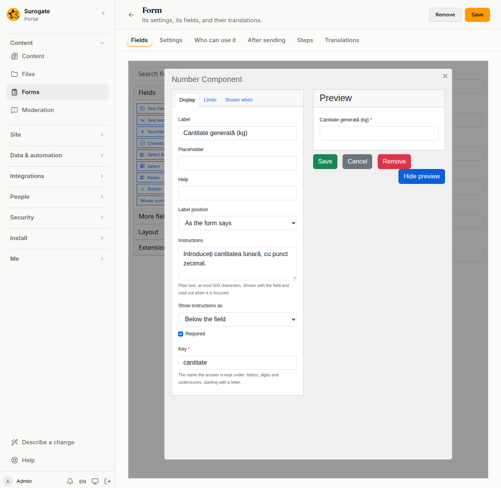
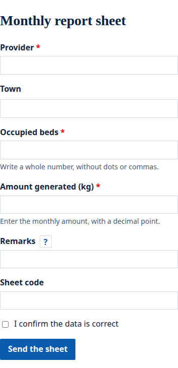
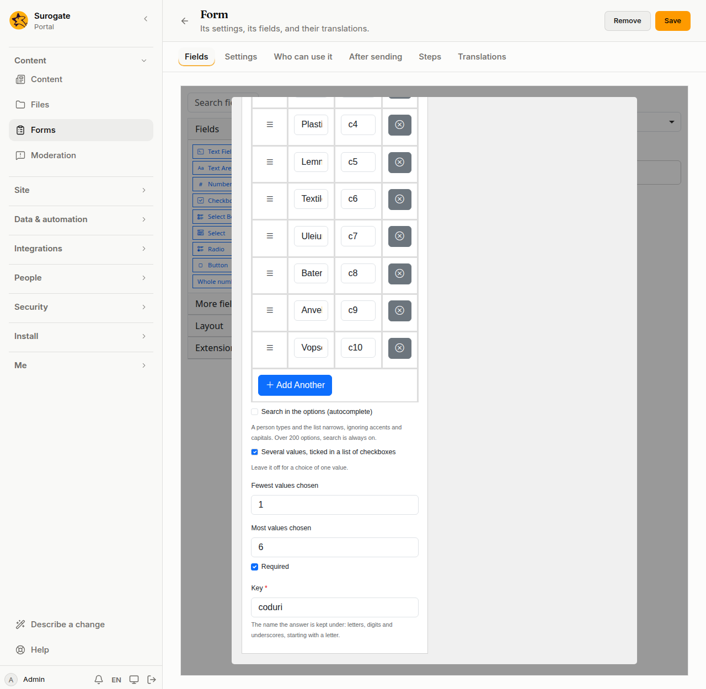
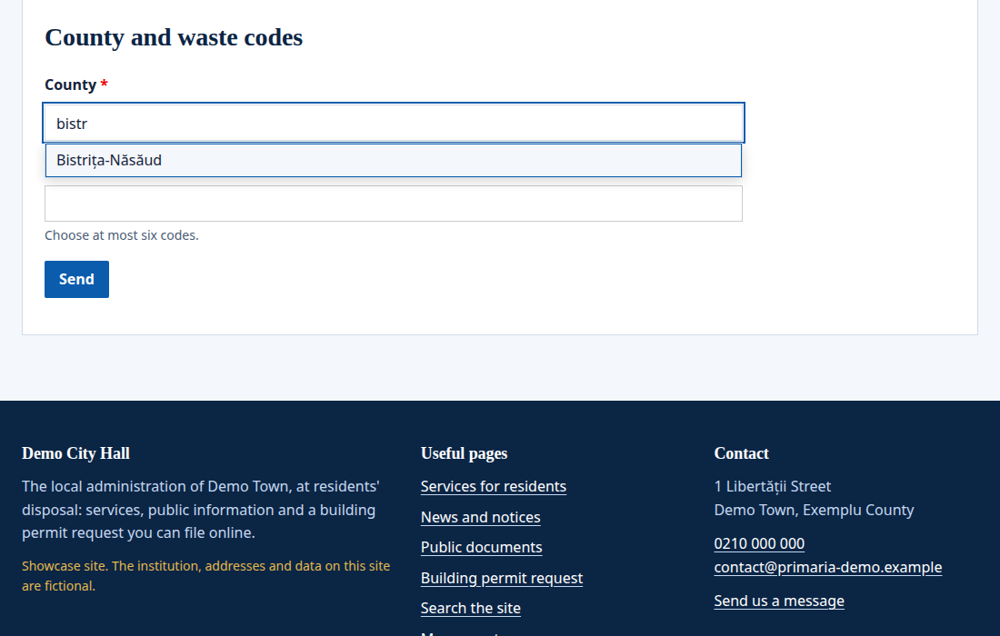
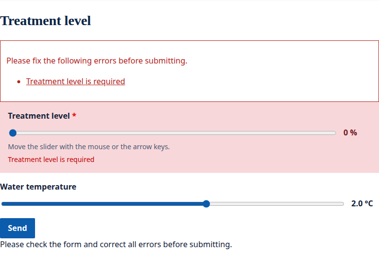

The form builder offers the portal's own fields in its **Fields** and **More fields** groups. Every setting below is a choice in the field's dialog in the builder: no code and no file is needed. Everything the browser checks, the portal checks again when the form is sent.

For the fields the portal's extensions add (barcodes, scanner, IBAN, signature), see [Extension fields](/portal/sites/form-fields/). For how to put a form on a page and who sends it, see [Forms](/portal/sites/forms/).

## Label position and instructions

Every field takes a label position and instructions, whatever its type.

In the form builder, on the **Settings** tab, **Where field labels go** sets where the labels of the whole form go: **Above the field**, **To the left of the field** or **To the right of the field**. It is above the field when you change nothing.

A field can say otherwise. On the **Fields** tab, click the field, and on its **Display** tab:

- **Label position:** **As the form says**, **Top**, **Left** or **Right**.
- **Instructions:** a text of at most 500 characters, written as plain text. It is read to people who use a screen reader when they reach the field.
- **Show instructions as:** **Below the field**, or **Icon "?" with the explanation on hover or focus**.

Instructions are among the texts on the form's **Translations** tab, with a row for each language: write them there like a label. A translation of instructions is also at most 500 characters.

### What a person sees

- **Left** puts the label on the same row as the field, in a column 30% as wide as the row. **Right** puts the label after the field, in the same kind of column.
- On a screen under 600 pixels wide the label is always above the field, whatever is set. A phone shows the form in one column.
- A checkbox on its own keeps its label after the box. **Top** puts it above the box.
- **Below the field**, the instructions are a line of text under the field. As an icon, a "?" button sits beside the label. The explanation shows when the mouse is over it, when it has the keyboard focus, and on a tap; **Escape** closes it.
- The field's own control reads the instructions to a screen reader when it takes the focus, in both ways of showing them.

### What the portal refuses

The form cannot be saved with a label position other than top, left or right, with instructions of more than 500 characters or that hold markup, or with a way of showing them that is neither below the field nor an icon. The console says which field.

## Dropdown with search and with checkboxes

A select (the **Select** field in the builder) can search its options and can take many values. In its dialog on the **Display** tab:

- **Search in the options (autocomplete):** tick it for a select a person types into. The list narrows as they type.
- **Characters typed before suggestions:** from 0 to 3, shown once search is on. With 0, the whole list is offered as soon as it opens.
- **Several values, ticked in a list of checkboxes:** leave it off for a choice of one value.
- **Fewest values chosen** and **Most values chosen:** shown once several values are on. Both are whole numbers from 1 up, and the fewest cannot be above the most.

A select with neither search nor several values stays the browser's own. A select with more than 200 options searches whether or not it was asked to: a list that long is no use without it.

### What a person sees

- **Search:** typing "bistr" in a county field with the 42 counties lists only "Bistrița-Năsăud". Accents and capitals do not matter, and the text is matched at the start of any word: "iasi" finds "Iași", and "nasaud" finds "Bistrița-Năsăud". When nothing matches, the list says "No results." Only an option can be chosen, never a text of the person's own. With **Characters typed before suggestions** above 0, the list says "Type at least 2 characters." until they have.

- **Checkboxes:** the open list shows a checkbox for each option. **Select all** is there only for a list of at most 100 options, and not when **Most values chosen** is below the number of options. **Clear** takes every choice away. Closed, the control shows what was chosen as labels, each with a button to take it away; above three it says how many, such as "6 selected".

- **The most:** once the most is reached, the other options cannot be ticked, and the list says "You can choose at most 6."

- **The fewest:** it is asked once something is chosen: "Waste codes treated: choose at least 2." A required select that is left empty says it is required, at the field.
- **Keyboard:** **Arrow Down** opens the list and moves down it, **Arrow Up** moves up, **Space** or **Enter** ticks the option the arrows are on (typing a search, **Enter** only), and **Escape** closes the list. A screen reader is told it is a combobox with a list, and, with checkboxes, that several values can be chosen.

The options can be the form's own or the options of an app: both are drawn the same way.

### What the portal refuses

The form cannot be saved with a number of characters above 3, or with fewest or most values that are not whole numbers from 1 up, the fewest above the most or above the number of options. When a form is sent, every value must be one of the options, none twice, and the number of values must be within the fewest and the most: otherwise it is refused, whether it came from the page or from a program.

## Slider

The **Slider** field is in the **More fields** group. In its dialog on the **Display** tab:

- **Label** and **Help**, **Required** and **Key**, as for any field, and **Label position** and **Instructions**.
- **Least** and **Most:** numbers, the least below the most.
- **Step:** a number above 0 that fits the range a whole number of times. A step of 5 fits 0 to 100; a step of 0.5 fits -10 to 10.
- **Where the handle starts:** within the range and on a step. Empty, it starts at the least. It is where the handle rests, not an answer.
- **Show the value beside the slider:** ticked, the value is written beside the slider.
- **Unit:** a short text after the value, such as % or kg. It is translated on the **Translations** tab.

### What a person sees

A horizontal slider with its value beside it. The arrows move it one step, **Page Up** and **Page Down** ten steps, **Home** and **End** to the ends. A screen reader reads it as a slider with its value, its least and most, and the value with its unit.

A slider that is not required and was not touched sends nothing: the place where it starts is not taken for an answer. A required slider that was not touched is refused like any required field, at the field.

The value sent is a number: a whole number when the least, the most and the step are.

A zone of fields read from a JSON draws a field of type `slider` as this slider.

### What the portal refuses

The form cannot be saved when the least is not below the most, when the step is not above 0 or does not fit the range, when the place the handle starts is not in the range and on a step, or when the unit is longer than 20 characters. When a form is sent, a value that is not a number, is outside the range or is not on a step is refused, whether it came from the page or from a program: "The value must be between 0 and 100, in steps of 5."

