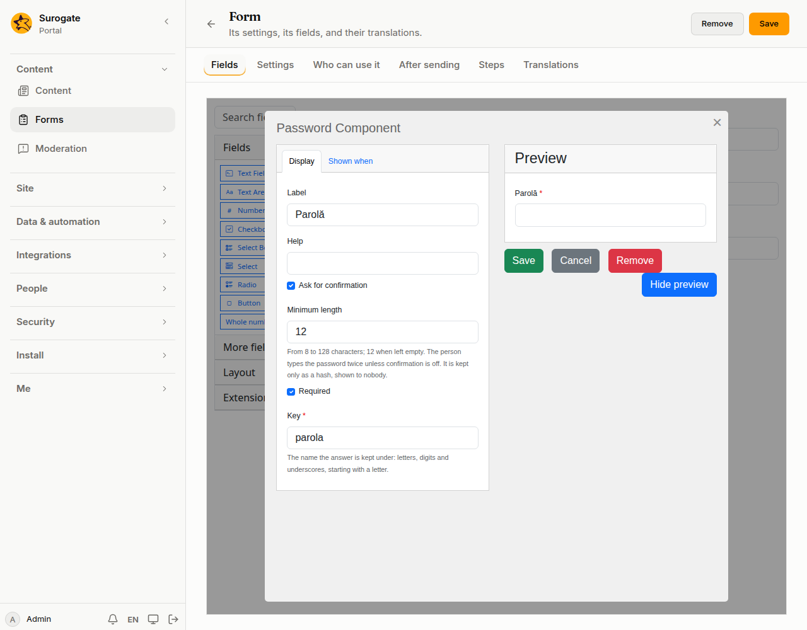
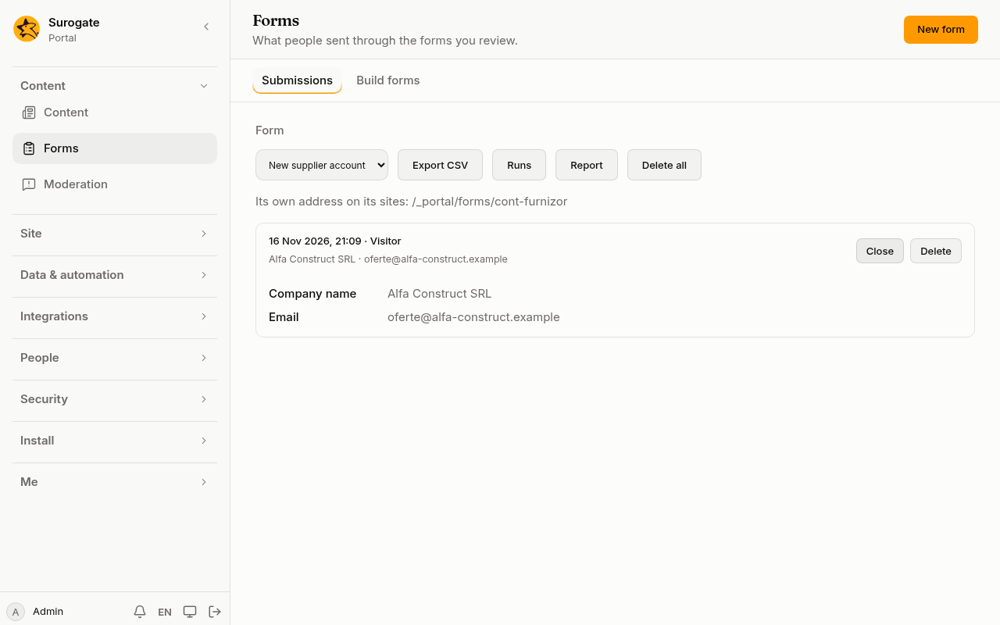
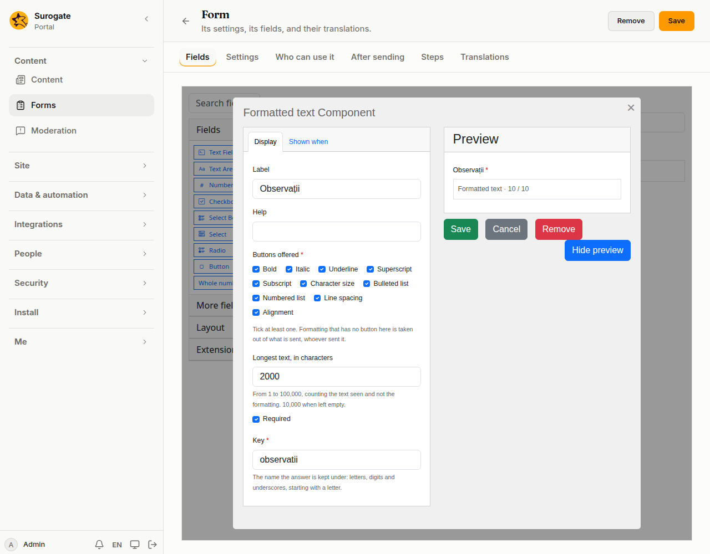
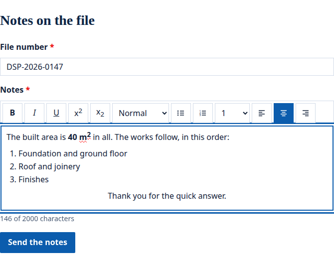

The form builder offers the portal's own fields in its **Fields** and **More fields** groups. Every setting below is a choice in the field's dialog in the builder: no code and no file is needed. Everything the browser checks, the portal checks again when the form is sent.

For the fields the portal's extensions add (barcodes, scanner, IBAN, signature), see [Extension fields](/portal/sites/form-fields/). For how to put a form on a page and who sends it, see [Forms](/portal/sites/forms/).

## Password

The **Password** field asks a person for a password they choose, such as when a supplier creates an account. It is kept only as a scrambled value that cannot be turned back into the password.

In the form builder, open **More fields** and drag in **Password**. Click the field's edit button to open its dialog:

- **Label** and **Help**: the text above the field and a hint under it.
- **Ask for confirmation**: ticked, the person types the password twice. It is ticked unless you clear it.
- **Minimum length**: from 8 to 128 characters. Left empty, it is 12.
- **Required**: the form cannot be sent without a password.
- **Key**: the name the answer is kept under.

### What a person sees

The person sees two boxes that show dots instead of letters: the field's label, such as **Password**, and **Confirm password**. Each has a **Show** button that turns into **Hide** while the letters are shown. Their browser may offer to save the new password, and they can paste it in.

The form is not sent while there is something to put right, and the message is next to the box it is about:

- **The passwords do not match** appears under **Confirm password**.
- **The password must have at least 12 characters.** appears when the password is shorter than the **Minimum length**.
- A password has at most 1,024 characters.

The portal checks all of this again when the form is sent, so a form sent by other means is refused in the same way. The portal's sign-in password rules are not applied to this field: its own **Minimum length** is the rule.

### Where the password goes

The password is never kept, and nobody can read it:

- **What is kept:** a scrambled value (an Argon2id hash with a random salt of its own). The same password gives a different value each time.
- **People who read what was sent:** it is not in the list on **Forms**, not in an opened submission, not in **Export CSV** (the column is left out) and not in the email that tells reviewers a form was sent.
- **Drafts:** a half-filled form is kept without the password. A person who comes back to it finds the password boxes empty.
- **[Actions](/portal/sites/actions/):** an action the form runs is given the scrambled value and never the password. If an action writes it in its log, the run's log on **Forms** shows **[hidden]** in its place.

### What the portal refuses

The form builder says what is wrong when you save, in these words:

- **A password field's shortest length is not between 8 and 128.**
- **A password field has a password of its own written in the form.** Take the default value out.
- **A password field takes no pattern or length limit of the texts.** Set its **Minimum length** instead.
- **A form with a password field cannot be filled in offline.** The password is scrambled by the portal when the form is sent, which needs a connection.

A password field cannot be the text a barcode draws.

## Formatted text

The **Formatted text** field lets a person write with bold, lists, sizes and alignment, such as the notes on a file or a description. What they write is kept and shown with the same formatting.

In the form builder, open **More fields**, drag in **Formatted text** and click its edit button:

- **Label** and **Help**.
- **Buttons offered**: tick the buttons the person gets. All ten are offered unless you clear some, and at least one stays ticked:
  - **Bold**, **Italic** and **Underline**;
  - **Superscript** and **Subscript**;
  - **Character size**: **Small**, **Normal**, **Large** and **Very large**;
  - **Bulleted list** and **Numbered list**;
  - **Line spacing**: 1, 1.15, 1.5 and 2;
  - **Alignment**: left, center and right.
- **Longest text, in characters**: from 1 to 100,000, and 10,000 when left empty. It counts the text a person sees, not the formatting.
- **Required** and **Key**.

### What a person sees

The person sees a toolbar of named buttons above a box to write in, and how many characters they have used. Hover or focus a button to read its name. **Ctrl+B**, **Ctrl+I** and **Ctrl+U** work as in a word processor, and the toolbar wraps on a phone, with buttons big enough to tap.

- Select the text first, then press a button or choose a size, a spacing or an alignment. Spacing and alignment apply to the paragraphs the selection touches.
- A paste, from Word or from a web page, keeps the formatting that has a button here, and keeps the text of everything else. Fonts and colors are lost.

When the box holds nothing but blank lines, the field counts as empty:

A text longer than the longest allowed is refused with **The text can have at most 2000 characters.**

### What is kept

Only formatting the field's buttons give is kept. When a form is sent, the portal removes everything else, whoever sent it and however: scripts and styles, links, images, frames and tables are taken out and their text stays. A button you cleared takes its formatting out too. What is kept is what people see, so a text is never shown differently from how it was written.

### Where people read it

- **On Forms:** the list shows the plain text on one line, up to 200 characters. Open a submission and the text is shown as it was written:

  

- **Export CSV** and the **email to reviewers** carry the plain text, a line for each paragraph.

### What the portal refuses

- **A formatted text field must offer at least one button, each from the list and none twice.**
- **A formatted text field's longest text is not between 1 and 100,000 characters.**
- **A formatted text field has a text of its own written in the form.** Take the default value out.
- **A formatted text field takes no pattern or length limit of the texts.** Set its longest text instead.

A formatted text field cannot be the text a barcode draws.
