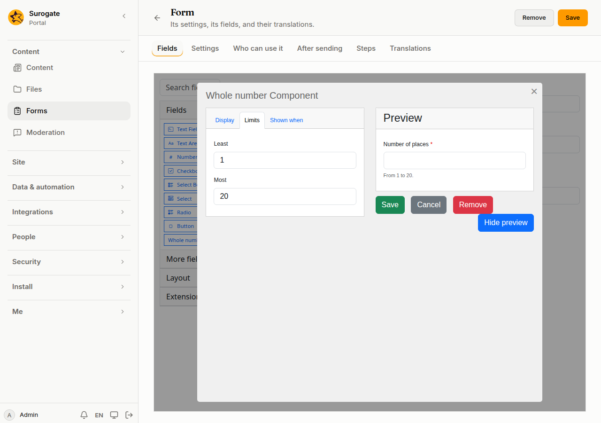
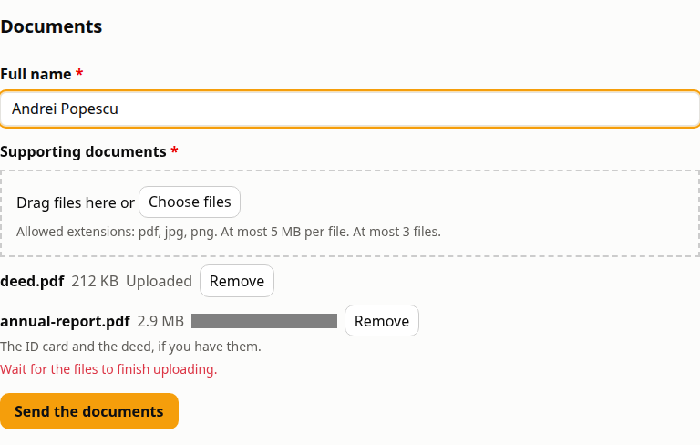
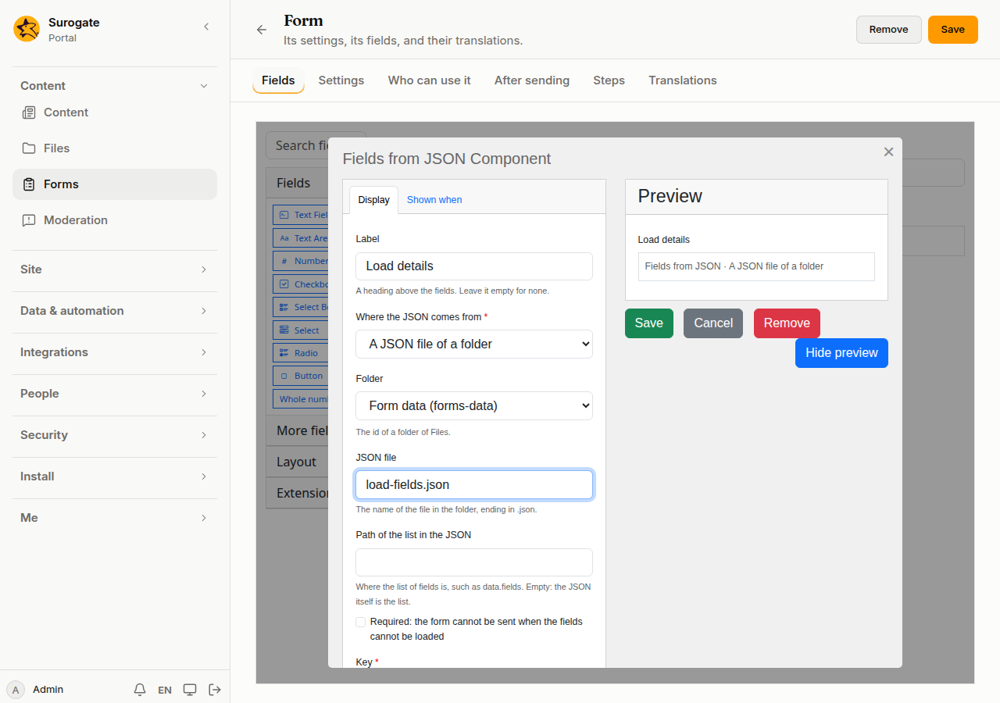
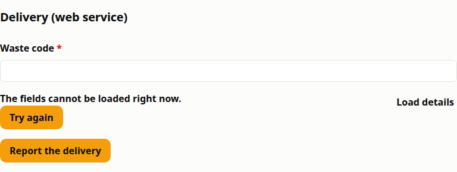
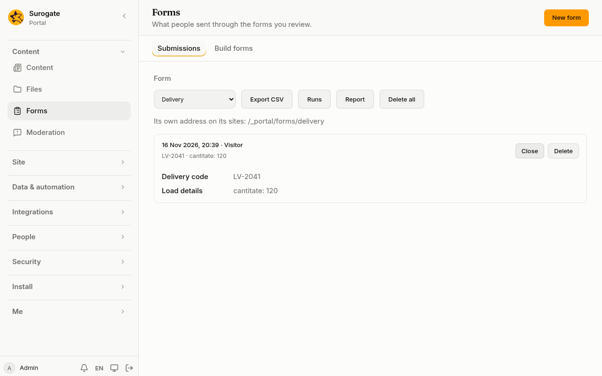

The form builder offers the portal's own fields in its **Fields** and **More fields** groups. Every setting below is a choice in the field's dialog in the builder: no code and no file is needed. Everything the browser checks, the portal checks again when the form is sent.

For the fields the portal's extensions add (barcodes, scanner, IBAN, signature), see [Extension fields](/portal/sites/form-fields/). For how to put a form on a page and who sends it, see [Forms](/portal/sites/forms/).

## Whole number

**Whole number** is in the **Fields** group of the form builder. It is a box for a number with no decimals, such as a count of places or a floor.

In the form builder, drag **Whole number** onto the form and click it. Its dialog has three tabs:

- **Display**: the label, the placeholder, the help under the box, whether the field is **Required**, and the **Key** its answer is kept under.
- **Limits**: **Least** and **Most**, each a whole number, negative if need be. Leave one empty for no limit on that side.
- **Shown when**: shows the field only when another field has a value, as for any field.

### What people see

A box that takes digits, and a minus sign at the start. Anything else, typed or pasted, is left out as it is typed: `12ab` becomes `12`, and the decimal point is dropped. A number is at most 9,007,199,254,740,991, either way.

- A box holding only a minus sign, or a number too long to be kept exactly, says **Enter a whole number.** On a Romanian page it says **Introduceți un număr întreg.**
- A number below **Least** or above **Most** says so, with the field's name and the limit: "Number of places cannot be greater than 20." The words are in the page's language.
- A required box left empty says that it is required.
- The portal checks the number again when the form is sent: a text, or a number with decimals, is refused.
- What is kept is a number, not a text. A [form's actions](/portal/sites/actions/) read it as a number.

Developers: see [Developer: Form fields](/portal/developer/form-fields/#whole-number).

## Files

**Files** is in the **More fields** group of the form builder. People add files to the form before they send it, and the form's reviewers download them from the submission.

In the form builder, drag **Files** onto the form and click it. Its dialog asks for:

- **Label** and **Help**.
- **Several files**: tick it to take more than one file. **Most files** then asks how many, from 1 to 20. A field for one file takes one.
- **Allowed extensions**: tick at least one of pdf, doc, docx, xls, xlsx, odt, ods, csv, txt, jpg, jpeg, png and zip. Files that run, such as exe, js or html, are never offered and never allowed.
- **Largest file, in KB**: from 1 KB to 25,600 KB (25 MB). The default, 10,240 KB, is 10 MB.
- **Files with the same name**: what happens when a person adds a file whose name is one already there. **Rename the new one** keeps both (`report.pdf`, then `report (1).pdf`). **Replace the first** keeps the new one only. **Refuse the new one** says "A file named report.pdf is already there". Names that differ only in capitals count as the same.
- **Required**, and the **Key** its answer is kept under.

A form with a **Files** field cannot be filled in offline: the portal refuses a form that has both.

### What people see

A drop zone: "Drag files here or **Choose files**", with the limits under it: "Allowed extensions: pdf, jpg, png. At most 5 MB per file. At most 3 files." A field for one file says "Drag the file here or **Choose a file**". On a Romanian page the words are "Trageți fișierele aici sau **Alegeți fișiere**".

Each file goes up as soon as it is added, one at a time. Its row shows its name and size, a progress bar while it goes up, **Uploaded** when it is done, and **Remove** to take it off. The form is sent with the files that went up well.

The form cannot be sent while a file is still going up ("Wait for the files to finish uploading.") or when one failed ("Remove the files that could not be uploaded.").

A refused file says why, beside its own row:

- "This extension is not allowed. Accepted: pdf, jpg, png."
- "The file's content does not match the extension .pdf": the portal reads the start of the file, and it must be what its extension says: a PDF, a JPEG or PNG image, an Office or OpenDocument file without macros, a ZIP, or plain text for csv and txt. Renaming a file does not get it through.
- "The file is larger than 5 MB", "The file is empty." and "The file has no valid name."
- "No more than 3 files can be added."
- "A file named deed.pdf is already there": only when the field is set to **Refuse the new one**.
- "Too many files sent from this address. Try again in a minute." A visitor may send 30 files a minute through one form.
- "Too many files are waiting to be sent. Send the form or remove some." A person may have 100 files waiting, and the visitors of one form 200 between them.
- "The file could not be uploaded. Try again." and "Files cannot be uploaded right now."
- "The file is no longer available. Upload it again.": the portal no longer holds a file that waited too long.

A file's name keeps its accents and loses any folder, control characters and spaces at its ends. It is at most 200 characters with its extension.

### Where reviewers find the files

On [Forms](/portal/console/forms/#read-a-submission), choose the form and **Open** a submission. Each file is listed under the field's label, with its size, as a link that downloads it. Only the form's reviewers and the administrators can download, and the portal checks it each time. A file never opens in the browser: it is always saved.

- The list of submissions names the files beside the first answers.
- The CSV export and the reviewers' email carry the files' names, never the files.
- Deleting a submission deletes its files, and so does the form's [retention](/portal/sites/forms/#keep-submissions-for-a-time) when it removes the submission.
- A file that was uploaded and never sent is deleted after 24 hours, unless the person's saved draft holds it.

Developers: see [Developer: Form fields](/portal/developer/form-fields/#files).

## Fields from JSON

**Fields from JSON** is in the **More fields** group of the form builder. It is a zone of the form whose fields are not drawn in the builder. A JSON, a list of fields, says which they are, and the form reads it when it opens. Change the JSON, and every form that reads it changes, with no new version of the form.

In the form builder, drag **Fields from JSON** onto the form and click it. Its dialog asks for:

- **Label**: the zone's heading.
- **Where the JSON comes from**: one of four sources, each asking only for what it needs (below).
- **Path of the list in the JSON**: where the list of fields is, such as `data.fields`. Empty: the JSON itself is the list.
- **Required: the form cannot be sent when the fields cannot be loaded**: tick it when the form is useless without them.
- **Key**: the name the zone's answers are kept under.

### The four sources

**JSON text written here** keeps the JSON in the form. The console refuses to save a text that is not a list of fields.

**A JSON file of a folder** reads a `.json` file of one of the [folders](/portal/console/files/) on **Files**. Choose the **Folder** and write the **JSON file**, such as `load-fields.json`. Upload a new file of the same name to change the fields.

**A named value** reads the result of one of the [named values](/portal/sites/values/). Choose it under **Named value**. The value may itself be the answer of a web call.

**A web call through a connector** asks one of the portal's web [connectors](/portal/sites/connectors/) for the JSON, so the fields can depend on a system of yours.

- **Web connector**: the connector that makes the call.
- **Path of the call**: added to the connector's address, such as `/fields`.
- **Query**: one line for each parameter, written `name = expression`, such as `code = form.waste_code`. The expression reads the form's fields as `form.<key>`.
- **Reload when these fields change**: the fields the query reads. When a person changes one, the fields are asked for again, a moment after the last change. A query reads only the fields chosen here.

### What the JSON holds

A list of at most 50 fields, up to 256 KB. Each field has a **key** and a **type**, a **label**, and may be required, have a default value, options, a least and a most, a step and a description:

- Types: text, textarea, number, integer, email, date, datetime, select, multiselect, radio, checkboxes, checkbox, slider and static (a line of text to show).
- A label or description is a text, or a text for each language of the site.
- A field's key may not be one the form already uses, and no key appears twice.

For example, this JSON describes one field, a required whole number of at least 0, with its label in Romanian and in English: `[{"key":"cantitate","type":"integer","label":{"ro":"Cantitate (kg)","en":"Quantity (kg)"},"required":true,"min":0}]`

### What people see

When the form opens, the zone says "Loading the fields…", then the fields appear among the form's own. What was typed in a field stays when the fields are loaded again, if that field is still there.

When the source cannot be read now, because it did not answer in time or answered with an error, the zone says "The fields cannot be loaded right now." with **Try again**. If **Required** was ticked, the form cannot be sent until the fields are there.

When the JSON is read but is not a good description, the zone says "The description of the fields is not right:", then what is wrong, such as "a key is there twice", and the key. The person who owns the JSON fixes it.

The fields are asked for at most 60 times a minute from one place. What the portal served is kept for 24 hours: the form is checked against the fields the person was shown, even if the JSON changed since. A form left open for more than a day is refused when it is sent, and the page has to be loaded again.

### In the console

**Forms** shows the zone's answers under its label, as `key: value` for each field that has a value, and the CSV export has one column for it.

Developers: see [Developer: Form fields](/portal/developer/form-fields/#fields-from-json).
