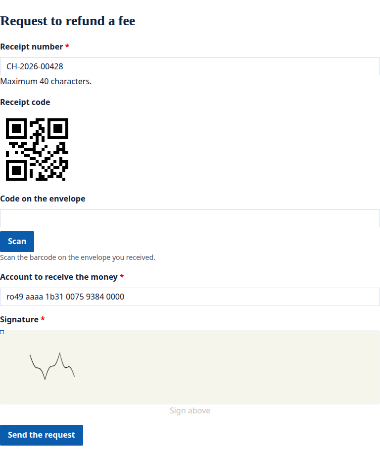
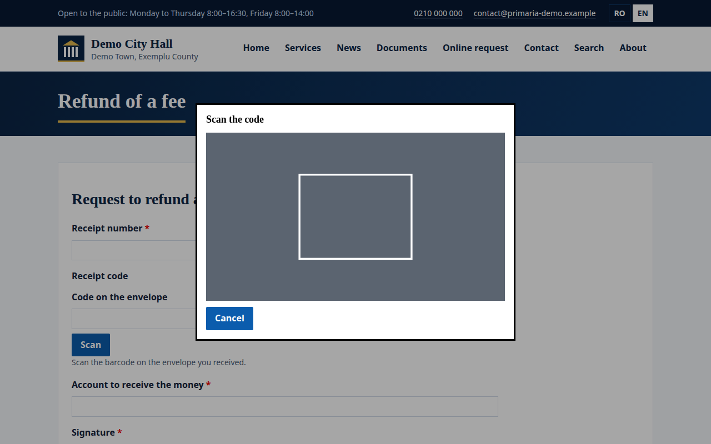
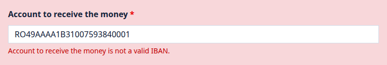
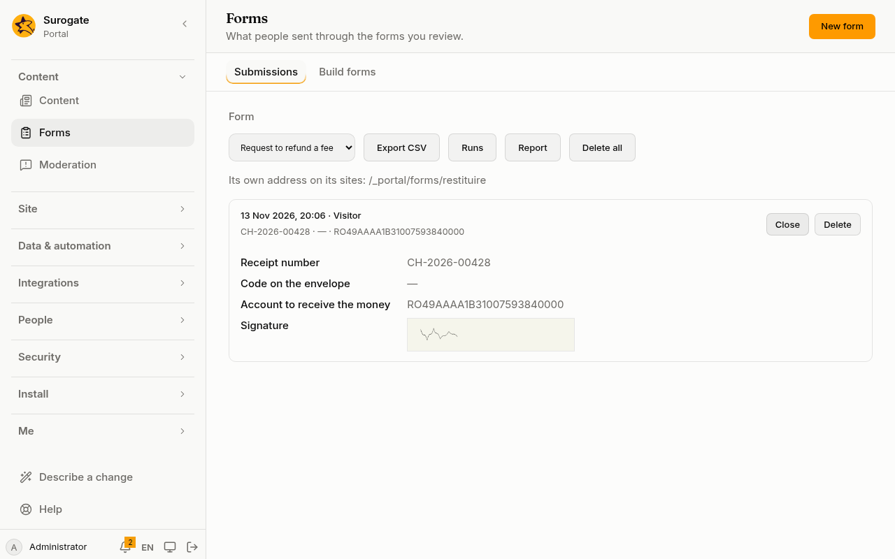

The portal's extensions add four kinds of field to [forms](/portal/sites/forms/): a barcode or QR code drawn on the form, a barcode scanner, an IBAN and a signature. As with every extension, they are open to every tenant of the portal. The form builder offers them in its **Extensions** group.

## What people see

Here a refund form uses all four. The QR code follows the receipt number as it is typed; the account is an IBAN; the person signs with a finger, a pen or the mouse.

## A barcode or QR code

A barcode draws a fixed text, or the value of another field of the form as people type it. It sends nothing with the form.

- It draws QR codes, Data Matrix, PDF417, Code 128, Code 39, EAN-13, EAN-8, UPC-A and ITF-14. In the form builder, **Format** picks one. A QR code is drawn when the form names none.
- It follows a field holding one value as text: a text, number, date, time, amount, single choice, scanned code or IBAN. Never ticked boxes, a yes or no, many choices, a record or a signature. In the form builder, **Value of the field** names the field it follows.
- A fixed text is at most 2,000 characters. In the form builder, it is **Fixed text**. A barcode has a fixed text or a field it follows, never both.
- A value the format cannot hold, such as letters in an EAN-13, shows "This code cannot be drawn." instead of a code.

## A barcode scanner

A text box with a **Scan** button. **Scan** opens the camera, the back one first on a phone, and the first code it reads fills the box. **Cancel** or **Escape** closes it and stops the camera.

- The form can name which codes it reads, with **Codes it reads** in the form builder; when it names none, it reads all those a barcode draws, with ITF in place of ITF-14.
- Without a camera, or when the person refuses it, the field says "There is no camera." and they can still type the code.
- What it holds is text of at most 2,000 characters, checked like any text field: required, length and pattern. The form builder sets whether it is required; the other checks are not set in the console yet. For now, this is set in the site's configuration: see [Developer: Extension fields](/portal/developer/form-fields/#the-fields).
- In a form shown on another site's page, the camera works only when that page allows it.

## An IBAN

A text box for a bank account. People may type spaces and lower case; the portal keeps the IBAN without spaces, in capitals.

- It is checked in the browser and again by the portal: a country that uses IBANs, that country's length, and the check digits.
- The form can limit it to some countries, such as Romania only: **Countries** in the form builder.
- A field hidden by its condition is not checked.

## A signature

A pad to sign on with a finger, a pen or the mouse. What is kept is the signature's image.

- Under the pad is the form's own text, or "Sign above" in the page's language. In the form builder, it is **Text under the pad**; it is translated like a label.
- The pad is as wide as the form, or as the form says, up to 2,000 by 1,000 pixels. The form can also set the colour of the pen and of the pad's background. The form builder does not set the size or the colours yet. For now, this is set in the site's configuration: see [Developer: Extension fields](/portal/developer/form-fields/#the-fields).
- A signature is at most 90 KB, so a form holds two.
- A required signature left empty says the field is required.

## In the console

On the **Forms** page, a signature is listed as **Signed**. Opening a submission shows its image.

The CSV export and the reviewers' email say `signed` instead of the image.

## Save a signature as a file

A form's actions can save the signature as a PNG in one of the portal's [folders](/portal/console/files/). A [document action](/portal/sites/document-actions/) can put it in a PDF, as an image whose source is the signature. The form builder does not set actions yet. For now, this is set in the site's configuration: see [Developer: Extension fields](/portal/developer/form-fields/#a-signature-saved-as-a-file).
