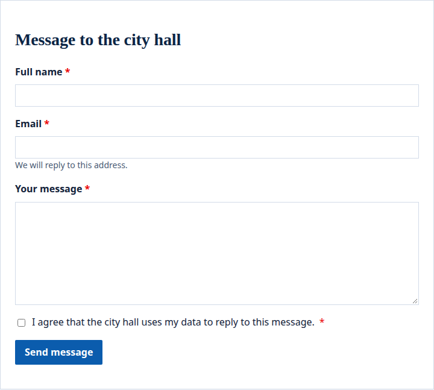
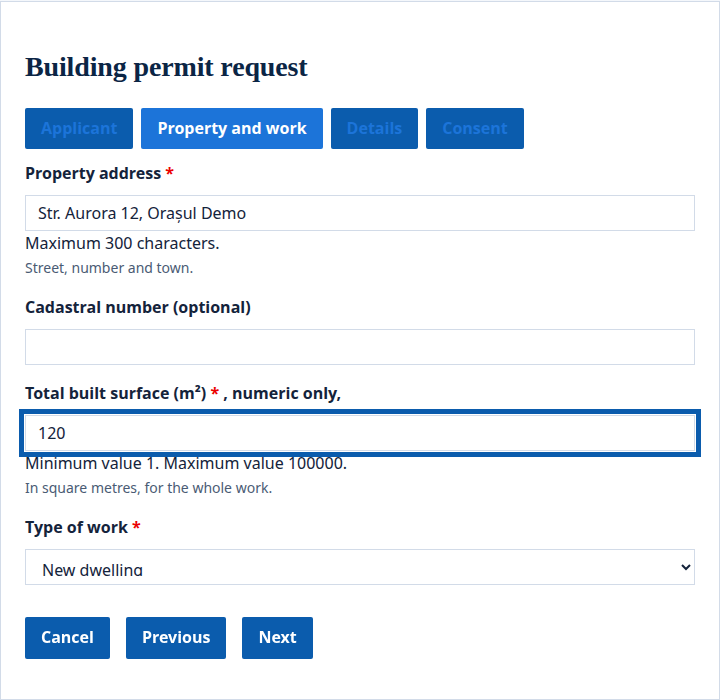
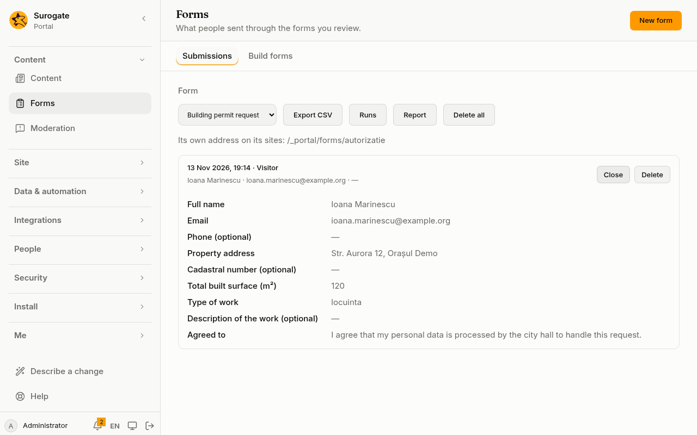

A form asks visitors or people signed in for something: a request, a registration, a complaint. The portal draws it, checks what is sent, and keeps it for the people who review the form, on [Forms](/portal/console/forms/) in the console.

Forms are written in [form.io](https://form.io)'s format: the components form.io's builder makes, as JSON or YAML. Administrators can also [build them in the console](/portal/console/forms/#build-a-form), without writing the file.

## What people see

**A visitor or a person signed in** sees the form on a page, in the site's design, with its fields, a box to tick for consent when the form asks for one, and its button:



A long form can be in steps. Each step is a tab at the top, and the person moves with **Next** and **Previous**:



When the form is sent, the person reads its confirmation, or what its [actions](/portal/sites/actions/#what-people-see) tell them.

**The form's reviewers** read what was sent on [Forms](/portal/console/forms/) in the console: each submission with who sent it, its answers and, when the form asked for consent, the text the person agreed to:



## Write a form

Each form is a file of the portal's, `forms/<id>.yaml`. Its id is lower-case letters, digits and hyphens, starting with a letter. See the [config example](#a-forms-file).

- `name`: the form's name, in both languages.
- `language`: the language its components are written in, `ro` unless you say otherwise.
- `display`: `form`, or `wizard` for a form in steps, where each step is a `panel` at the top of the form.
- `sites`: the sites that offer it. Leave it out to offer it on every site.
- `confirmation`: what a person reads once the form is sent. Without it, the portal thanks them.

## What a form may hold

- **Fields:** text, text area, number, email, phone number, web address, checkbox, select boxes, select, radio, day, time and currency.
- **Layout:** panels, columns, fieldsets, tabs and wells, nested at most eight deep.
- **Text blocks** (`content`), in the markup a site's pages allow.
- **One submit button.**

Each field's `key` is a name, unique in the form, such as `name` or `birth_date`. A select, radio or select boxes lists its own options. A form holds at most 300 components.

A field can be shown only when another field has a value, with a condition (see the [config example](#a-field-shown-on-a-condition)). A field hidden by its condition is not required, and what was typed in it is not kept.

A form holds no script. The portal refuses a form with custom conditions, calculated values, custom validation, logic, options read from an address, a rich text editor, or a template that calls anything. The refusal names the part. Show and hide fields with conditions instead.

## Translations

The text of a form is written in its `language`. Under `i18n`, give each text in each of its sites' other languages, the text as the key. A form offered on a Romanian and English site, written in Romanian, needs an English translation of every label, placeholder, description, option and tab. The portal refuses a form that leaves one out, and names the text.

form.io's own words, such as Next, Previous and the error messages, are translated by the portal.

## Who sends it and who reads what was sent

- **Who sends it:** `public: true` lets anyone send it, signed in or not. Otherwise `permissions.submit` names who may: `signed-in`, groups, organizations or people. A form that is neither public nor names anyone is for its reviewers alone.
- **Who reads what was sent:** `permissions.review` names the people, groups or organizations who read, export and delete its submissions. The administrators always do. Reviewers may send the form too.

People who may not send a form do not see it on a page, and its address answers as if there were no form.

## Put a form on a page

In the [page builder](/portal/console/pages/#forms), **Add a form** to a part of the page. It offers the forms the site offers. In a page's file, it is a placement of the portal's `form` widget (see the [config example](#a-form-on-a-page)). A page shows at most five forms.

## Its own address

Each form also has an address of its own on every site that offers it, `/_portal/forms/<id>`: the form alone, in the site's design. Add `?locale=en` for another language. On a domain that serves several sites, add `?site=<site>`.

## What the portal checks

The browser checks the form as it is filled in. The portal checks it again when it arrives, by the same rules, whatever the browser did:
- required fields;
- lengths and number limits;
- email and web addresses;
- each choice among its options;
- each value the right kind.

Fields the form does not have are dropped. A form that does not pass is not kept, and the person is told to check it. What they typed stays.

A visitor sends at most ten forms a minute from one address. A form filled in by a robot is thanked and not kept.

## Come back to a form

A long form can be left and finished later. For a person signed in, the portal keeps what they have typed a couple of seconds after they stop. When they open the form again, on any computer, it is filled in as they left it. What they began is deleted once they send the form, or after 30 days untouched.

A visitor's draft stays in the browser tab only. Reloading the page keeps it; closing the tab forgets it, so nothing is left behind on a shared computer.

Turn drafts off for a form with `drafts: false`.

## Ask for consent

A form can ask people to agree to something before they send it, such as how their data is used (see the [config example](#consent)). The form shows a box to tick, with this text, before its button; a step-by-step form shows it as a last step. The form cannot be sent without the box ticked. The portal keeps the text the person agreed to, in their language, with what they sent. Reviewers see it on [Forms](/portal/console/forms/), and it is in the export. If the text changes while someone has the form open, they are asked to load the page again.

## Tell the reviewers

Each time the form is sent, the addresses under `notify.to` (at most 20) get an email in the form's language with a link to Forms in the console (see the [config example](#tell-the-reviewers-by-email)). With `answers: true`, the email also holds the answers. Leave it off when the answers are personal data that should not travel by email. `subject` sets the email's subject in each language.

Email is sent only when the portal has a mail server; ask whoever runs the portal.

## Keep submissions for a time

Submissions older than `retention.days` are deleted, a few times a day (see the [config example](#delete-submissions-after-a-time)). Without `retention`, they are kept until someone deletes them.

## Fill in a form offline

A public form can be filled in where the connection comes and goes, such as on a tablet in the field: give it `offline: true` (see the [config example](#fill-in-offline)).

Open the form at its own address, `/_portal/forms/<id>`, once while online. From then on, that browser can open the address without a connection. A form sent without a connection is kept on the device, and the page says so. It is sent when the browser is back online: when the page is opened again, or within a minute while it is open. Each form is sent once, even if the connection drops halfway.

What is sent offline goes as a visitor's, even for a person signed in. Only public forms can be filled in offline. If something kept offline cannot be sent, because the form changed meanwhile or no longer exists, the page asks to fill the form in again.

## Pick a record

A `record` field picks a record of one of the portal's [data models](/portal/sites/data-models/) (see the [config example](#a-record-field)).

**Choose** opens a list of the model's records, 20 at a time, with **More** for the next ones and a search box when the model has searchable fields. A record is named by the model's title field, or else its first text field. With `multiple`, a person picks up to 50 and closes the list with **Done**; **Clear** empties the field.

The list shows only the records the person may see, and the record the form makes checks the pick again. A required record field must hold at least one. A form with a record field cannot be filled in offline. In the form builder, **Record** is among **More fields**.

## Fields from apps

An approved app can add field types and option lists ([Build an app](/portal/sites/build-an-app/#form-fields-and-options)). Use them in the form's file (see the [config example](#fields-from-an-app)).

The app's field is drawn by the app; its value is checked when the form is sent. A select's options come from the app as the person filling the form in. If the app does not answer, the form says it cannot be filled in right now. A form uses at most 10 such selects, and cannot be filled in offline. The console's builder keeps these parts when you edit the form, but does not offer them: write them in the file.

## After it is sent

A form can run [actions](/portal/sites/actions/) once it is sent and kept: work out a reference number, tell the person something, or send them to a payment page (see the [config example](#actions-after-it-is-sent)).

If the actions fail, what was sent is still kept, and the person is told so, with the failing action's `errorMessage` when it has one.

## From an app

Each sent form raises the portal's `form.submitted` event, with the form's id and the submission's. Wire it to an app's receiver, or to a webhook, on [Events](/portal/console/events/). A program reads submissions with a token given the **forms** scope, as one of the form's reviewers.

## Personal data

What a signed-in person sent, and what they began, are part of their export, and are deleted when they are erased (see [Users](/portal/console/users/)). What a visitor sent names no one.

## Config example

### A form's file

In `forms/<id>.yaml`, here `forms/cerere-audienta.yaml`:

```yaml
name: { ro: Cerere de audiență, en: Meeting request }
public: true
permissions:
  review: [group:Registratura]
components:
  - { type: textfield, key: name, label: Nume, input: true, validate: { required: true } }
  - { type: email, key: email, label: Email, input: true, validate: { required: true } }
  - type: select
    key: topic
    label: Subiect
    input: true
    dataSrc: values
    data: { values: [{ label: Taxe, value: taxes }, { label: Urbanism, value: planning }] }
  - { type: textarea, key: details, label: Detalii, input: true }
  - { type: button, key: submit, label: Trimite, action: submit }
i18n:
  en: { Nume: Name, Subiect: Subject, Taxe: Taxes, Urbanism: Planning, Detalii: Details, Trimite: Send }
confirmation:
  ro: Mulțumim. Vă vom contacta în cel mult trei zile lucrătoare.
  en: Thank you. We will contact you within three working days.
```

- `public: true` lets anyone send it; `permissions.review` names who reads what was sent.
- `components` are form.io's components, each with a `type`, a `key` and a `label`; `validate` sets what is required.
- `i18n` gives each text in the other language, the text as the key.
- `confirmation` is what a person reads once the form is sent.
- `name`, `language`, `display`, `sites` and `confirmation` are described under [Write a form](#write-a-form).

### A field shown on a condition

On a component:

```yaml
conditional:
  show: true
  conjunction: all
  conditions: [{ component: topic, operator: isEqual, value: planning }]
```

- The field shows only when the `topic` field equals `planning`.

### A form on a page

In a page's file (`sites/<site>/pages/<page>.yaml`):

```yaml
- { id: audienta, app: portal, widget: form, preferences: { form: cerere-audienta } }
```

- `form`: the id of a form the site offers.

### Consent

In the form's file:

```yaml
consent:
  text:
    ro: Sunt de acord cu prelucrarea datelor mele pentru această cerere.
    en: I agree to my data being used for this request.
```

- `consent.text`: what the person agrees to, in each language.

### Tell the reviewers by email

In the form's file:

```yaml
notify:
  to: [registratura@primarie.ro]
  answers: false
```

- `to`: the addresses, at most 20.
- `answers`: whether the email also holds the answers.
- `subject`: the email's subject, in each language; optional.

### Delete submissions after a time

In the form's file:

```yaml
retention:
  days: 365
```

- `days`: how long a submission is kept.

### Fill in offline

In the form's file:

```yaml
public: true
offline: true
```

- `offline: true` lets the browser fill the form in without a connection; the form must be public.

### A record field

Among a form's `components`:

```yaml
- type: record
  key: applicant
  label: Solicitant
  model: people
- type: record
  key: related
  label: Cereri legate
  model: requests
  multiple: true
```

- `model`: the data model whose records are picked.
- `multiple: true`: the person picks up to 50.

### Fields from an app

Among a form's `components`:

```yaml
components:
  - { type: appfield, key: sig, label: Semnătură, input: true, app: crm, field: signature, validate: { required: true } }
  - { type: select, key: county, label: Județ, input: true, dataSrc: app, data: { app: crm, options: counties } }
```

- `appfield`: a field type an approved app gives; `app` and `field` name them.
- `dataSrc: app`: a select whose options come from the app, named by `data.app` and `data.options`.

### Actions after it is sent

In the form's file:

```yaml
redirects: [https://plati.example.ro]
actions:
  submitted:
    - type: redirect
      to: '"https://plati.example.ro/plata?ref=" + urlEncode(submission.id)'
```

- `redirects`: the https sites the form may send people to.
- `actions.submitted`: the [actions](/portal/sites/actions/) that run once the form is sent and kept.
