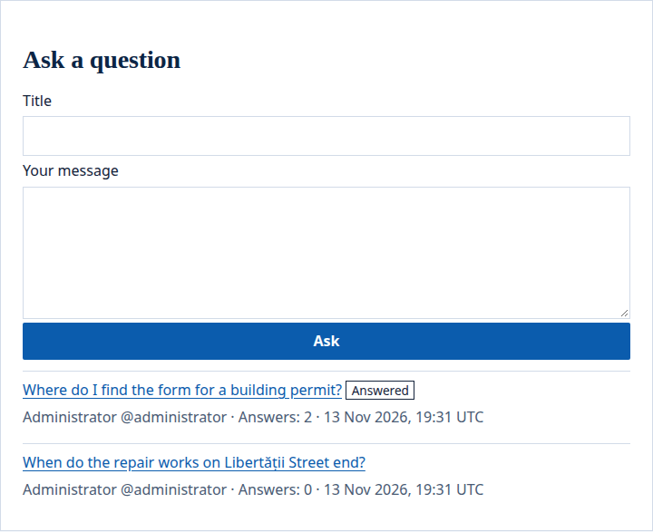
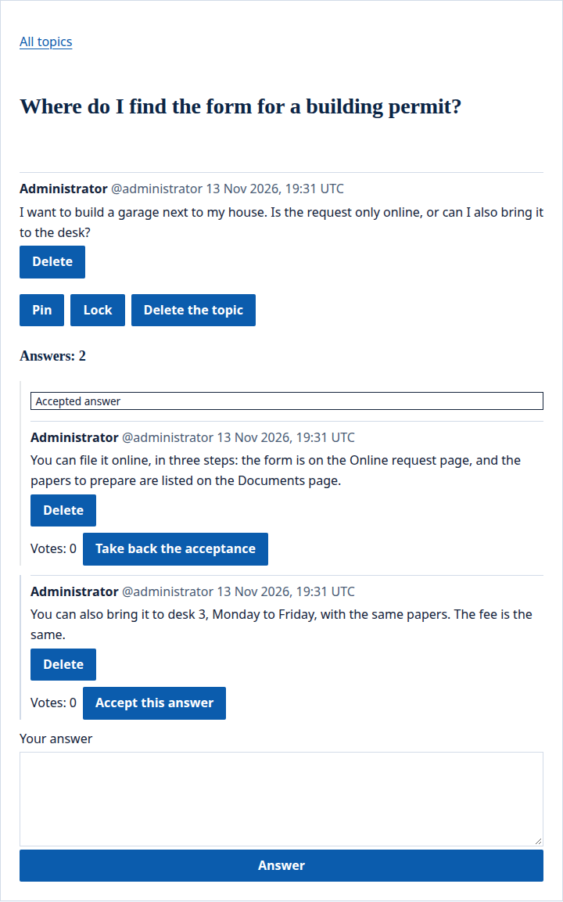

The portal's forum widget is a board of topics. People signed in start a topic with a title and a message, and others answer it. On a Q&A forum, people vote answers up, and the one who asked accepts the answer that solved it.

## What people see

The forum lists its topics, with a form to start one. On a Q&A forum, a question that has an accepted answer is marked **Answered**:

A topic opens on the same page: its message, then its answers, and a form to answer. On a Q&A forum, each answer shows its votes and the answer that solved the question is marked **Accepted answer**. A moderator also sees **Pin**, **Lock** and **Delete the topic**:

## Place a forum

A forum is a widget placed on a page. On [Pages](/portal/console/pages/#the-portals-widgets), add **Forum** with **Add a widget…**, then set its settings in its row:

- **Kind**: **Discussions**, for topics people talk about, or **Questions and answers**, for questions and their answers. Discussions unless you choose otherwise. Changing it later changes the topics started afterwards, and each topic keeps the kind it was started with.
- **New topics and replies**: **Shown at once, moderated after**, so a topic or an answer shows as soon as it is written, or **Wait for a moderator**, so it waits until a moderator approves it.
- **Topics per page**: the list shows 20 topics a page, or any number from 1 to 50.

Developers: see [Developer: Forums and Q&A](/portal/developer/forums/#a-forum-on-a-page).

Each forum widget is a board of its own: two forums, on one page or on two, keep their topics apart. A page with a forum is made for each person and never kept in a cache.

The topics belong to the widget where they were started. Moving the widget to another page, or giving it another name in the site's configuration, leaves its topics behind: they come back if it returns.

## Topics and answers

The forum lists its topics, pinned ones first, then the most recently answered, each with its author, its number of answers and when it was last answered. Pressing a topic opens it on the same page: its message first, then its answers, 50 to a page. **All topics** leads back to the list.

Visitors read the topics and are asked to sign in. People signed in who may [see the widget](/portal/sites/permissions/) start a topic (a title of up to 200 characters and a message of up to 10,000) and answer topics, in plain text with its line breaks. They name others with `@` and their handle, as in [comments](/portal/sites/comments/#name-someone).

When someone answers a topic, the person who started it gets a [notification](/portal/sites/notifications/) that leads to the answer.

People delete their own topics and answers, and flag someone else's, as with [comments](/portal/sites/comments/#delete-and-flag). A topic nobody answered goes when its author deletes it. One that others answered stays for their answers, as **Topic removed**, with no title, words or author, and takes no new answers.

## Questions and answers

On a Q&A forum:

- Each answer shows its votes. People signed in vote an answer up once, never their own, and may take their vote back.
- The one who asked, or a moderator, accepts an answer; it then shows first, marked **Accepted answer**, and its author is told. The others follow, the most voted first.
- A question with an accepted answer people see is marked **Answered** in the list.

## Moderate a forum

The site's [moderators](/portal/console/moderation/#who-moderates) see a topic's **Pin**, **Lock** and **Delete the topic**:

- **Pin** keeps a topic at the top of the list.
- **Lock** closes a topic: it keeps its answers but takes no new ones, votes or acceptance, and says so.
- **Delete the topic** deletes it with all its answers.

Topics and answers that wait, are flagged or were hidden are in the [moderation queue](/portal/console/moderation/), as **Forum on** the page and the topic's title. Hiding a topic's first message hides the topic; deleting it deletes the topic. A topic waiting for a moderator shows to its author only, marked as waiting.

## Limits

Each person starts at most 5 topics an hour and writes at most 50 messages a day in one topic; the limits of [comments](/portal/sites/comments/#limits) on how fast one writes apply too. A topic takes at most 1,000 answers. Each person votes, or takes a vote back, at most 10 times a minute.

When a person is erased from the portal, their topics nobody answered go with them; the ones others answered stay for those answers, with no title, words or author. Their votes are taken back.
