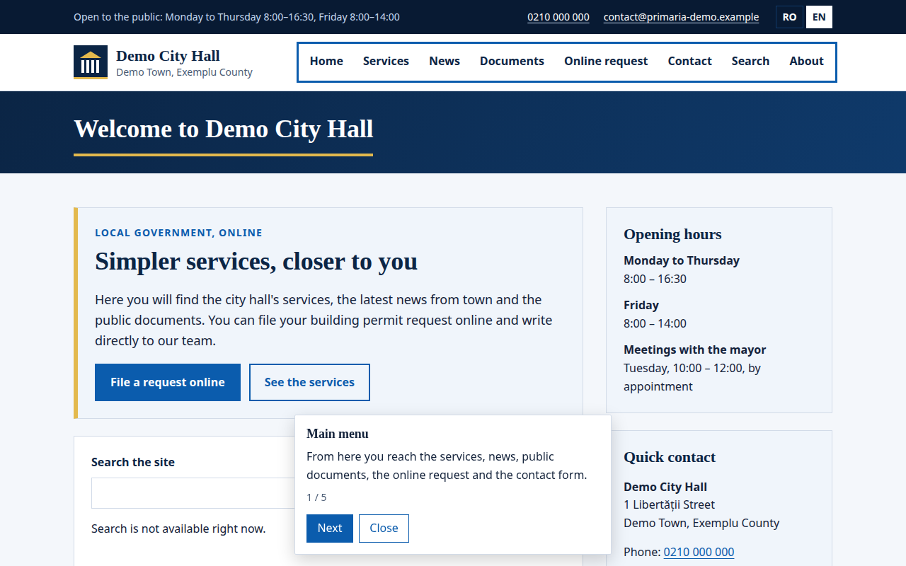
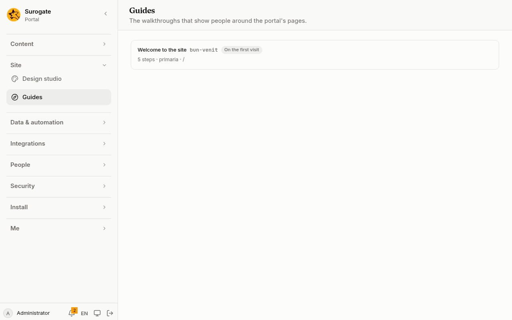

A user guide walks people through a page, one step at a time. Each step has a title and a text, and can point at a part of the page, which is outlined and scrolled into view. People move with **Next** and **Previous**, and end with **Finish** or **Close**.

## What people see

Here a guide starts on someone's first visit to the home page. Its first step points at the main menu:



- The step's box sits next to the part of the page it is about; a step that points at nothing shows on its own.
- **Escape** closes a guide when it has the focus.
- A guide's text is part of its pages: everyone who may see a page can read the guides on it.

## Start a guide

A guide starts:

- at its page's address with `?guide=<id>`, for example in a link from a help page;
- from a form, with the `startGuide` action ([UI actions](/portal/sites/actions/#ui-actions)), on a page that shows the form and that the guide applies to. A form opened at its own address starts no guide;
- by itself on a first visit, when the guide says so.

Each browser remembers the guides it has shown by themselves and those it finished: a first-visit guide does not start again there, even when the person left the page without closing it. When a page has several first-visit guides, the first by id starts. A browser that keeps nothing never starts a guide by itself.

## In the console

[Guides](/portal/console/guides/) lists the portal's guides for administrators: each guide's name and id, how it starts, its number of steps, and the sites and pages it applies to.



## Config example

A guide lives in its own file, `guides/<id>.yaml`. This one is `guides/welcome.yaml`, so its id is `welcome`:

```yaml
name:
  ro: Bun venit
  en: Welcome
sites: [main]
pages: [/, /servicii]
start: first-visit
steps:
  - title:
      ro: Căutați aici
      en: Search here
    text:
      ro: Scrieți ce căutați și apăsați Enter.
      en: Type what you look for and press Enter.
    target: "[data-placement=search]"
  - title:
      ro: Gata
      en: That's all
    text:
      ro: Puteți reporni ghidul oricând.
      en: You can start the guide again any time.
```

- `name`: the guide's name, in every language.
- `sites` and `pages` say where the guide applies. Left out, it applies on every site or every page. Each page must be one of the guide's sites.
- `start` is `manual`, the default, or `first-visit`: the guide starts by itself the first time someone opens one of its pages.
- `steps`: at most 30, each with a `title` and a `text` in every language, as plain text.
- `target` is a CSS selector for the part of the page the step is about, such as `#main` or `[data-placement=intro]`; each part placed on a page carries its id as `data-placement`. A step whose target finds nothing shows on its own.

A guide can be written in JSON instead: the file is read the same way. To bring in a guide made elsewhere, save its JSON as `guides/<id>.yaml`.
