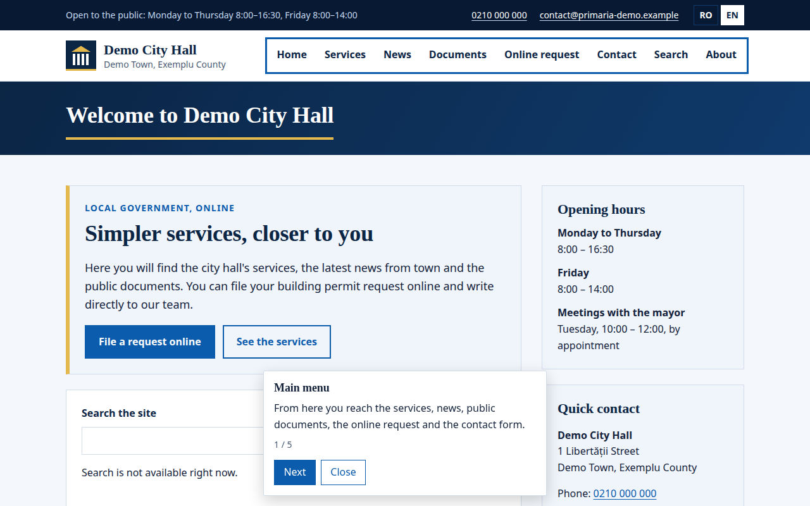
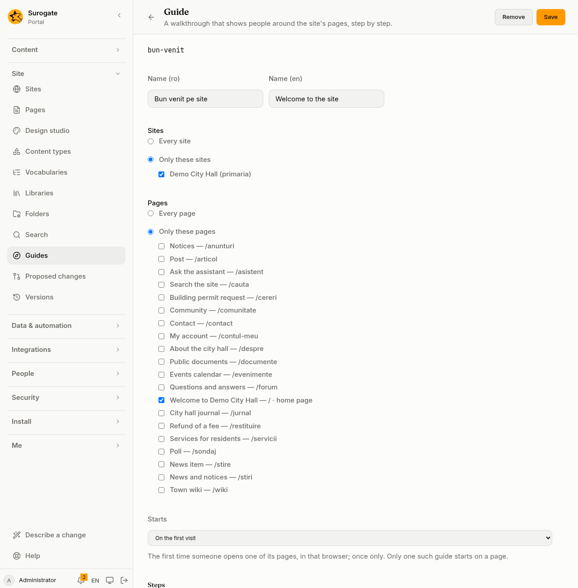
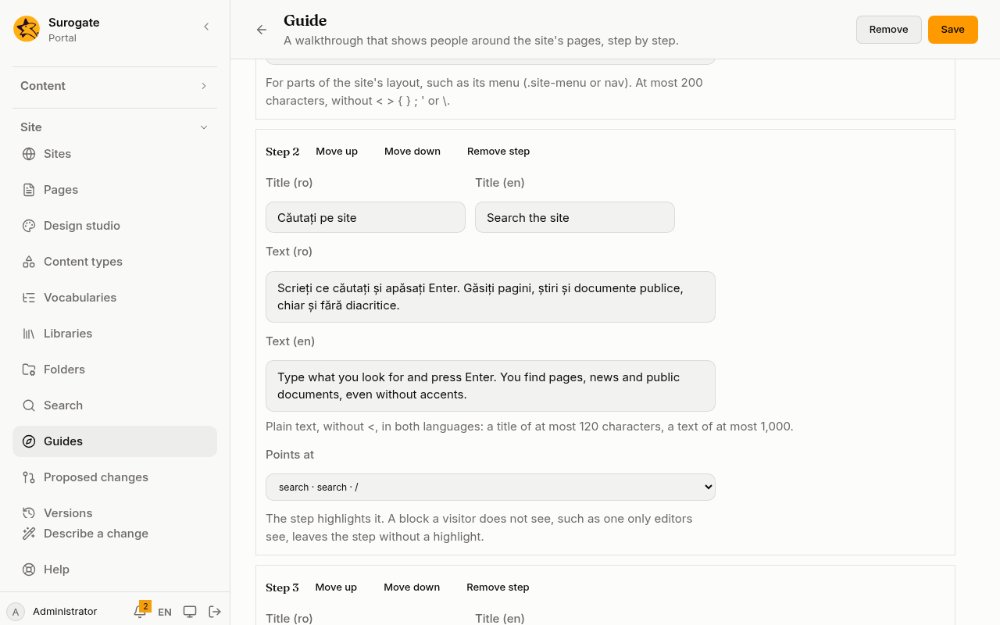
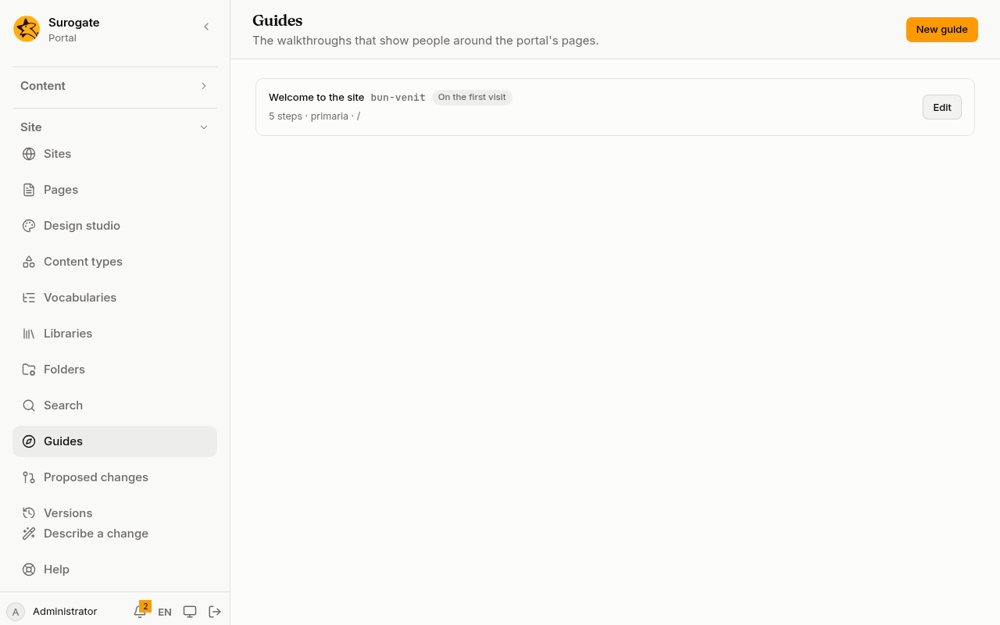

A user guide walks people through a page, one step at a time. Each step has a title and a text, and can point at a part of the page, which is outlined and scrolled into view. People move with **Next** and **Previous**, and end with **Finish** or **Close**.

## What people see

Here a guide starts on someone's first visit to the home page. Its first step points at the main menu:

- The step's box sits next to the part of the page it is about; a step that points at nothing shows on its own.
- **Escape** closes a guide when it has the focus.
- A guide's text is part of its pages: everyone who may see a page can read the guides on it.

## Write a guide

On [Guides](/portal/console/guides/), **New guide** makes a guide and **Edit** changes one. A portal has at most 50 guides.

- **Id:** lower-case letters, digits and `-`. It is in the guide's address, and cannot change once the guide is saved.
- **Name**, in every language.
- **Sites** and **Pages:** **Every site** or **Only these sites**, and **Every page** or **Only these pages**, each with a box to tick per site or page. Only the pages of the sites ticked are offered. With **Only these** and nothing ticked, the guide shows nowhere, and the editor says so. A site or page that no longer exists is listed, ticked, as such: untick it before saving.
- **Starts:** when asked for, or by itself the first time someone opens one of its pages. A guide that starts when asked for shows the address to add to a page's address, `?guide=<id>`.
- **Steps:** at most 30, each with a title (at most 120 characters) and a text (at most 1,000) in every language, as plain text without `<`. **Move up**, **Move down** and **Remove step** order them; a guide keeps at least one.

**Points at** chooses what a step highlights:

- **Nothing:** the step shows on its own, without a highlight.
- **A block** of the guide's pages, by its id, its widget and its pages; a block inside a group too.
- **A part of the page**, such as its main region.
- **Something else, by a CSS selector:** for parts of the site's layout, such as its menu, for example `.site-menu` or `nav`. The editor checks the selector as the browser reads it; `< > { } ; ' \` are not allowed.

A step whose part is not on the page, or that a visitor cannot see, such as a block only editors see, shows on its own.

Developers can also write a guide as a file: see [Developer: User guides](/portal/developer/guides/#a-guides-file).

## Start a guide

A guide starts:

- at its page's address with `?guide=<id>`, for example in a link from a help page;
- from a form, with the action that starts a guide ([UI actions](/portal/sites/actions/#ui-actions)), on a page that shows the form and that the guide applies to. A form opened at its own address starts no guide;
- by itself on a first visit, when the guide says so.

Each browser remembers the guides it has shown by themselves and those it finished: a first-visit guide does not start again there, even when the person left the page without closing it. When a page has several first-visit guides, the first by id starts. A browser that keeps nothing never starts a guide by itself.

On a form's **Steps** tab, add **Start a guide** and pick the guide: see [Forms](/portal/sites/forms/). A guide a form or a flow starts cannot be removed until they stop starting it: the console lists them.

## In the console

[Guides](/portal/console/guides/) lists the portal's guides for administrators: each guide's name and id, how it starts, its number of steps, and the sites and pages it applies to, with **Edit**.

