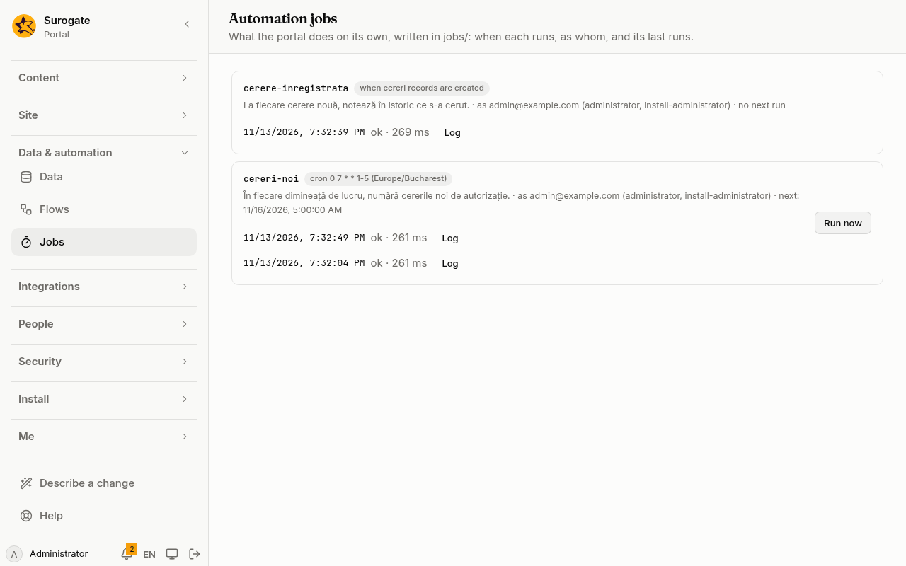
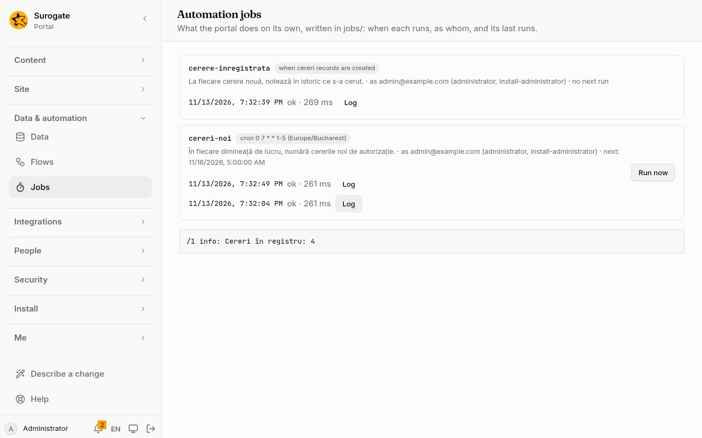

An automation job is work the portal does on its own: count the new requests every morning, close what has waited too long, refresh figures every hour. It is a trigger and a list of [actions](/portal/sites/actions/), run as a set person on a set site.

## In the console

A job tells no page anything and answers no one, so what people see of it is what it does: a record added, an email sent, a line in a log. Administrators see the jobs under **Jobs** in the console: its trigger, the person it runs as and their roles, when it runs next, whether it runs now, how many changes it still has to run for, and its last runs with their logs:



**Log** shows what a run wrote:



Runs are kept 30 days, with only their errors unless the job has `debug: true`. **Run now** runs a job on a time at once, as its person. The portal runs a job once for each time, however many servers it has.

## Write a job

Each job is a file `jobs/<id>.yaml` (see the [config example](#a-jobs-file)).

- `site` is the site the job runs for; its first language is the run's.
- `runAs` names the person the job acts as: what they may see and change, the job may. Without it, the job acts as a visitor. When the person no longer exists or may not sign in, the run fails and says so.
- `description` says what it is for, in the console.

## When it runs

`trigger` is one of:

| Trigger | Runs |
|---|---|
| `every: 15m` | every 15 minutes (also `2h`, `1d`; from 5 minutes to 30 days) |
| `daily: "07:30"` | every day at that time |
| `cron: "0 7 * * 1-5"` | at the minutes the five fields name: minute, hour, day of month, month, day of week (0 is Sunday) |
| `at: 2026-12-01T08:00:00+02:00` | once, at that moment |

`daily` and `cron` follow `timezone`, UTC when left out. On the night clocks go forward, a time that does not exist that night is not run; on the night they go back, a time that happens twice runs once.

`skipIfRunning: false` lets a run wait for the one before to end; by default, a time that comes while the job still runs is skipped and kept in its history. `misfire` says what happens to times missed while the portal was not running: `once` (the default) runs the job once, `skip` goes straight to the next time.

## When records change

A job can also start when a [data model's](/portal/sites/data-models/) records are created, updated or deleted (see the [config example](#a-job-that-runs-when-records-change)). Each change runs the job once, the oldest first. The run reads the change as `trigger`:

| | |
|---|---|
| `trigger.op` | `created`, `updated` or `deleted` |
| `trigger.id` | the record's id |
| `trigger.before` | the record before the change (`null` when it was created) |
| `trigger.after` | the record after it (`null` when it was deleted) |
| `trigger.at` | when the change was made |

`before` and `after` hold only what the job's person may see of that model: when they may see only their own records, another person's record is `null` there, and its id alone is given.

A change made by a job may start jobs again, at most three deep, so a job that changes the record it was started by stops there; the job's history says so. At most 100 changes wait for a job; past that, new ones are not run, and the history says so once a minute. A change that is undone never starts a job. When a record linked from another is deleted and the link is cleared, that other record's change starts no job.

**Run now** is for jobs on a time: a job started by records runs only for a change.

## When people come and go

A job can start when a person is created, changed or signs in (see the [config example](#a-job-that-runs-when-people-come-and-go)). `on` lists `created`, `updated` and `signed_in`. The job runs once each time, however it happened: in the console, through SCIM, through a sign-in with a provider or a directory, or through a directory's sync.

The run reads `trigger.event`, `trigger.id` (the person's id) and `trigger.at`. `trigger.user` holds their name and email as they are when the run starts, only when the job runs as an administrator; otherwise, and once the person is gone, it is `null`.

At most 5,000 people wait for a job, enough for a directory that brings many at once; past that, new ones are not run, and the history says so.

## When the portal starts, fails or is asked for

A job can start when the portal's configuration starts, when a run fails, or when a page is asked for (see the [config example](#a-job-that-runs-when-a-run-fails)):

- **`started`:** once each time a new configuration is published or rolled back, and when the job first appears. The run reads `trigger.revision`.
- **`error`:** a form, endpoint or job ended failed. `sources` names which; all three when left out. The run reads `trigger.source.kind`, `trigger.source.id`, `trigger.runId`, `trigger.reason` and `trigger.message`. The message is the run's own words only for a job that runs as an administrator, since they may hold what people sent; other jobs get only the words the portal shows anyone, or `null`.
  - Not heard of: a run the portal was too busy to start, the failures of a job that itself hears of failures, and an endpoint another one called (the run that called it is heard of instead).
  - A job hears of one form, endpoint or job at most once a minute.
- **`request`:** a page of the job's site was asked for, at or under one of `paths` (1 to 20). `/news` takes `/news` and `/news/today`, never `/newsletter`. The run reads `trigger.path` (an article's own address, such as `/news/my-article`), `trigger.locale` and `trigger.userId` (`null` for a visitor).
  - Counted: a page opened. Not counted: a page checked again for changes, a preview, and pages served from a cache before the portal.
  - A job hears of at most 60 pages a minute; the pages never wait for it.

`paths` goes only with `request`, and `sources` only with `error`. At most 100 events wait for a job; past that, new ones are not run, and the history says so.

## When mail arrives

A job can start for each message that arrives in a [mailbox](/portal/sites/connectors/#mailboxes) (see the [config example](#a-job-that-runs-when-mail-arrives)). The run reads:

- `trigger.from` (`address`, `name`), `trigger.to` and `trigger.cc`;
- `trigger.subject`, `trigger.date` and `trigger.text` (the message's text, at most 64 KB);
- `trigger.attachments`, each file's `filename`, `contentType` and `size` (the files themselves are not read);
- `trigger.autoSubmitted` and `trigger.listId`, set for automatic replies and mailing lists.

A message over 5 MB gives only who sent it and its subject, with `trigger.tooLarge` true. A message the portal cannot read at all runs the job with `trigger.unreadable` true and nothing else, so the mail after it is still read.

- **When:** the mailbox is read about once a minute, and up to 20 new messages are taken each time. The job runs once for each.
- **From when:** the first read only marks where the job begins. Mail that was there before is never run for. The same is true after the job's trigger, the mailbox's server or folder, or its username changes; the job's history says so.
- **Failures:** when the mailbox cannot be read (a wrong password, a server that does not answer, a certificate the portal does not trust), **Jobs** shows why, the history says so once, and the next tries wait longer, up to an hour.
- **Loops:** a job that sends mail to the address it reads starts itself again. Skip machine mail with `condition: trigger.autoSubmitted == null`.

## When an app sends an event

A job can start each time an approved app's server publishes one of its events (see the [config example](#a-job-that-runs-when-an-app-sends-an-event)). The run reads `trigger.app`, `trigger.name`, `trigger.payload` (the event's fields) and `trigger.personId` when the app named a person. Events sent in the browser do not start jobs. At most 100 events wait for a job; past that, new ones are not run, and the history says so. Once the app is no longer approved, its events start nothing. A job that calls an app whose answer sends the event that starts the job again stops after three rounds.

## When something happens in the DMS

A job can run when a document changes in the DMS: `trigger: { dms: { on: [document.state] } }`. See [Documents](/portal/sites/documents/#when-something-happens-in-the-dms) for the events and what the run reads.

## When something happens in Keel

A job can run when a case or process changes in Keel: `trigger: { keel: { on: [case.closed] } }`. See [Keel](/portal/sites/keel/#when-something-happens-in-keel) for the events and what the run reads.

## Send mail

A job may send email with the `email` action, as forms do. Its mail leaves once the run ends well, within the portal's hourly room, and at most 100 recipients an hour for each job.

## What it may do

The actions read `trigger` (`kind` is `time` or `manual`, `at` is the time it was due; `record`, `user` or `platform` for the triggers above), the person as `user`, `site`, `vars` and `values`, and may call [flows](/portal/sites/flows/). A run has three minutes.

A job tells no page anything and answers no one. It may not use a [connector](/portal/sites/connectors/) that signs in as each person, since no one is at the keyboard.

## Config example

### A job's file

In `jobs/<id>.yaml`, here `jobs/new-requests.yaml`:

```yaml
trigger:
  cron: "0 7 * * 1-5"
  timezone: Europe/Bucharest
site: main
runAs: user:clerk@primaria.ro
actions:
  - type: findRecords
    model: requests
    where: { status: '"new"' }
    into: open
  - type: log
    level: info
    message: '"New requests this morning: " + string(size(vars.open))'
onError:
  - type: log
    level: warn
    message: error.message
```

- `trigger`: when it runs, from [When it runs](#when-it-runs).
- `site`, `runAs` and `description` are described under [Write a job](#write-a-job).
- `actions`: the list the job runs.
- `onError`: what runs when the list fails.

### A job that runs when records change

```yaml
trigger:
  record:
    model: requests
    on: [created, updated]
site: main
runAs: user:clerk@primaria.ro
actions:
  - type: log
    level: info
    message: '"Request " + string(trigger.op) + ": " + string(trigger.after.subject)'
```

- `record.model`: the data model; `record.on`: `created`, `updated` or `deleted`.

### A job that runs when people come and go

```yaml
trigger:
  user:
    on: [created]
site: main
runAs: user:admin@primaria.ro
actions:
  - type: email
    to: trigger.user.email
    subject: '"Bun venit pe portal"'
    text: '"Bună, " + trigger.user.name + "!"'
```

- `user.on`: `created`, `updated` and `signed_in`.

### A job that runs when a run fails

```yaml
trigger:
  platform:
    on: [error]
    sources: [form, endpoint]
site: main
runAs: user:admin@primaria.ro
actions:
  - type: email
    to: '"it@primaria.ro"'
    subject: '"A run failed"'
    text: 'trigger.source.kind + " " + trigger.source.id + ": " + trigger.message'
```

- `platform.on`: `started`, `error` or `request`.
- `platform.sources`: with `error`, which of `form`, `endpoint` and `job`.
- `platform.paths`: with `request`, the paths asked for.

### A job that runs when mail arrives

```yaml
trigger:
  mail:
    connector: cereri
site: main
runAs: user:registratura@primaria.ro
actions:
  - type: createRecord
    model: requests
    condition: trigger.autoSubmitted == null
    values:
      subject: trigger.subject
      sender: trigger.from.address
      body: trigger.text
```

- `mail.connector`: the mailbox [connector](/portal/sites/connectors/#mailboxes).
- `condition`: skips machine mail.

### A job that runs when an app sends an event

```yaml
trigger:
  event:
    app: shop
    name: order.paid
site: main
runAs: user:registratura@primaria.ro
actions:
  - type: createRecord
    model: payments
    values:
      order: trigger.payload.id
```

- `event.app` and `event.name`: the approved app and the event it sends.
