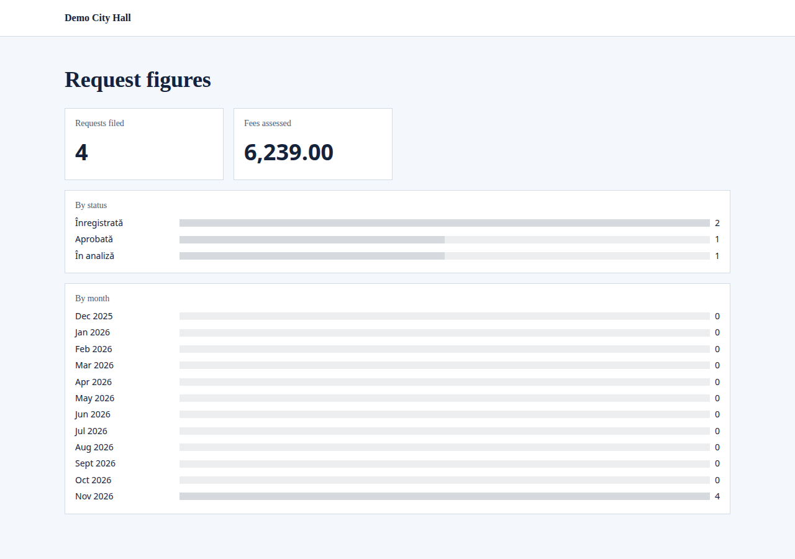

A [data model](/portal/sites/data-models/) can declare its KPIs: how many records there are, what they add up to, how they split by a field, how they go month by month. The portal shows them on a page as tiles and bars.

## What people see

A page of figures shows each KPI of the model as a tile, for a single number, or as bars, for a split by a field or by a period:



## Declare them

KPIs go in the model's file (see the [config example](#kpis-in-a-models-file)). A KPI counts the records or works out a sum, an average, a least or a most; it can keep only some records, split them by a field, or follow them over time. A model has at most 12 KPIs, each with its own `id`.

## Show them

The portal's `kpis` widget shows a model's KPIs, all of them or the ones named. A model can also make its own page of KPIs on a site, as it makes [its own pages](/portal/sites/listings/#a-models-own-pages-and-form). See the [config example](#the-kpis-widget-on-a-page).

## What each person sees

Each person sees figures over the records they may see. Someone who may see every record sees the totals over all of them. Someone who may see only their own sees totals over their own. A visitor, where only owners see their records, sees nothing.

Amounts are shown with two decimals, and numbers as the page's language writes them. A total with no records is 0. A sum, average, least or most over no records is "—", and an empty period shows no bar for an average, least or most.

Figures over every record are kept for a minute, so they may be a minute behind.

## Config example

### KPIs in a model's file

In `models/<id>.yaml`, next to the model's fields:

```yaml
kpis:
  - id: total
    label: { ro: Cereri, en: Requests }
    measure: count
  - id: fees
    label: { ro: Taxe încasate, en: Fees collected }
    measure: sum
    field: fee
    where: { status: approved }
  - id: byStatus
    label: { ro: Pe stări, en: By status }
    measure: count
    by: status
  - id: monthly
    label: { ro: Pe luni, en: By month }
    measure: count
    period: month
```

- **`measure`:** `count`, `sum`, `avg`, `min` or `max`. Everything but a count names its `field`, a number or an amount.
- **`where`:** keeps only the records whose filterable fields have these values, at most 5 of them.
- **`by`:** makes bars, one for each value of a filterable text or yes-or-no field. The 10 largest are shown; records with no value make a bar of their own, "—".
- **`period`:** makes bars over the last 12 days, weeks, months or years, up to the current one. Weeks start on Monday, and periods follow UTC. `on` names the date they count by: a date field, a date and time field, or `created_at` (the default).
- A model has at most 12 KPIs, each with its own `id`.

### The kpis widget on a page

In a region of a page's file (`sites/<site>/pages/<page>.yaml`):

```yaml
- id: figures
  app: portal
  widget: kpis
  preferences: { model: requests, kpis: [total, monthly] }
```

- `model`: the model whose KPIs it shows.
- `kpis`: the ones to show, by their `id`; all of them when left out.

### A page of figures from the model

In the model's file:

```yaml
dashboards:
  - site: main
    path: /requests/figures
    title: { ro: Indicatori, en: Figures }
```

- `site` and `path`: where the page is.
- `title`: the page's title, in both languages.
