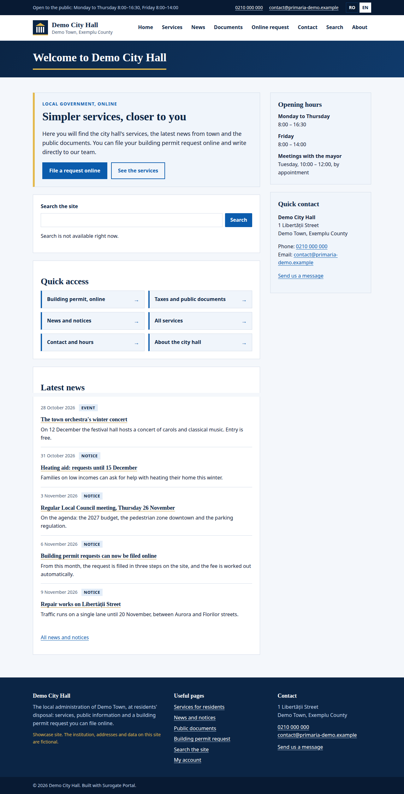
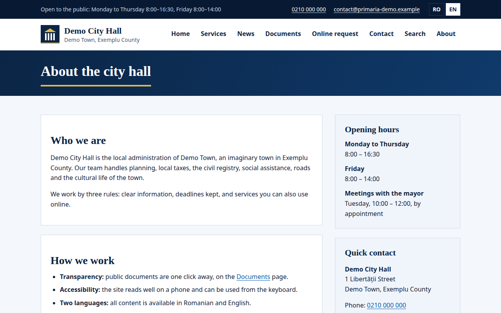

Every page has a layout: the frame around its content. The portal has two of its own, `one-column` and `two-column`. A site can also have layouts of its own, with its header, navigation and footer, and marked places for what each page holds.

A page can also hold its own text, written in HTML, without an app: an HTML block.

Administrators can also choose a page's layout and arrange its blocks in the console, under [Pages](/portal/console/pages/).

## What people see

Everyone who opens a page sees the layout around its content. Here the site's own layout gives every page the same top bar, menu, language links and footer, and puts the page's title in a band above its content. The page's own regions, `main` and `aside`, fill the places the layout marks:

A page's text is written as HTML blocks and fragments, and shows as part of the page:

## A layout of the site's own

A site can have layouts of its own. A layout is a frame for every language of the site, with a frame of its own for a language that needs its own words, and a stylesheet if it wants one. Its name is made of lower-case letters, digits and hyphens, and starts with a letter. A page uses a layout by its name: in the console's [page editor](/portal/console/pages/#edit-a-page), **Layout** lists the site's own layouts beside the portal's. A site has at most 32 layouts. `one-column` and `two-column` are taken.

The console's [design studio](/portal/console/studio/#use-a-design-in-a-site) turns a design's frame into a layout of the site. Apart from that, the console does not write layouts yet. For now, this is set in the site's configuration: see [Developer: Give a site its own layout](/portal/developer/layouts/#a-layout-of-the-sites-own).

## The marked places

A layout marks the places where a page's content goes:

- **Regions:** the main content of the page, in a region called `main`, which every layout needs. A layout can add others, such as `aside`, each name once; the page's content goes in them by name.
- **The title:** the page's title, as its heading; at most once. Without a place for it, the title opens the main region.
- **The languages:** links to the same page in each of the site's languages; at most once.

A frame for one language has the same regions as the layout's frame for every language. For now, this is set in the site's configuration: see [Developer: Give a site its own layout](/portal/developer/layouts/#the-marked-places).

## What a frame may hold

The portal checks a layout's markup and refuses what it does not take, naming the element or attribute; nothing is quietly dropped.

- A frame holds text and structure: headings, lists, links, images, figures, tables and sections. It holds no main section and no top heading: the page gives one of each.
- Scripts, styles, frames, forms, buttons and drawings made in markup are refused, and so are comments, styles written on single elements and event handlers.
- Images need a description for those who cannot see them, empty for decoration.
- Links go to pages of the site (but not the portal's own addresses), to other websites, to email addresses and to phone numbers. Images come from secure addresses or are embedded in the frame.
- An address relative to the page, such as `logo.png`, is refused: it would change from page to page.

A frame takes at most 256 KB. For now, this is set in the site's configuration: see [Developer: Give a site its own layout](/portal/developer/layouts/#what-a-frame-may-hold).

### Images in each screen's size

An image whose width is given is served at that width, and twice that for sharp screens, in a lighter format, so phones load less. An image without a width, or with sizes of its own, is shown as it is. If the portal cannot resize an image, visitors get the original. For now, this is set in the site's configuration: see [Developer: Give a site its own layout](/portal/developer/layouts/#images-in-each-screens-size).

## Its stylesheet

A layout can have a stylesheet that styles its frame with the site's [design tokens](/portal/developer/design/), by their own names.

- It fetches nothing from elsewhere: it takes only addresses on the site, and images and fonts embedded in it.
- It styles the frame's own elements and classes, not the page as a whole and not the content: there, the token names belong to the apps' widgets.
- It leaves the portal's own controls alone: the placement menus and the skip link.
- It takes at most 256 KB.

For now, this is set in the site's configuration: see [Developer: Give a site its own layout](/portal/developer/layouts/#its-stylesheet).

## An HTML block

An HTML block is text a page holds itself, for each of the site's languages. It needs no app and no approval. In the console's [page editor](/portal/console/pages/#edit-a-page), **Add text** adds one.

An HTML block holds the text of every language of the site, and no other. The text is checked like a frame, without the portal's marked places, and takes at most 64 KB per language. An HTML block can go in any layout's regions.

The same settings, as files in the site's configuration, are in [Developer: Give a site its own layout](/portal/developer/layouts/#an-html-block-on-a-page).

## Fragments and page templates

A fragment is text kept once and placed on many pages. Change it once, and every page that holds it changes. Its text holds what an HTML block holds. A site has at most 200 fragments. Administrators make fragments in the console, under [Pages](/portal/console/pages/#fragments). The same settings, as files in the site's configuration, are in [Developer: Give a site its own layout](/portal/developer/layouts/#a-fragment).

A page template is a page's starting point. It holds a name in each language, a layout and what its regions hold, as a page does. It is never shown to visitors; administrators start new pages from it in the console, under [Pages](/portal/console/pages/#page-templates). A site has at most 50. The same settings, as files in the site's configuration, are in [Developer: Give a site its own layout](/portal/developer/layouts/#a-page-template).

## Check it

The portal reads the layouts and blocks with the rest of the site, and names each problem:
- a page naming a layout the site does not have, or a region its layout does not have;
- markup or a stylesheet the portal does not take, with the reason;
- a frame without a main region, or with a region named twice;
- a frame for a language the site does not have.

A problem keeps the whole change from going live. In the console, the page editor lists the problems when [a save is refused](/portal/console/pages/#when-a-save-is-refused). Those who write the site's files check them before they go live, and render the pages to see the layout: see [Developer: Check a site](/portal/developer/check-a-site/) and [Developer: Give a site its own layout](/portal/developer/layouts/#check-it).
