A listing shows the records of a [data model](/portal/sites/data-models/), or the rows of a [data source](/portal/sites/data-sources/), on a page, as a table. People see the records they may see, sort, filter, search and group them, export them, open one, and, where they may, add, edit and delete them in place.

## What people see

A listing is a table of the model's records, with a search box and, for people who may add records, an **Add** button. Each row has **Open** and, where the person may, **Edit** and **Delete**:

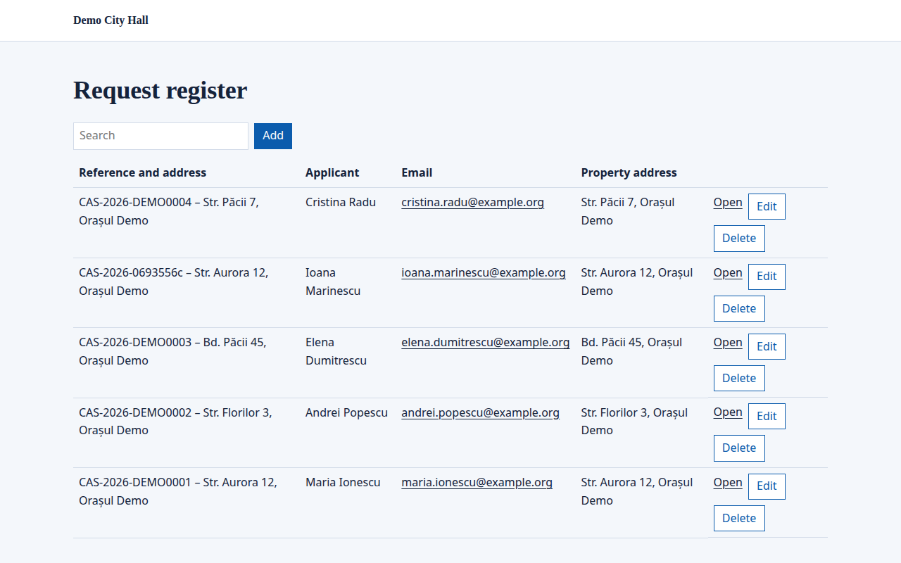

**Open** shows a record's details below the list:

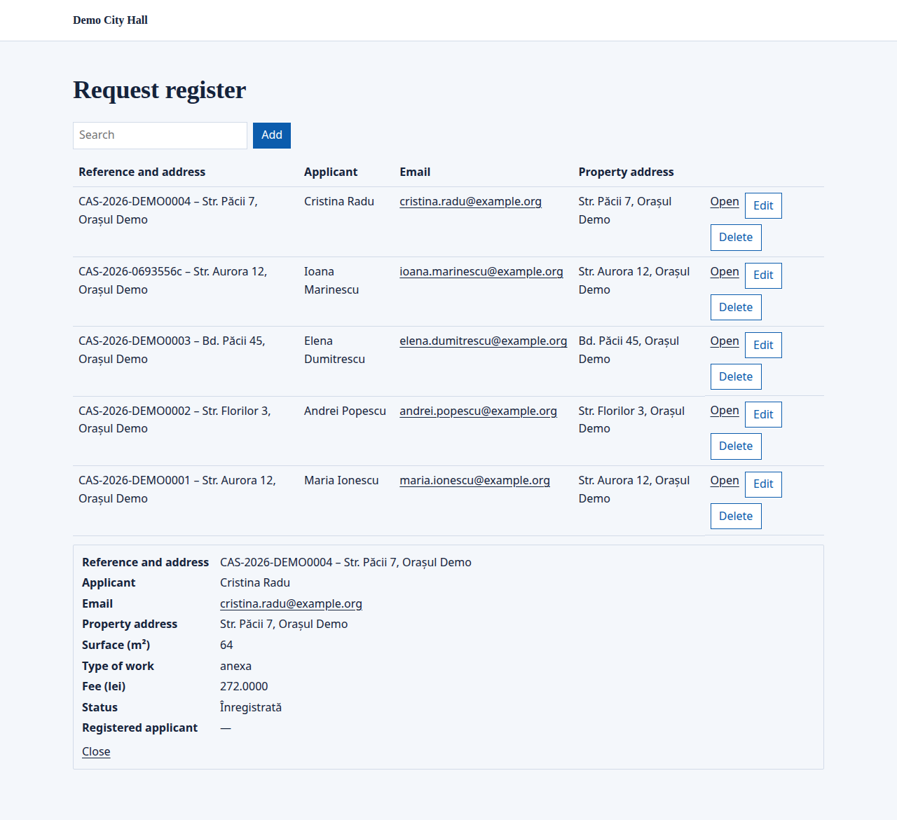

**Add** opens a small form with the model's fields, and **Choose** picks the record a link points at:

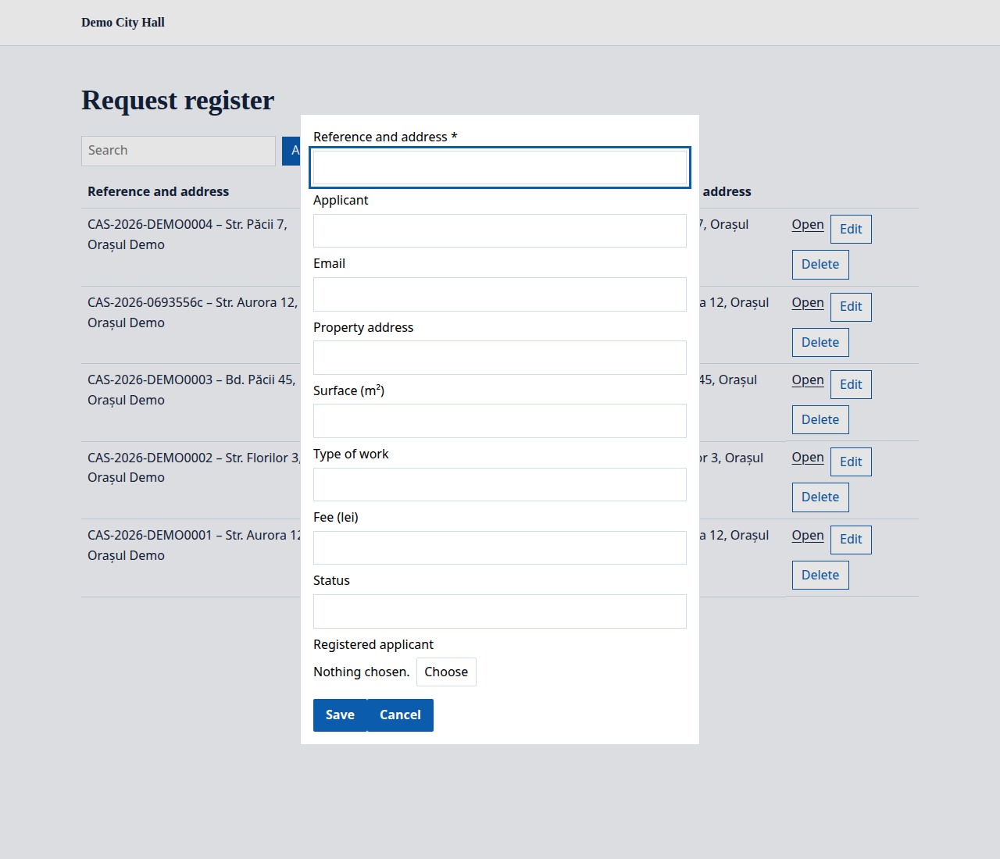

## Place a listing

A listing is one of the portal's widgets, placed on a page. It shows the records of one model, or the rows of one data source, with the columns, sorting, grouping and export the page chooses. Whether it offers **Add**, **Edit**, **Delete** and **Archive** is the page's choice too, but the model's [permissions](/portal/sites/data-models/#who-may-do-what) still decide who may: someone who may only edit their own records sees **Edit** only on theirs.

On [Pages](/portal/console/pages/#the-portals-widgets), add **Listing** with **Add a widget…**, then set its settings in its row:

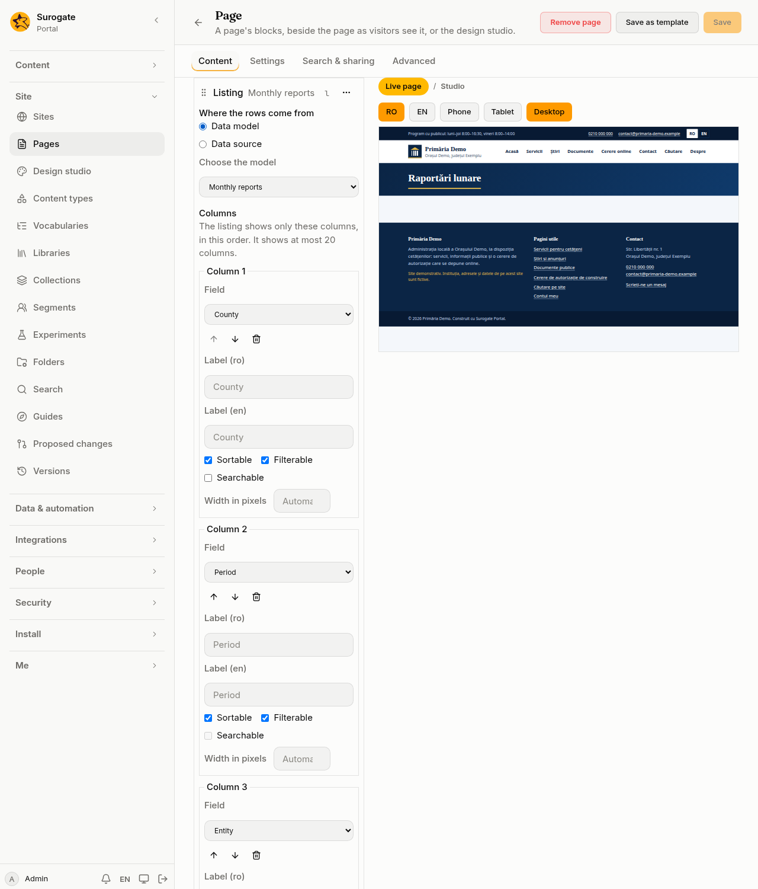

- **Where the rows come from:** **Data model**, or **Data source**. It is required. A source that nobody named for this person's use shows nothing.
- **Columns:** the columns to show, in order, at most 20. For each: its field (or the source's column), its label in each language (the field's own when left empty), whether it is **Sortable**, **Filterable** and **Searchable** (only text can be searched), and its **Width in pixels**. Until you add a column, a listing of a source shows every column it answers, and a listing of a model shows its title and its first fields.
- **Default sort:** at most 3 columns, each ascending or descending.
- **Rows per page:** 20, 50 or 100. People can change it.
- **Grouping:** the columns people may **group on**, at most 2 grouped by default, the **Totals of a group** (sum, average, smallest or largest of a column of numbers), and whether dates are grouped by **day, month or year**. Only text, links, yes or no and dates can be grouped.
- **Export:** for each of Excel (xlsx), CSV and PDF, who can export. Nobody, until you name someone.
- **Row operations:** **People can add**, **People can edit**, **People can delete** and **People can archive**. A source's rows can only be added and removed, and only when the source says how.
- **Form that adds and opens records**: a [form bound to the model](/portal/sites/model-forms/). With one, **Add** opens the form, and **Open** and **Edit** open it on the record, in place of the details below the list and the small dialog. It lists the forms bound to the model you chose, the model's own among them.
- **Show the map too**: for a model with a location, a [map](/portal/sites/maps/#a-map-on-a-page) above the table that follows its search and filters.

Developers: see [Developer: Data sources](/portal/developer/data-sources/#a-listing-over-a-model-or-a-source) and [Developer: Listings](/portal/developer/listings/#a-listing-on-a-page).

A search box shows when the model has searchable fields, or the listing has searchable columns. A listing shows the rows a page at a time, with **Previous**, **Next** and the page numbers, and **Total: n rows** under it.

## Sort, filter and search

Each column heading is a link: a click sorts by that column, and a second click reverses it. Under the heading, the **…** opens the column's menu:

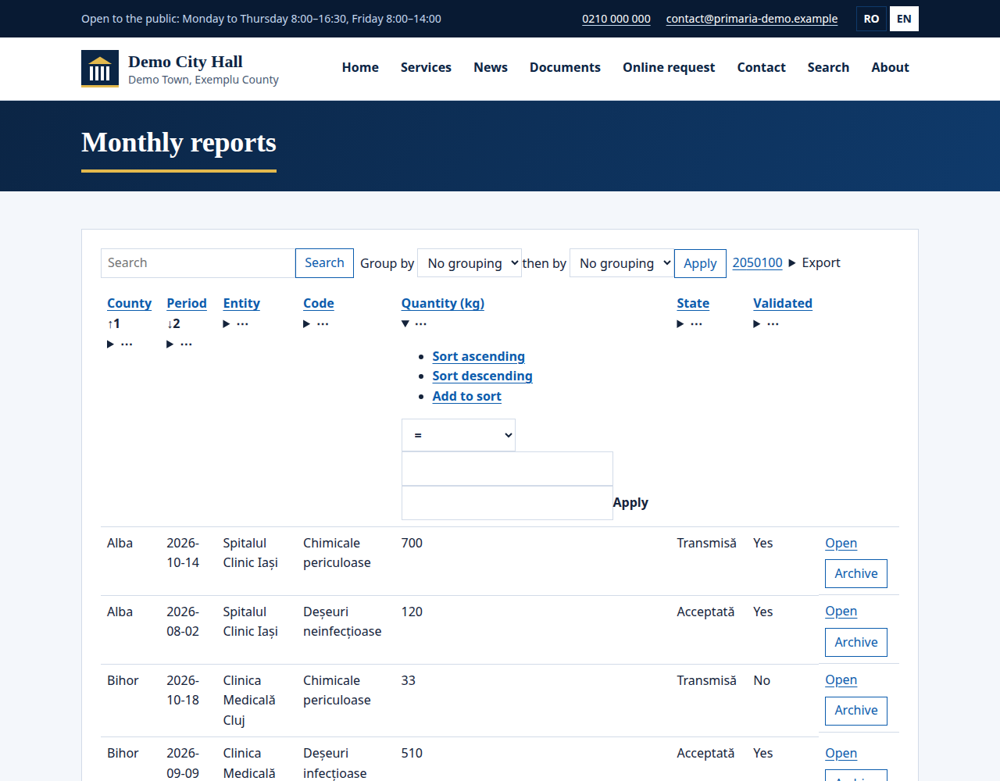

- **Sort ascending**, **Sort descending** and **Add to sort**. A listing sorts by up to 3 columns: the first sorted shows 1, the next 2, and so on. Shift and click on a heading adds it to the sort too.
- **A filter**, by how the column's values compare. Text: contains, is, starts with, is empty, is not empty. Numbers, dates and times of the day: =, ≠, <, ≤, >, ≥, between two values, is empty, is not empty. Yes or no: is yes or is no. A link: one of the records, chosen from those the person may read. A time of day only says empty or not.
- A column that can be searched has a search of its own.

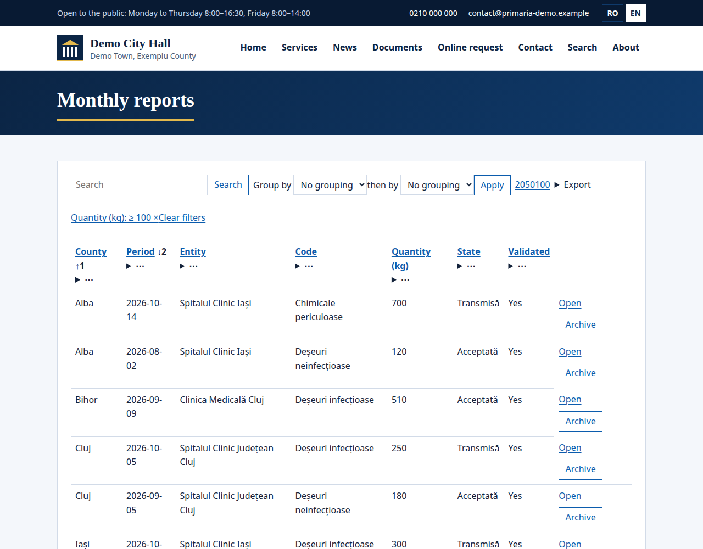

What is filtered shows as a line above the table, one entry for each filter, with **Clear filters**. The address of the page keeps the sort, the filters, the search and the page, so that a view can be shared or bookmarked. An address that names a column alone sorts on it going up, and a minus before it, going down.

## Group

**Group by** groups the rows by up to 2 columns, **then by** a second. Each group is a line with its name, how many rows it holds and its totals (such as the sum of a quantity). A click on a group opens its rows, and a second click closes it.

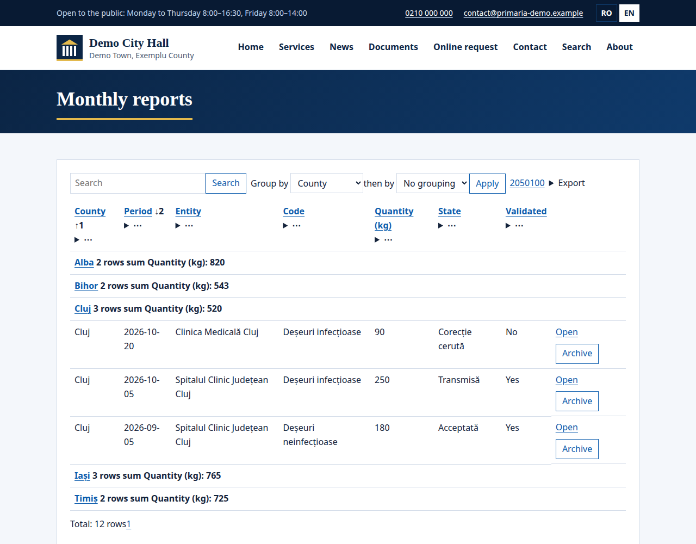

Dates are grouped by the day, the month or the year the listing says. A page shows 20 groups, and an open group shows its first 50 rows.

## Export

People the listing names can **Export** what they see: **Excel (XLSX)**, **CSV** or **PDF**, each only for those named for it. The file holds what the listing shows with its current filters, sorting and search, in the order shown, with the columns' labels in the person's language; the PDF also says which filters apply, who exported it and when.

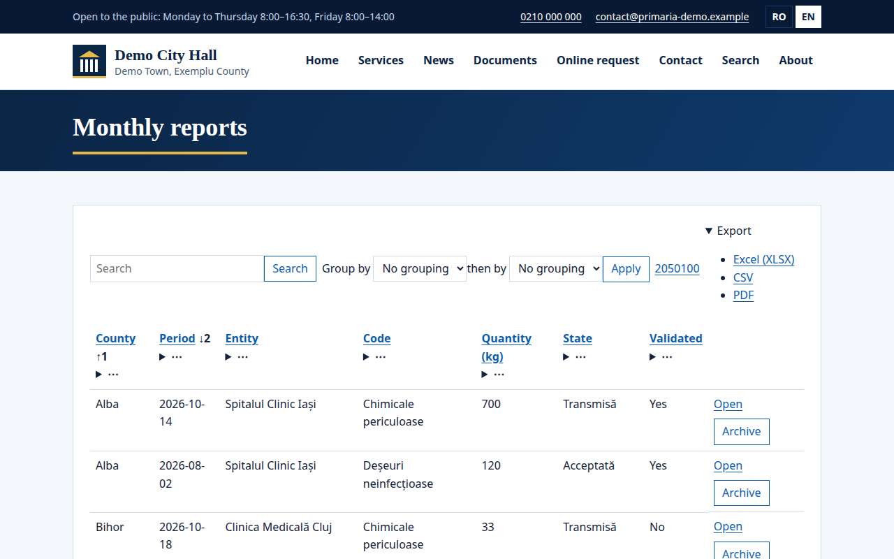

- An Excel or CSV file holds at most 50,000 rows, and a PDF at most 5,000. Past that, the export is refused and says how many rows there are, so the filters can be narrowed: nothing is cut off.
- A person exports one file at a time.
- An export is written to the [audit log](/portal/console/audit/) as **listing.export**, with who, the listing, the format, which columns were filtered and how many rows.
- A cell that starts with `=`, `+`, `-` or `@` is written as text, so that a spreadsheet never runs what a visitor typed.

## A listing of a data source

A listing can show a [data source](/portal/sites/data-sources/) instead of a model: a SQL query, the portal's own data, a JSON web service or a form's submissions. Everything above works the same: columns, sorting, filtering, searching, grouping and export.

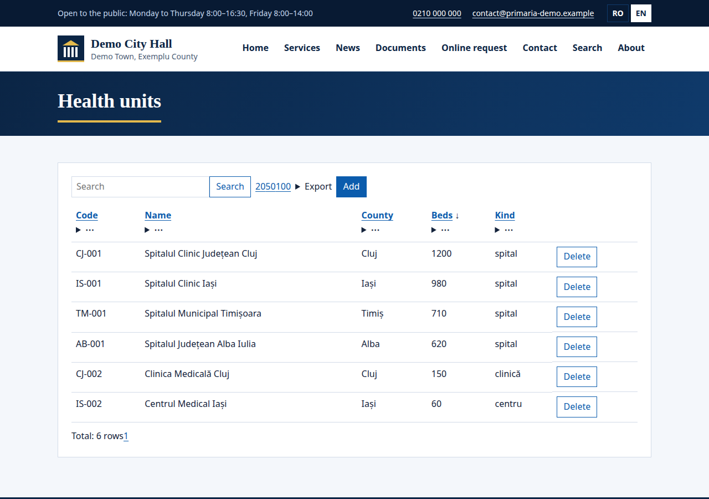

- The source's own **Who may use this source** decides who sees the listing.
- A source's rows are read, not edited. A SQL or web service source can offer **Add** and **Delete** when it says how: see [Add, remove and open a row](/portal/sites/data-sources/#add-remove-and-open-a-row).
- When the source cannot answer, the listing says so in one sentence, with **Try again**.
- A source with many rows is filtered, sorted and grouped by the portal, after reading as many as the source allows.

## Archive

For a model that keeps its history and archives what is deleted, the button that removes a row says **Archive**, asks for a reason where the model wants one, and takes the row out of the list. The record is kept, with its history. People the model names see **Archived** next to **Active**, and can **Restore** an archived row. An archived row cannot be changed, only restored.

## What each person sees

- Everyone sees only the records they may see: their own, where that is all they may see.
- Someone who may neither see the records nor add any sees nothing of the listing.
- Adding, editing and deleting are offered only to people signed in, never to visitors.
- A row that the model's [lock](/portal/sites/data-models/) holds closed, such as a sheet of a year that has ended, has **Open** only: also the rows a search, a sort or **Load more** brings in later, which the page asks the portal about.
- Values show as text; dates and times in the person's own time; web addresses as links only when they are http, https or mailto.

**Open** shows a record's details below the list, with the title of the records it links to when the person may see them. Its address can be shared: `?p_<placement id>_record=<record id>`. Search engines are told not to keep such addresses.

**Add** and **Edit** open a small form with the model's fields. A link is chosen with **Choose**, from a list of the linked model's records, as a form's [record field](/portal/sites/forms/#pick-a-record) does. A change sends only what was changed. A value the model refuses is shown with its field.

For a model that calculates figures, checks its records, hides fields on a condition or has states, the dialog runs the model's own logic as the person types, as a [form for records](/portal/sites/model-forms/) does: what the portal calculates shows grey, what is asked for has a star, each message shows at its field, and the state's moves are buttons beside **Save**:

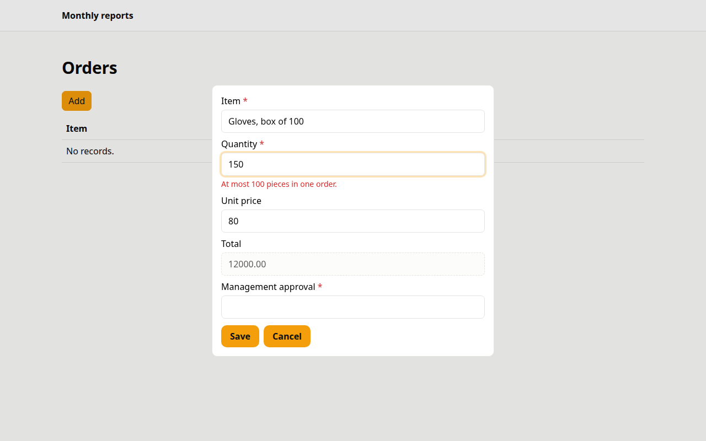

## Archiving and the history

Where the model keeps its [history](/portal/sites/data-models/#history-and-archiving) and archives what is deleted, a listing says **Archive** where it said **Delete**. A record that is archived leaves the list. When the model asks for a reason, the listing asks for it first, and nothing is archived without one.

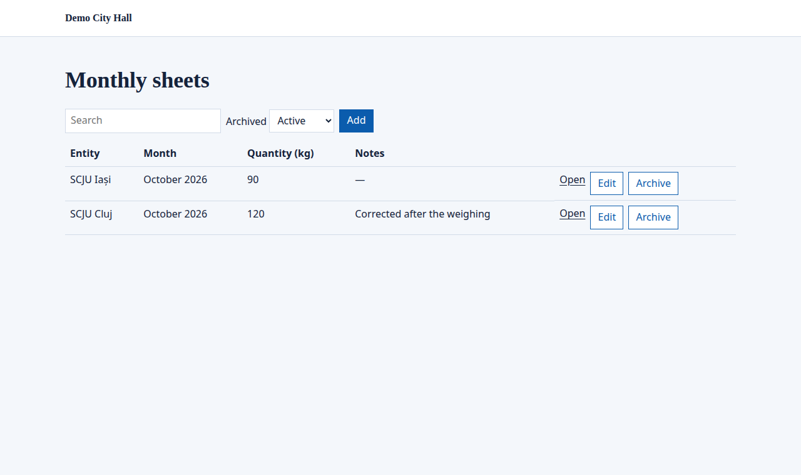

People who may see archived records have an **Archived** filter next to the search. It lists what is archived, each with **Restore** for those who may restore, and without **Edit** or **Archive**.

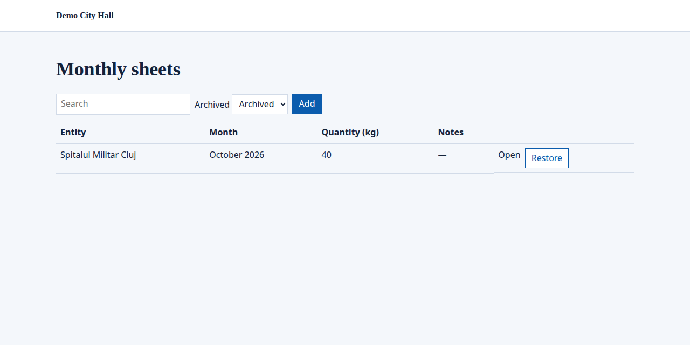

**Open** on a record shows **History** to those who may see it: its versions, each one's values, a comparison of two, the check of the sealed versions and the record as it was at a date. **Go back to this version** is offered to those who may change the record. See [Reading the history](/portal/sites/data-models/#reading-the-history).

## A model's own pages and form

A model can make its own page on a site, with a listing that offers everything. The page's title is the model's name unless the model gives one. A path that a page already has is refused. Add it on the model's **Pages** tab: see [On pages](/portal/sites/data-models/#on-pages). Developers: see [Developer: Listings](/portal/developer/listings/#a-models-own-page).

Each model also has its own form, `model-<id>` (an `_` in the id becomes `-`), to place like any [form](/portal/sites/forms/): one field for each of the model's fields, links as [record fields](/portal/sites/forms/#pick-a-record), sent to a new record. It is bound to the model, so it also opens records to edit and shows what the model calculates: see [Forms for records](/portal/sites/model-forms/). Who may send it is who may add records: when everyone may add records, visitors too, even where the form is placed on no page. The record holds what was sent; the form keeps its own copy for a day only.
