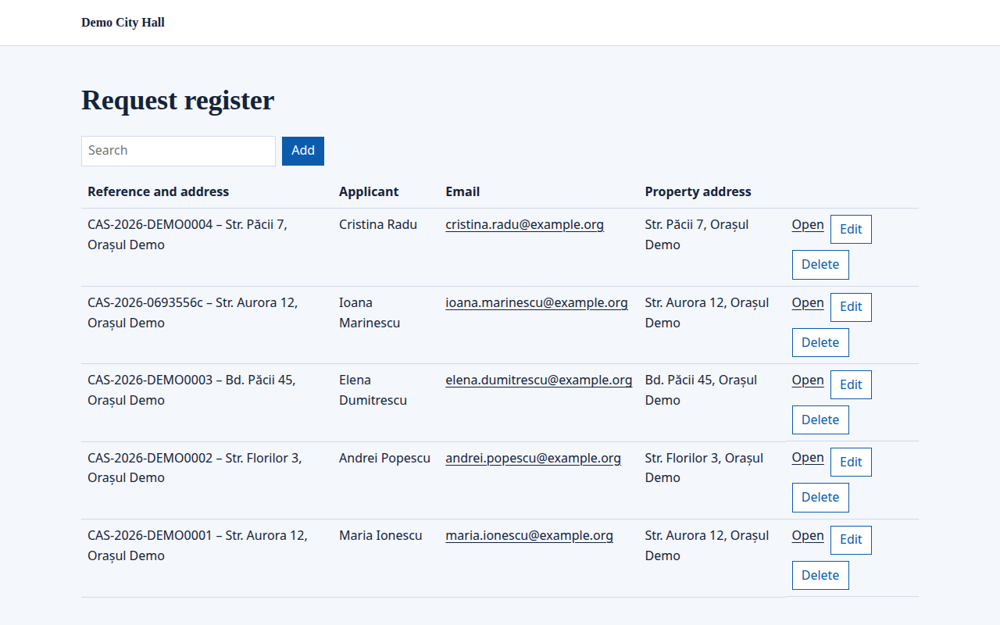
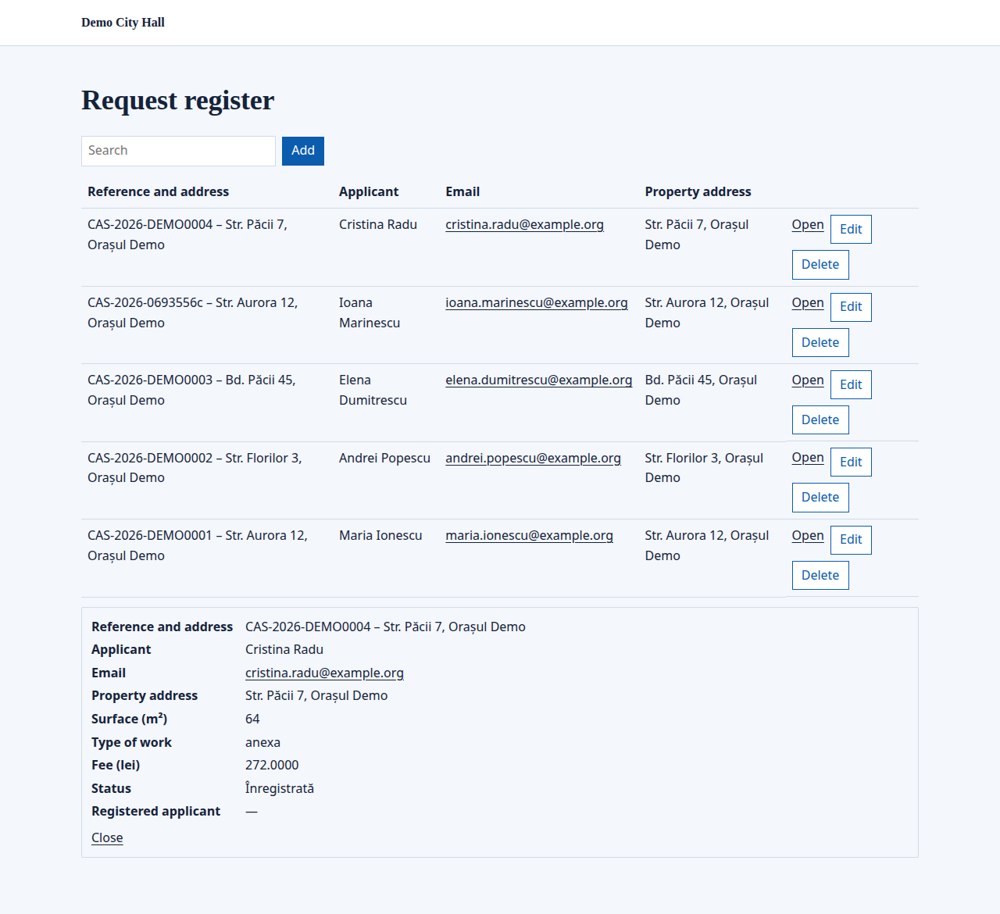
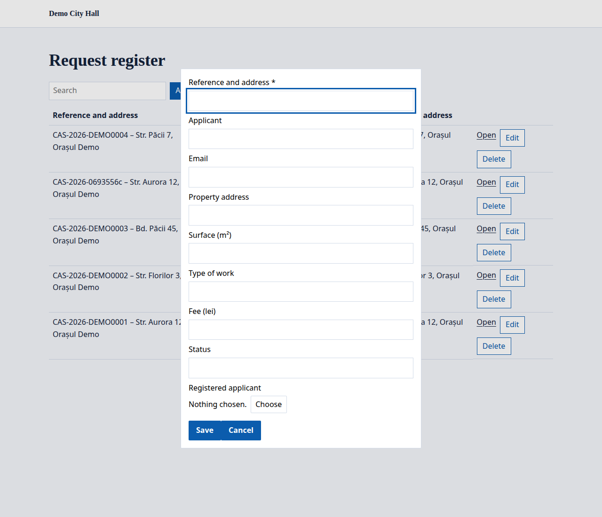

A listing shows the records of a [data model](/portal/sites/data-models/) on a page, as a table. People see the records they may see, search and filter them, open one, and, where they may, add, edit and delete them in place.

## What people see

A listing is a table of the model's records, with a search box and, for people who may add records, an **Add** button. Each row has **Open** and, where the person may, **Edit** and **Delete**:

**Open** shows a record's details below the list:

**Add** opens a small form with the model's fields, and **Choose** picks the record a link points at:

## Place a listing

A listing is one of the portal's widgets, placed on a page. It shows the records of one model, with the columns and filters the page chooses: at most 8 columns, none of them a link (left out, the title and up to 3 more fields), and filters on filterable fields, by exact value. Whether it offers **Add**, **Edit** and **Delete** is the page's choice too, but the model's [permissions](/portal/sites/data-models/#who-may-do-what) still decide who may: someone who may only edit their own records sees **Edit** only on theirs.

The console's page editor does not place listings yet. For now, this is set in the site's configuration: see [Developer: Listings](/portal/developer/listings/#a-listing-on-a-page).

A search box shows when the model has searchable fields. Sortable columns sort when their heading is clicked. A listing shows 20 records, and **Load more** brings the next ones.

## What each person sees

- Everyone sees only the records they may see: their own, where that is all they may see.
- Someone who may neither see the records nor add any sees nothing of the listing.
- Adding, editing and deleting are offered only to people signed in, never to visitors.
- Values show as text; dates and times in the person's own time; web addresses as links only when they are http, https or mailto.

**Open** shows a record's details below the list, with the title of the records it links to when the person may see them. Its address can be shared: `?p_<placement id>_record=<record id>`. Search engines are told not to keep such addresses.

**Add** and **Edit** open a small form with the model's fields. A link is chosen with **Choose**, from a list of the linked model's records, as a form's [record field](/portal/sites/forms/#pick-a-record) does. A change sends only what was changed. A value the model refuses is shown with its field.

## A model's own pages and form

A model can make its own page on a site, with a listing that offers everything. The page's title is the model's name unless the model gives one. A path that a page already has is refused. For now, this is set in the site's configuration: see [Developer: Listings](/portal/developer/listings/#a-models-own-page).

Each model also has its own form, `model-<id>` (an `_` in the id becomes `-`), to place like any [form](/portal/sites/forms/): one field for each of the model's fields, links as [record fields](/portal/sites/forms/#pick-a-record), sent to a new record. Who may send it is who may add records: when everyone may add records, visitors too, even where the form is placed on no page. The record holds what was sent; the form keeps its own copy for a day only.
