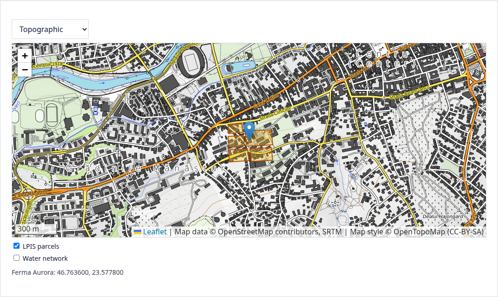
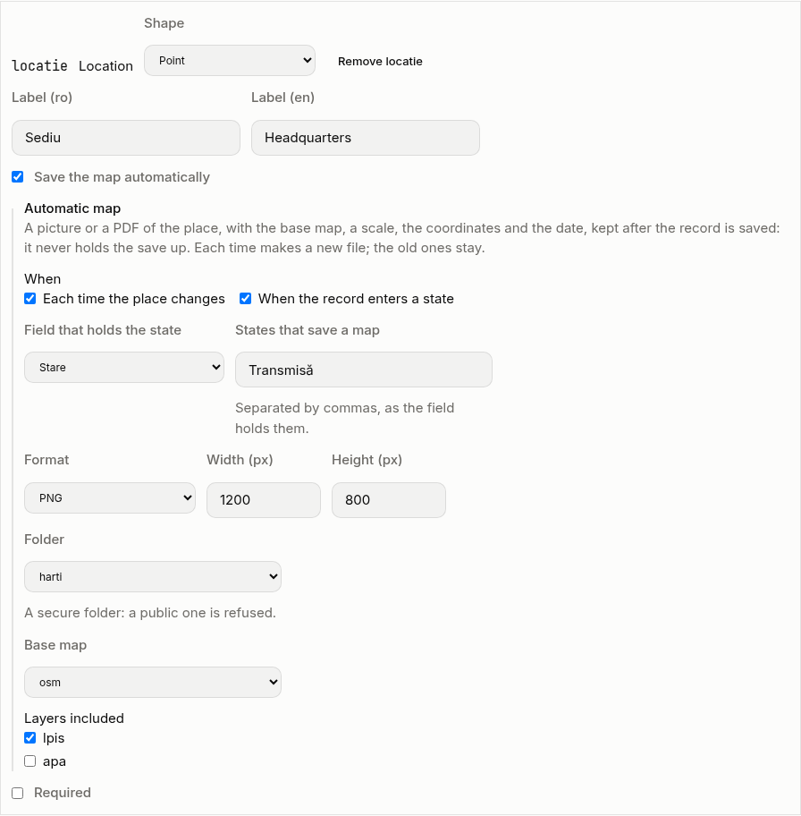
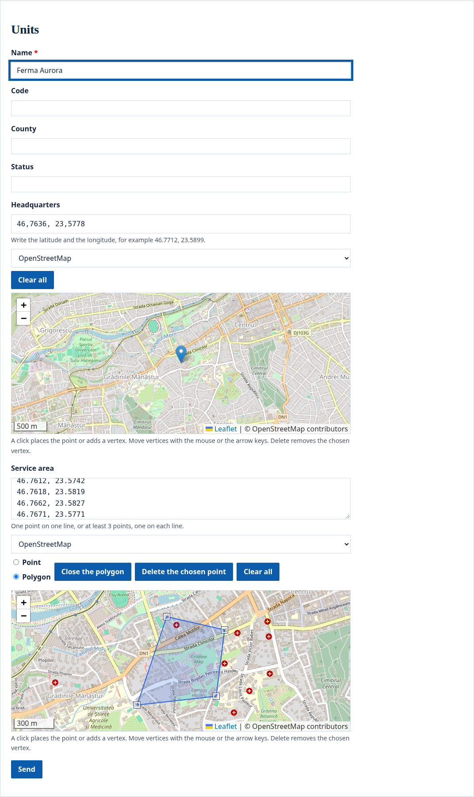
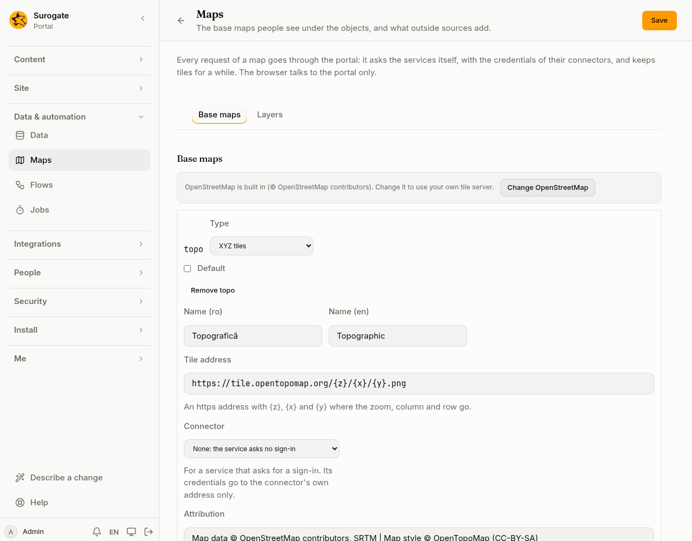
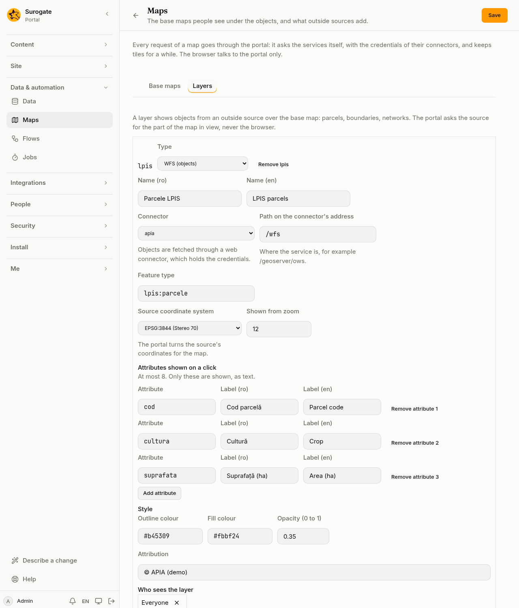
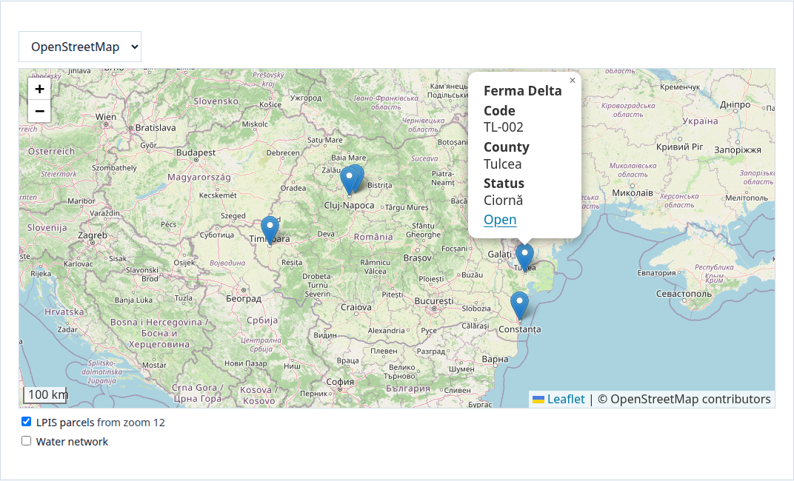
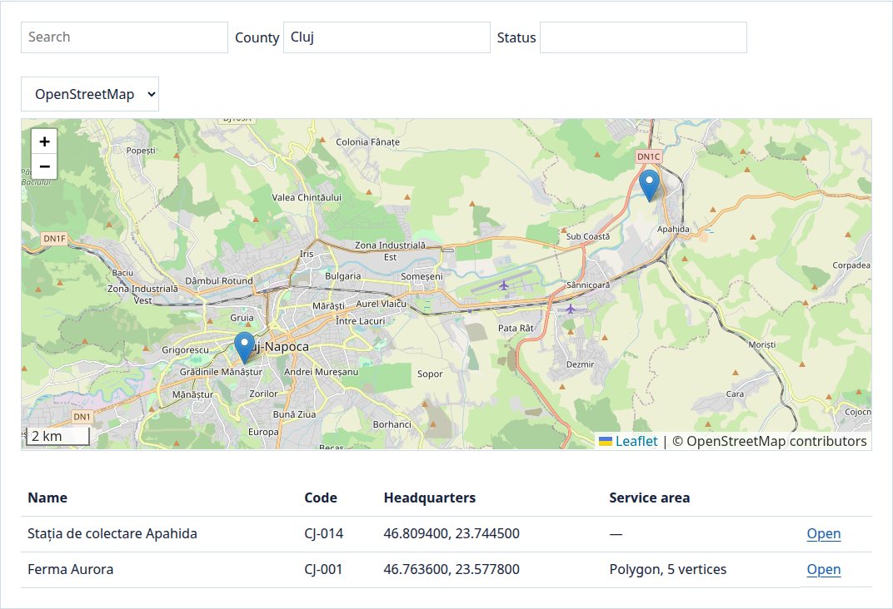
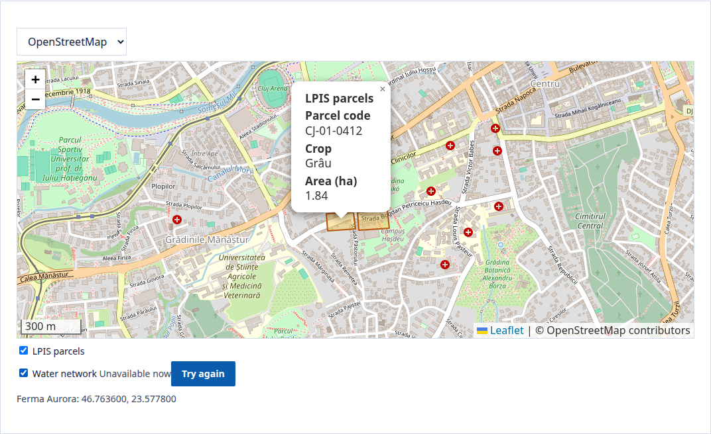
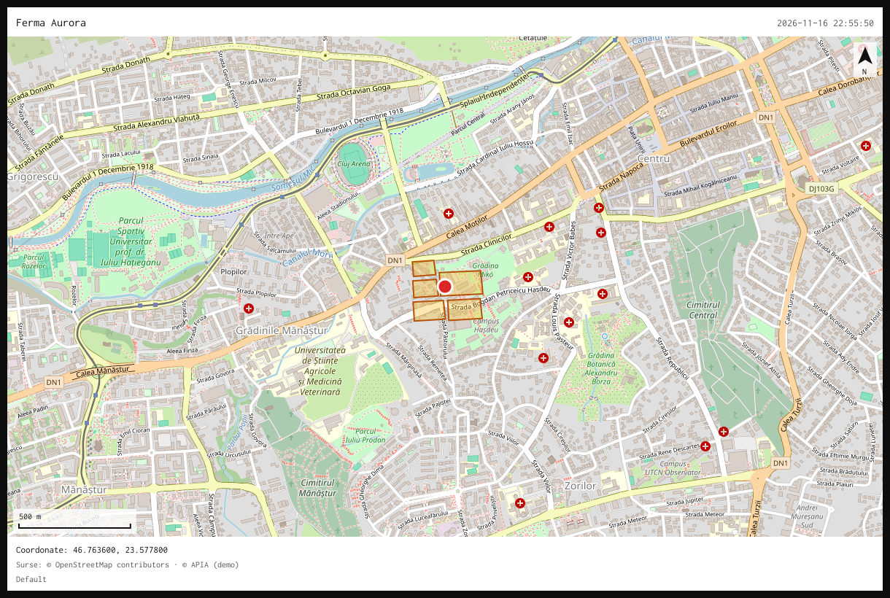
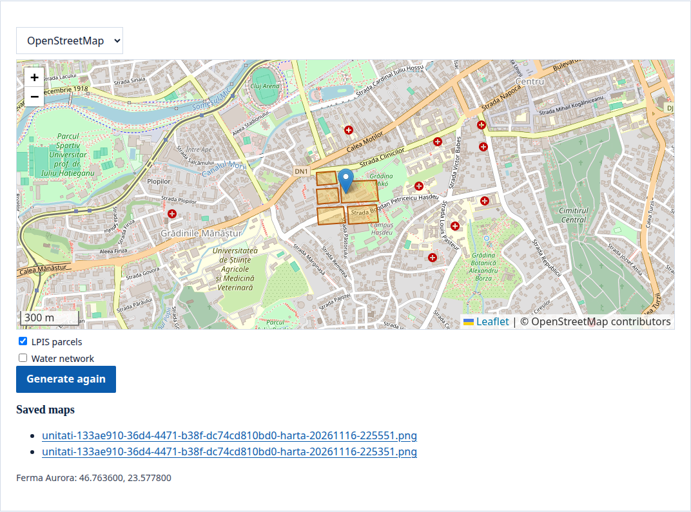

A record can have a **place**: a point, such as a head office, or a simple polygon, such as an area a unit serves. People mark it on a map, the portal shows it on a map, and the portal can keep a picture or a PDF of that map each time the place changes.

All of it is set in the console. Every request of a map goes through the portal: it asks the map services itself, with the credentials of their [connectors](/portal/sites/connectors/), and the visitor's browser talks to the portal only.

## What people see

On a record's page a map shows where it is, on the base map the person chooses. A click on a marker shows the fields the page chose, and **Open** goes to the record's page.

The same record on another base map, here a topographic one:

The map works from the keyboard: the arrow keys move it, + and - zoom, and Tab goes from one object to the next. The place is also written as text under the map.

## A location on a record

In a [data model](/portal/sites/data-models/), add a field of the type **Location**. Its **Shape** says what it takes: **Point**, **Polygon** or **Point or polygon**. A location is neither filtered nor sorted on, and it can be required.

A saved field keeps its type. Its shape can change to **Point or polygon** at any time. It cannot change from points to polygons while the table holds points.

In a form, and in a listing's **Add** and **Edit** window, a location field has two ways in, and both work on their own:

- **The map.** A click places the point. For a polygon, clicks add corners; a double click, or **Close the polygon**, ends it; corners move with the mouse or the arrow keys; **Delete the chosen point** and **Clear all** take corners away.
- **Coordinates as text.** For a point, "latitude, longitude", such as `46.7712, 23.5899`. For a polygon, one point on each line, at least 3. A decimal point or a decimal comma both work, so `46,7712, 23,5899` is a point too. The text is the way in for people who cannot use a mouse, and the map follows it as it is typed.

The portal checks the place again when it is saved, and says what is wrong at the field, in Romanian ("Poligonul se intersectează cu el însuși"):

- a longitude is from −180 to 180 and a latitude from −90 to 90, with at most 7 decimals;
- a polygon has at least 3 different points and at most 1,000, and it is closed for you when it is not;
- a polygon never crosses itself, and has no holes; lines and shapes of several parts are not taken.

The order people see is **latitude, longitude**. The order the portal keeps, and gives to programs, is the standard one for GeoJSON: **longitude, latitude**.

Everywhere else a location is read as what it is:

- a listing shows a point as `46.771200, 23.589900` and a polygon as "Polygon, 6 vertices";
- a CSV or Excel export has the point as `POINT(23.5899 46.7712)`, and a polygon as `POLYGON((…))`; a JSON export and the API give GeoJSON.

Developers: see [Developer: Maps](/portal/developer/maps/#a-location-field).

## The Maps page

Administrators set what is on the maps at **Maps**, under **Data & automation**. It has two tabs, **Base maps** and **Layers**.

### Base maps

A base map is the map under the objects. **OpenStreetMap** is built in, and it is the default until you say otherwise. **Change OpenStreetMap** lets you point it at a tile server of your own.

**Add base map** gives one:

- **Id**, and a **Name** in each language;
- **Type**: **XYZ tiles** (an address with `{z}`, `{x}` and `{y}`), **WMTS** (a service address, the layer, and the tile matrix set, which must be one of web Mercator's, `GoogleMapsCompatible` by default) or **WMS** (a service address, the layer or layers, and its version);
- **Connector**, when the service asks for a sign-in. The base map's address must be the connector's own address, so its credentials go nowhere else. A connector that signs in as each person cannot be used;
- **Attribution**, the text shown on the map, such as "© OpenStreetMap contributors". It is required;
- **Least zoom** and **Greatest zoom**;
- **Default**. One base map is the default.

Add a topographic base map, for example your country's WMS, or a source of your own. People choose among the base maps a page offers.

If a base map's service does not answer, the map says "The base map … is not answering now." The objects stay on a blank background, and the person can choose another base map. A base map that a page still offers cannot be removed: the console names the pages.

### Layers

A layer puts objects from an outside source over the base map, such as the parcels of an agency.

**Add layer** gives one:

- **Type**: **WMS** (a picture; a click asks the source what is there), **WFS**, **OGC API Features** or **GeoJSON at an address** (objects drawn by the portal);
- **Connector**, which holds the credentials. It is required for a WFS, an OGC API and a GeoJSON layer, and optional for a WMS (which can have an address instead). The **Path** is where the service is on the connector's address;
- the layer, feature type or collection asked for;
- **Source coordinate system**: **EPSG:4326** (WGS84), **EPSG:3857** (web Mercator) or **EPSG:3844** (Stereo 70). The portal turns the source's coordinates for the map;
- **Attributes shown on a click**: up to 8, each with a label in both languages. Only these are shown, and as text: nothing the source sends is read as markup;
- the **colours** and **opacity**, **Shown from zoom** (12 for objects when left empty) and the **attribution**;
- **Who sees the layer**: people signed in when left empty. A person it is not shown to does not see it in the legend, and the portal refuses it if they ask for it directly.

The portal asks a source only for the part of the map in view, at most 5,000 objects at a time. When there are more, the map says "Zoom in to see all the objects." A source that does not answer in 10 seconds, or that fails, shows in the legend as **Unavailable now** with **Try again**; the rest of the map goes on, and the page does not fail.

## A map on a page

On [Pages](/portal/console/pages/#the-portals-widgets), add **Map** with **Add a widget…**. Its settings:

- **Data model** and **Location field**. Only models with a location are offered;
- **What it shows**: **The record the page opens**, or **The model's records**. The records follow each viewer's access: a map never shows, or counts, a record the person may not see;
- **Base maps offered** and **Base map at first**; none ticked offers every base map;
- **Layers offered** and **Layers on at first**;
- **Height**, from 200 to 1,200 pixels;
- **Fields shown on a click**: up to 8, none of them a link.

A page of a record takes the record from its address: `?record=<id>`, or the address a listing's **Open** makes. A map of the model's records shows at most 5,000 objects; more asks to narrow the filters: "Too many records for the map: narrow the filters."

A [listing](/portal/sites/listings/) can show the same map above its table. Tick **Show the map too**: the map follows the listing's search and filters.

### Layers in the work of a case

The Map widget can sit on the page of a record or of the case being handled, so the person working on it sees the place of the file and the outside layers on one map, for example the parcels around the point.

A page that shows a case gets the record from its address, as above: link to it with `?record=<id>`.

## Save the map automatically

A location field can keep a picture or a PDF of its map by itself. On the field, tick **Save the map automatically** (see the model editor above) and choose:

- **When**: each time the place changes, and/or when the record enters a state. For a state, name the field that holds it and the states that save a map;
- **Format**: **PDF, A4**, or **PNG** with its size, from 800×600 to 3000×2000 pixels;
- **Folder**, which must be a secure folder: a public folder is refused when the model is saved, because it would show the map of every record;
- **Base map** and **Layers included**.

The file is made after the record is saved and **never holds the save up**. It is named `<model>-<record id>-harta-<yyyymmdd-hhmmss>.<png or pdf>`. Every save that asks for a map makes a new file, and the old files stay, as the proof of each view.

A map holds:

- the base map and the layers asked for, centred on the place, which is marked;
- a scale and a north arrow;
- the coordinates (for a polygon, its centre and its number of points);
- the sources' attributions, the date and time, the record's title and the portal's name.

The words on it are in the default language of the portal's first site. A PDF is an A4 page; a file is at most 10 MB.

On the record's page the map lists the files made, to those who may open the folder. If a map cannot be made, the portal tries again, three times in all. If it still fails, the page says "The map could not be saved", gives the reason, and offers **Generate again**.

If a layer, or the base map, does not answer when the map is made, the file is made without it and says so on the map ("The layer … could not be read at …"). With no base map, the place is drawn on white with its coordinates.

### The action Save a map

[Forms, flows, endpoints and jobs](/portal/sites/actions/) can do the same with the action **Save a map**, in the **Documents** section: for one record, or for a place the action is given, in a folder the run may write to. It answers where the file is and which layers could not be read. A job that saves the map of fifty records makes fifty files. Like every extension action, it counts toward the limit of 20 extension actions a run. See [Document actions](/portal/sites/document-actions/#save-a-map).

## Limits

- 5,000 objects on a map, and 5,000 a layer request.
- 20 base maps and 50 layers.
- A source that does not answer in 10 seconds is "unavailable". The portal keeps a base map's tiles an hour.
- A map's files are at most 10 MB, and the picture of a map is at most 3000×2000 pixels.
- Out of scope: searching for an address; drawing on a map outside a location field; routes and distances; maps that work offline.
