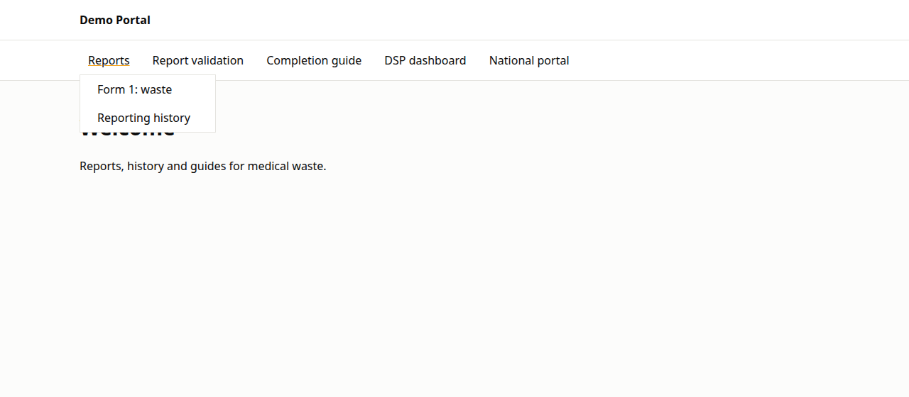
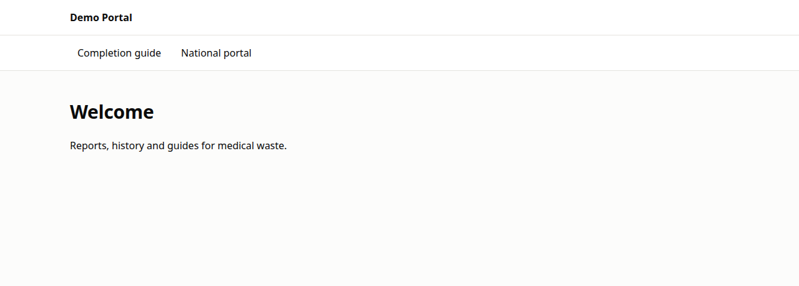
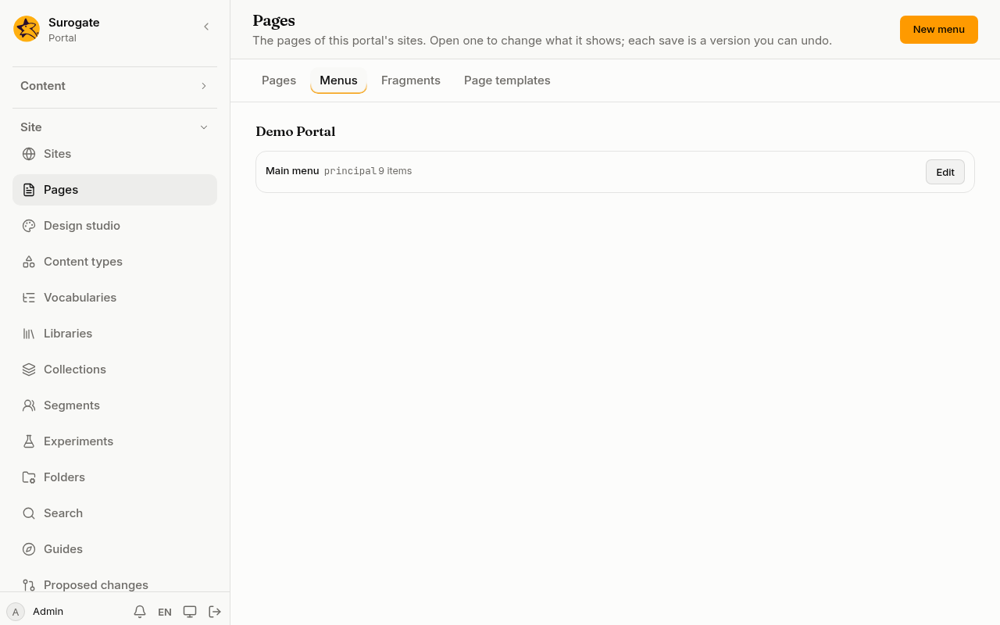
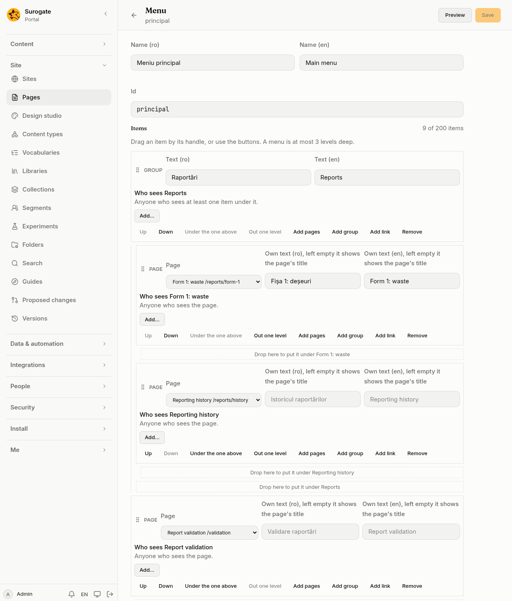
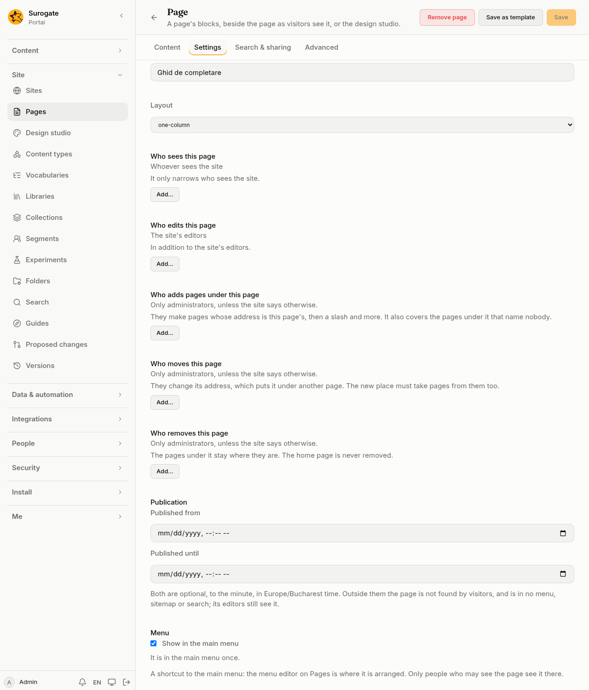
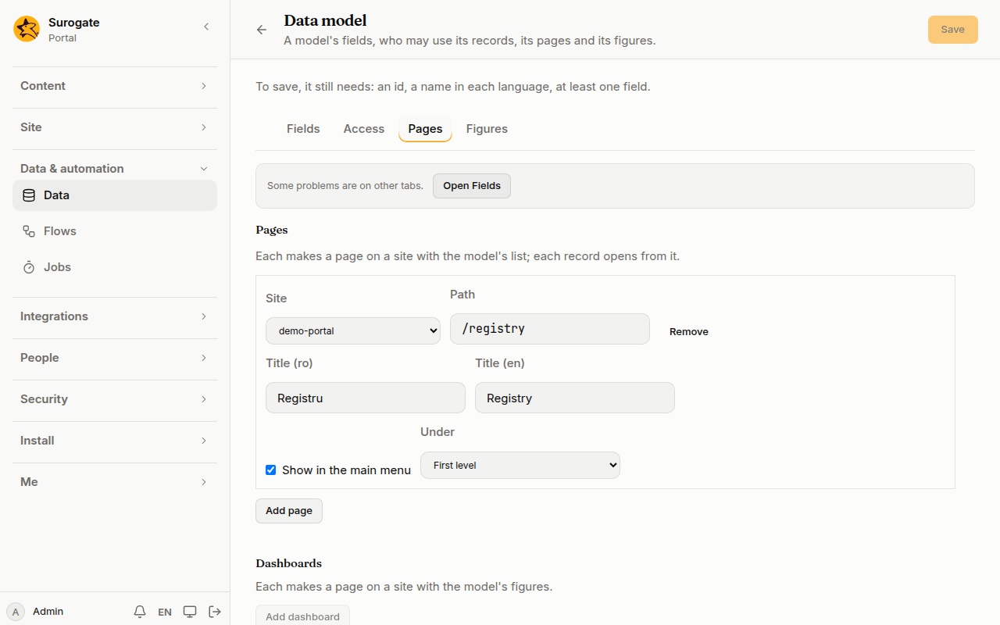

A site has menus: lists of links that people use to move around. A menu holds pages of the site, groups that open into submenus, and links to other websites. You build it in the console, by dragging, and it shows on the site's pages at once. Each person sees only the items that are for them.

## What people see

The portal's own layouts show the site's **main menu** above the page. A layout the site wrote itself can place the main menu and other menus where it wants.

- A menu is a navigation landmark named by the menu, with a list inside a list for a submenu.
- The page being shown is marked as the current page, and the items that hold it are marked too.
- A submenu opens with the mouse, with a tap, or from the keyboard: **Enter** or **Space** on its name opens it, and **Escape** closes it.
- On a narrow screen the whole menu sits under one **Menu** button.
- A menu with nothing left in it for the person is not shown at all. There is no empty navigation.

What a person sees is cut on the server for each person. An item they may not see is not in the page, not hidden by styles. Two people with different rights get different menus from the same address.

## Make a menu

Menus are on **Pages**, under the **Menus** tab. Each site has a **main** menu from the start, which cannot be removed. A site can have up to 10 menus; the others are made with **New menu**, and are used by layouts that place them.

A menu has:

- an **id**, in lower-case letters, digits and hyphens, fixed once saved. A layout places the menu by it;
- a **name** in each language of the site. The name is what the navigation is called for people who use a screen reader;
- its **items**, up to 200, nested three levels deep.

## The items

An item is one of three kinds:

- **Page**: a page of the site. It shows the page's title in each language. Type **Own text** in each language to show another text; leave both empty to keep the title. A page of a data model's [pages](/portal/sites/data-models/) is in the list too.
- **Group**: a text in each language and no link. It holds other items: that is how a submenu is made. A page item can hold items too: the page is a link, and its items open under it.
- **Link**: a text in each language and an `https:` address, with **Open in a new tab** if you want it.

A text is at most 60 characters, in every language of the site. The same page can be in a menu more than once, and in several menus.

**Add pages** shows the site's pages: tick several, and they are added together, last on the level you chose, in the order of the list. **Add a group** and **Add a link** add those kinds. Each item has the same buttons for what it holds.

### Order by dragging

Drag an item by its handle onto another item to put it before that one, onto **Drop here to put it under …** to put it inside a group, or onto **Drop here to put it last**. An item takes the items under it along.

The buttons do the same without a mouse:

- **Up** and **Down** move an item among its neighbours.
- **Under the one above** puts it inside the item above it, last.
- **Out one level** takes it out of the item that holds it, right after it.

A menu is at most three levels deep: items, the items of a group, and the items of a group in a group. When a move would make it deeper, the editor does not make it, and says so.

## Who sees an item

Each item has **Who sees** and the same choice of people as everywhere in the portal, see [Choose who](/portal/sites/permissions/#choose-who). It only narrows. An item that points to a page is shown to a person only when both are true:

1. the person may see the page: its own rights, the site's, and, for a page published on a schedule, whether it is published;
2. the person is among those the item names.

When nothing is chosen:

- a page item is for **anyone who sees the page**;
- a group is for **anyone who sees at least one item under it**;
- a link is for **anyone who sees the site**.

More rules that keep it predictable:

- An item a person may not see takes its items under it away with it, even if some of them would be visible.
- A group none of whose items a person may see is not shown to them.
- Someone who is not signed in sees only the items for public pages.
- A person with two roles sees what each of them allows.
- A page that a person may not see is never named in their menu. The page opens at its address if they are allowed, whether or not it is in the menu.
- An administrator who sees the portal as someone else sees that person's menus.

**Back to the default** returns the choice to what the item's kind means.

## Changes are live

A saved menu is a [version](/portal/console/versions/) like any other change on **Pages**, and it is live at once, on every server, without a restart. People see the new menu the next time they load a page; they do not need to sign in again. **Undo** on **Versions** brings the old menu back, live as well.

**Preview** shows the site's home page with the menu as you have it now, saved or not. A save the portal refuses, for example when a text is missing in a language, changes nothing that is live, and lists what to fix.

## Show a page in the menu

A page can be put in the main menu from its own settings, without opening the menu editor. In the page editor, **Settings** has a **Menu** section:

- **Show in the main menu**: ticked, the page is added last on the level you chose; unticked, every item of the page leaves the main menu.
- **Under**: **First level**, or one of the main menu's groups or pages.
- **Text in the menu**: the page's title unless you write one in each language.

The box tells the truth about the menu: it is ticked when the page is in the main menu at least once, and the menu editor is where the menu is arranged. Other menus are never touched by the box.

- A **new page** has the box ticked, on the first level. Untick it for a page that people reach only from a form, for example: its address works all the same, only the menu does not show it.
- Unticking it for a page that is in the menu several times asks first, and says how many items it takes out.
- A page that is ticked but that a person may not see, or that is not published yet, is not in that person's menu. The box does not get around anyone's rights.

### A data model's pages

A data model makes pages of its own, a list of its records and dashboards of its figures. On the model's **Pages** tab, each page has the same box, **Show in the main menu**, ticked for a new page, and **Under**. When the model is saved, the pages are put in the main menu, or taken out of it, with a version of its own.

A page that the model no longer makes leaves the menu with it.

## When a page moves or goes

Menu items point at the page, not at its address.

- When a page gets a new address in the page editor, the items that point at it follow it, in the same save. The page editor says which menus follow.
- When a page is removed, the confirmation names the menus it is in. Its items leave those menus in the same version, and the items that stood under them move up a level. **Undo** on **Versions** brings back the page and its items together.

## In a layout the site wrote itself

A site's own layout places a menu with a `<portal-menu name="...">` element, once for each menu. The layout is refused, naming the element, when the site has no such menu. The main menu is always there, so `<portal-menu name="principal">` always works. See [Give a site its own layout](/portal/sites/layouts/#the-marked-places) and [Developer: Give a site its own layout](/portal/developer/layouts/#the-marked-places).
