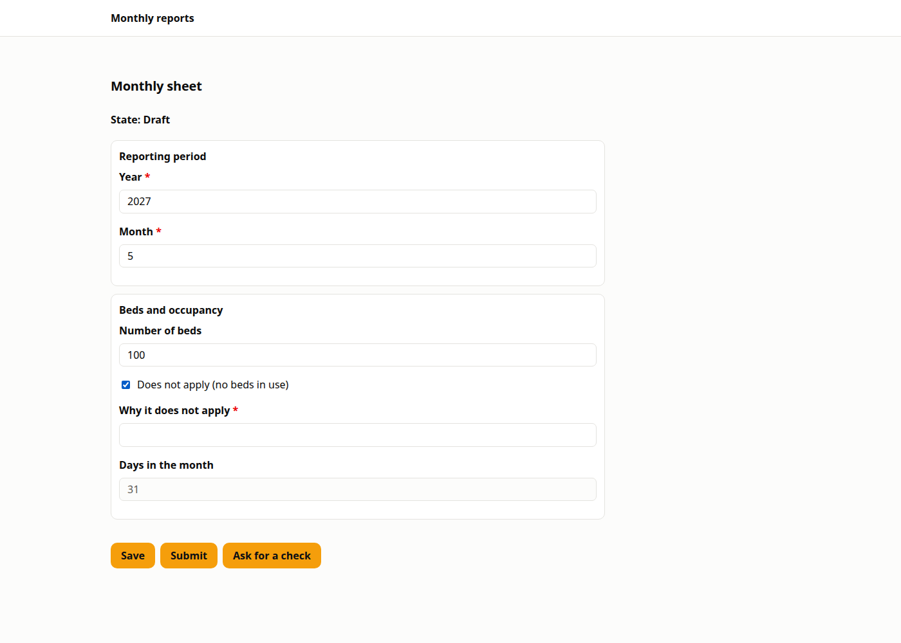
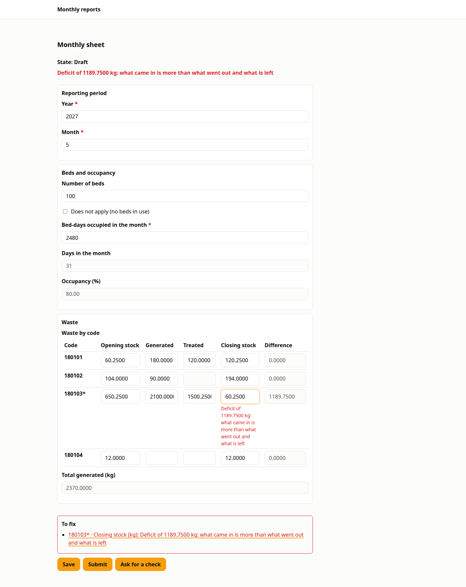
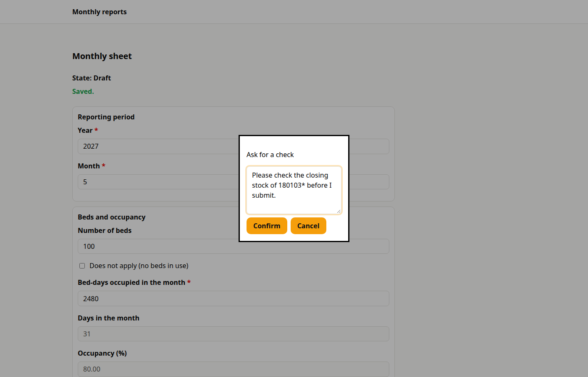
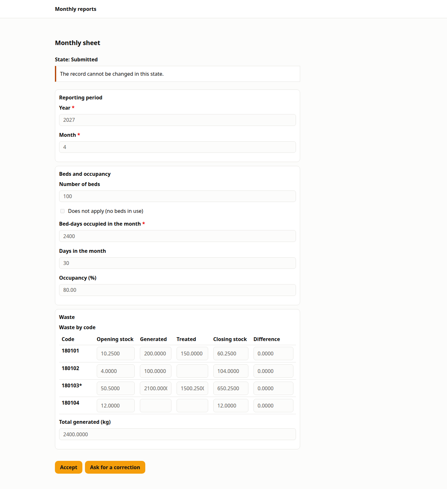
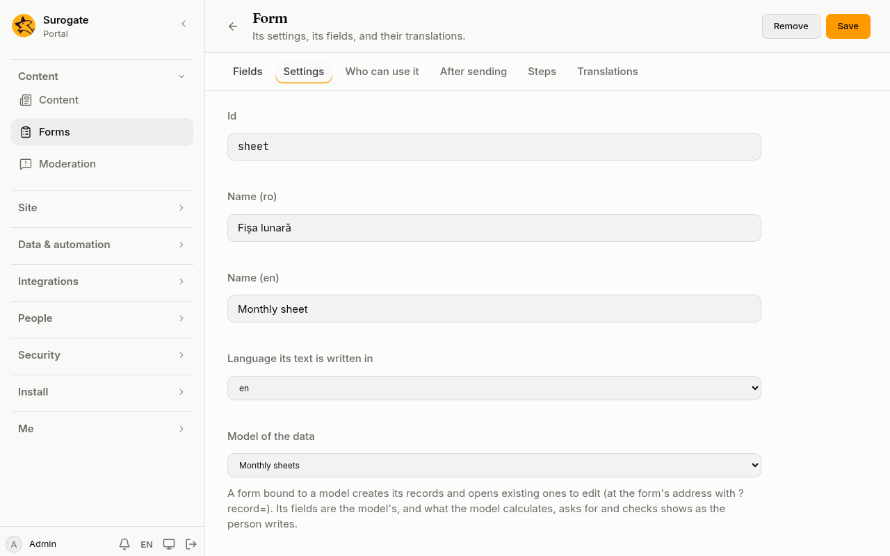
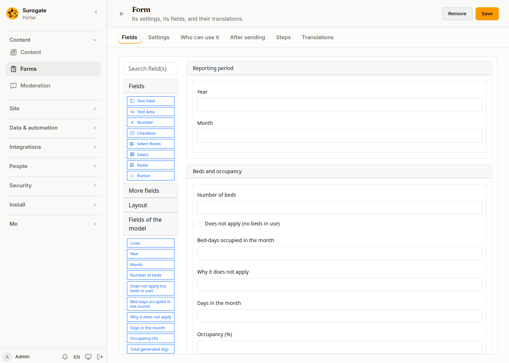
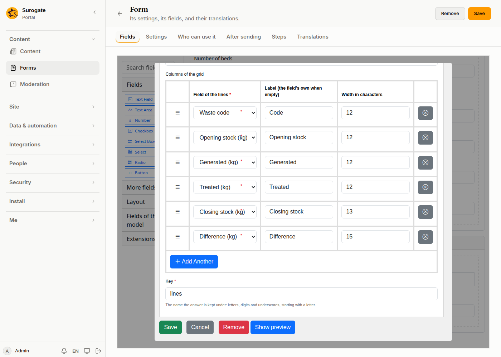
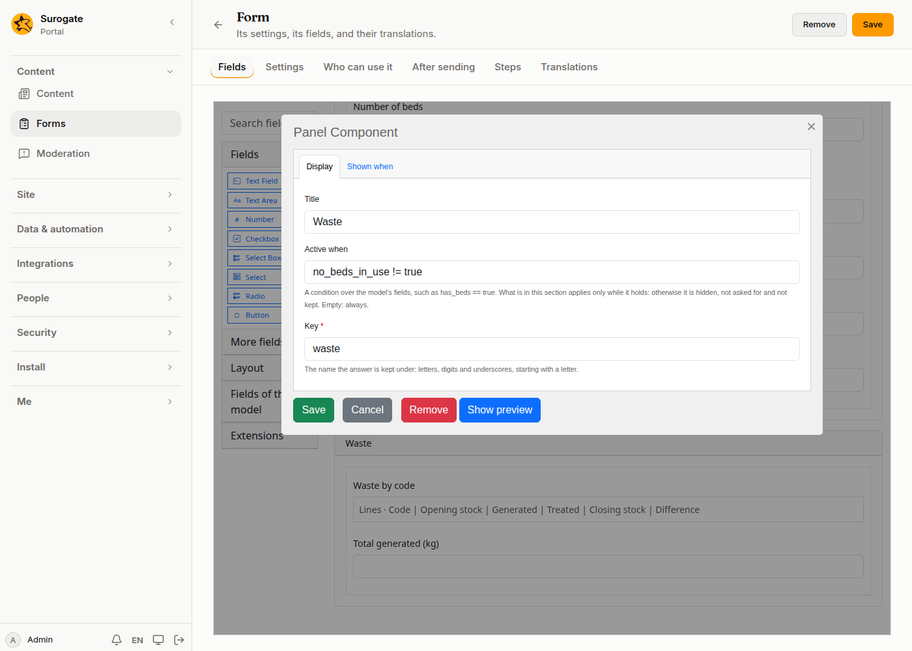
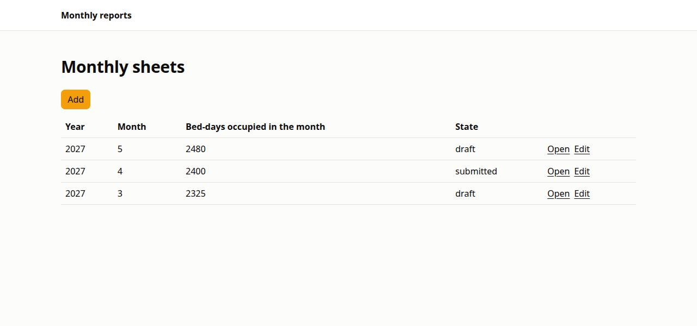
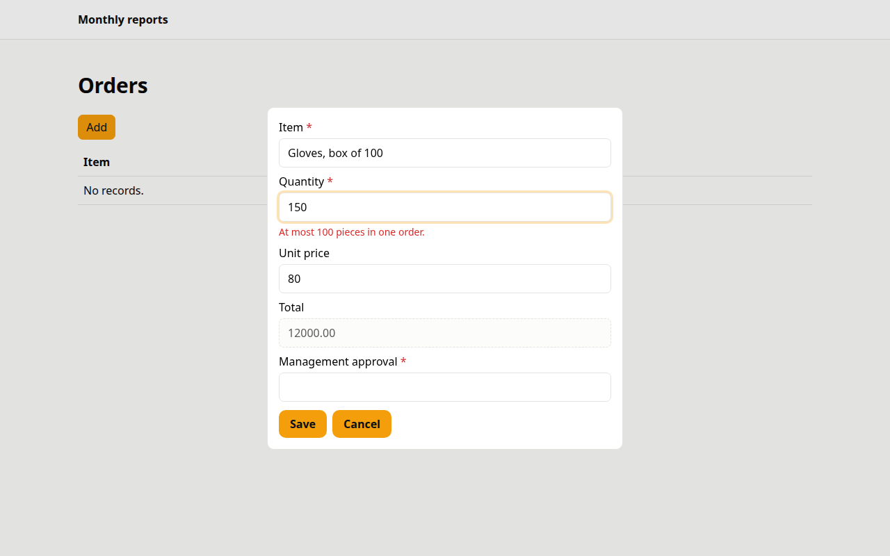

A form can be bound to a [data model](/portal/sites/data-models/). It then creates the model's records and opens existing ones to edit, in place of sending an answer to be read. What the model calculates, asks for and checks shows as the person types, and the portal checks it again when they save.

Use it for records that are filled in more than once, over a period, such as a monthly sheet: the figures the model calculates are shown but never typed, a field that does not apply is hidden, and a record can go through states such as draft, submitted and accepted.

## What people see

A person opens the form from a page, from a [listing](#open-a-record), or at its own address, `/_portal/forms/<id>`. For a new record it is empty except for what the portal fills in. For an existing record, add `?record=` and the record's id to the address.

- **Figures the model calculates** are grey and cannot be typed in. They change as the person types: here the days in the month, the occupancy, each row's difference and the total.
- **A field that does not apply** is hidden, or shown but off, as the model says. A value typed into it is cleared. The same goes for a whole section that carries a condition ([see below](#make-a-form-for-a-model)):

   In the grid, a cell can be off on one row and on in another: the treated cell of a waste code that is not treated is off.
- **A field that is asked for** has a star. It may be asked for at every save, or only when the record is submitted; the star is the same.
- **A field the person may not change** is grey, for them only. Another person may change it.
- **A message** shows under the field, or under the grid cell, once the person has touched it, and under all of them once they have tried to save. A form just opened does not fill up with errors.
- **A value taken from another record** shows when the form opens, and again when the fields that choose it change: the opening stock above is last month's closing stock, taken from the sheet of the month before. When there is no such record, the form says so and shows the value the model gives.

If something in the form changed on the portal while the person was typing, the portal's answer wins: it shows its values and its messages, and keeps what the person typed.

### Save, and move between states

**Save** keeps the record as it is, all of it or nothing: the header and every line of the grid are written together. Saving checks only what must hold at every save. What waits for the record to be submitted is listed as a warning.

When the model has [states](/portal/sites/data-models/), the form shows the state the record is in, and a button for each move the person may make from it, such as **Submit**:

A move saves what was written and moves the record in one go. If something does not hold, nothing moves. The form lists every problem, each with a link to its field or cell, and the record stays where it was.

A move that asks for a comment asks for it before it goes:

A record that can no longer be changed, because of its state or its [lock](/portal/sites/data-models/), opens for reading, with the reason above it and no **Save**:

## Make a form for a model

Administrators bind a form on [Forms](/portal/console/forms/#build-a-form). **New form** makes one, **Edit** opens one.

1. On **Settings**, choose the **Model of the data**. The form then creates that model's records.

   

2. On **Fields**, a group **Fields of the model** appears in the palette, with one entry for each field of the model, and **Lines** where the model has lines. Drag the fields onto the form, in panels, columns or tabs as for any form. A field keeps the model's name, and its label is the model's. Only fields of the model can be placed: the form is not saved with any other.

   

3. **Lines** draws the lines of the record as a grid. Click it to choose its columns: a row for each, with the **Field of the lines**, a **Label** (the field's own when empty) and a **Width in characters**. Drag a row to move the column. The model's link back to the record is no column.

   

   When the model's rows are fixed (one for each code of a list), the code column is read-only and rows cannot be added or removed. When they are free, the grid has **Add a row** and **Remove the row**, within the least and most the model allows.

4. **Who can use it** sets who may open the form. A person who may not send the form but may see or change the model's records may still open it, to read or to change a record.

5. **Show a section on a condition.** A panel, a fieldset, a well or a tab can say when it applies. In its settings, **Active when** takes a condition over the model's fields, such as `no_beds_in_use != true`: the section is shown only while it is true, and what is in it is not asked for and not kept while it is false. The field appears among the settings only for a form bound to a model.

   

   The condition belongs to the fields in the section, so it holds wherever they are written: in another form, in a listing's dialog, through the API. Two forms cannot put one field under different conditions, and a form that shows the field outside the section does not fit one that puts it under a condition (the condition would hide the field there): put the same condition on both. A model's own form follows the model as it is. A step of a step-by-step form cannot have a condition (put it on a section inside the step). A condition that cannot be worked out counts as false.

A form has one grid, and a form bound to a model is not filled in offline and keeps no drafts of its own: the record is saved as a draft record instead.

A bound form can go step by step: each panel at the top is a step, what was written on one step is kept on the next, and **Save** and the model's moves are the form's own buttons, below the steps, as for any bound form.

Each model also has a form of its own, `model-<id>`, made for it: every field of the model, calculated ones read-only, and the grid of its lines. It works as a form you bind yourself.

## Open a record

A [listing](/portal/sites/listings/) can name a form bound to its model. **Add** then opens the form, and **Open** and **Edit** open it on the record:

A listing without a form keeps its small dialog for **Add** and **Edit**. For a model that calculates, checks or has states, the dialog works as the form does:

## Who sees and does what

- A person signed in saves with the form's own buttons, and the record is written as they are. A visitor, where the form is open to everyone, sends it as any form is sent, with the rows written in the grid; the record is made by the form's **Create a record** action, with the same checks, and the visitor does not see the record again. A model's own form makes the record and carries the rows. A form open to everyone that is bound to a model must have that action, or the portal refuses it.
- What a person may change in a record, field by field, comes from the model: its permissions, the rights set on a field, the state the record is in and its lock.
- The portal checks everything again when the record is saved, however it is sent: the form, a listing's dialog, the API or an action. The form is the first look, not the check.
- What the portal calculates is never sent by the form; a value taken from another record is sent only when the person wrote it themselves.

Developers: see [Developer: Forms](/portal/developer/forms/#a-form-bound-to-a-model).
