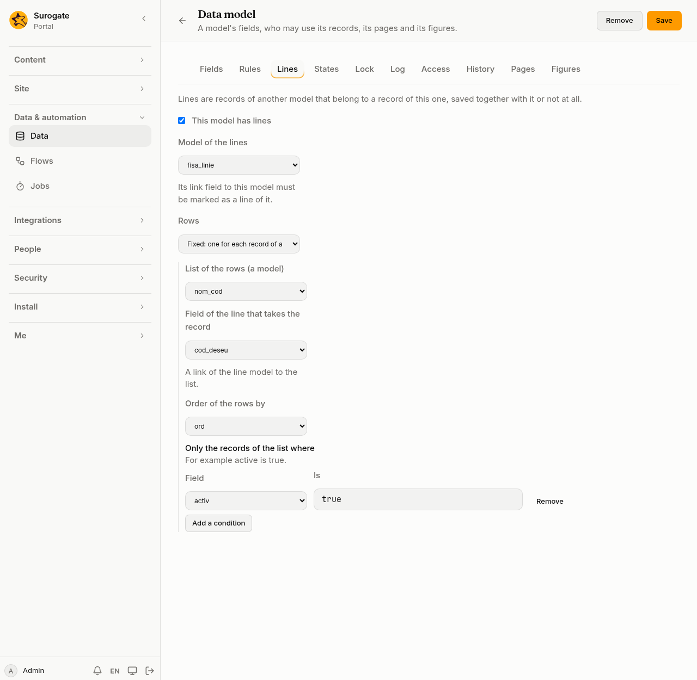
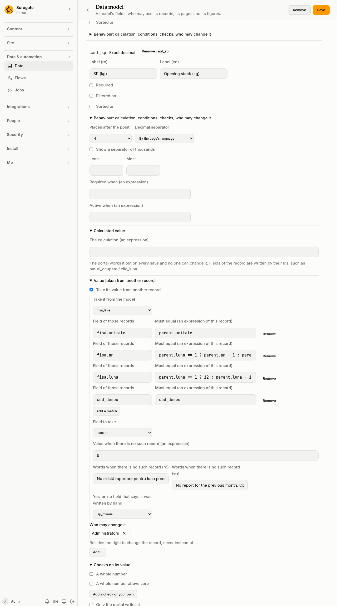
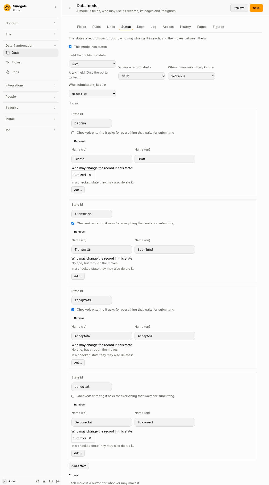
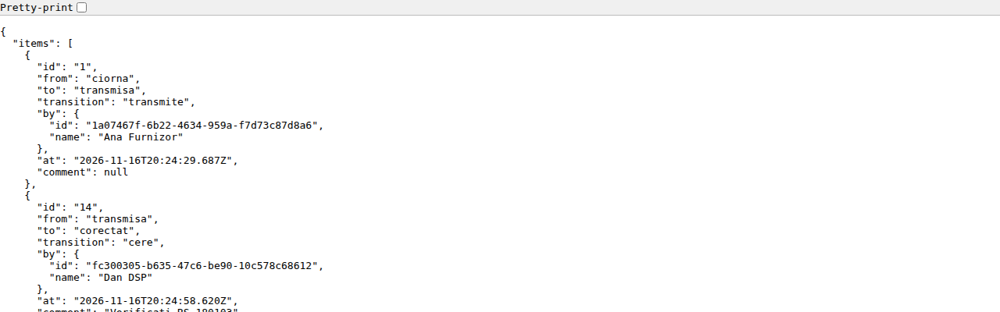
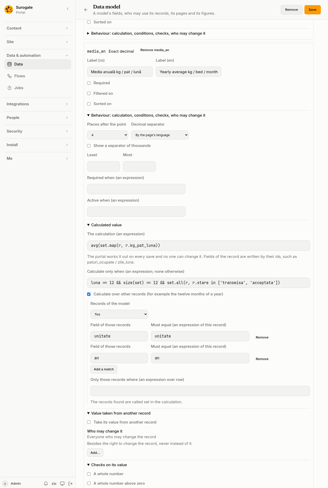
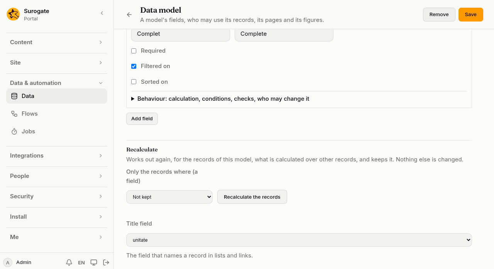

This page continues [Calculated fields and checks](/portal/sites/model-logic/). It covers records made of a header and lines, values taken from other records, the states a record goes through, and figures worked out over many records. Everything is set in the model editor, in **Data**.

## Lines

A report with one row for each kind of waste is a record with **lines**. The header is one model, the lines another, and the lines belong to the header: a line does not exist without it, deleting the header deletes its lines, and a line has the rights and the lock of its header.

To set it up:

1. In the model of the lines, on the field that links to the header, tick **The records of this model are lines of the model it links to**.
2. In the model of the header, open the **Lines** tab, tick **This model has lines**, and choose the model of the lines.
3. Choose how the rows come about:
   - **Fixed**: one line for each record of a list, such as the active waste codes, in the order the list says. The portal makes the lines when the header is made. People can neither add nor remove them, and cannot change a line's code. A code switched off later is not added to new records, and the records that already have it keep it.
   - **Free**: people add and remove the rows, with an optional least and most.



A header's calculations can read its lines (`sum(lines.map(l, l.cant_g))`) and a line's calculations and rules can read their header (`parent.luna`). Writing one line works out the header again in the same go. The header and all its lines are saved together or not at all: when one line is refused, nothing is written, and each problem names the line and the field.

Over the API, a header is sent with its lines in one call. See [Developer: Data models](/portal/developer/data-models/#logic-in-a-models-file).

## A value taken from another record

A field can take its value from another record when the record is opened or saved: an opening stock from last month's closing stock, a name from the first report of the year. Tick **Take its value from another record** in the field's **Behaviour** and set:

- **Take it from the model**, and how it matches: pairs of a field of that model and an expression of this record that it must equal, such as `fisa.luna` equal to the month before.
- the **field to take**, or an expression over `source`;
- the **value and words when there is no such record**, which a form shows, such as "No report for the previous month. Opening stock = 0";
- the **states** in which it follows its source. Left empty, it follows until the record is checked;
- a yes-or-no field that says the value was **written by hand**.



A value taken from another record cannot be changed by the people who write the record. A person named in **Who may change it** can write over it: the value they wrote is kept, the flag says so, and later changes to last month no longer replace it. Writing the value taken again puts the field back to following its source. Once a record is checked, its value no longer follows: last month's change leaves it as it was.

## States and moves

A record can go through **states**: a draft, submitted, accepted, to be corrected. They are set on the **States** tab.



- **Field that holds the state**: a text field. Only the portal writes it, and every record starts in the **initial state**. Optional fields keep **when it was submitted** and **who submitted it** each time the record enters a checked state.
- Each state has a name in each language, **who may change the record in this state** and whether it is **checked**. Where no one is named, no one changes the record, but through the moves. In a checked state only the people named may delete it.
- Each **move** is a button for whoever may make it: where it goes, the states it leaves, **who may make it**, an optional condition and whether it **asks for a comment**.

Entering a checked state is submitting. The portal then applies every check that was set to count when the record is submitted, and the required fields of that kind. When one fails, the move is refused with the whole list of problems, and the record stays where it was. A draft that lacks them can still be saved.

A move can be made together with changes: **Submit** saves the values and moves the record in one go, or neither. The state cannot be written any other way. The lock counts for moves too: after it holds, only the people it lets through can move a record.

Every move is kept in a **log**: who made it, when, from which state to which, and the comment. Where the model also keeps the history of its records, each of these writes makes a version (a header's with its lines), a delete archives the record and its lines, and the version a move into a checked state makes is sealed, so it can no longer change.



Moves can be made from a form's, a flow's or a job's action list with the action **Change the state of a record**, with the rights of the person it runs as. Developers: see [Developer: Data models](/portal/developer/data-models/#logic-in-a-models-file).

## Figures over many records

A calculated field can be worked out over other records: the twelve months of a year, the reports of a unit. In **Calculated value**, tick **Calculate over other records**, choose the model and how its records match this one (the same unit and the same year), and write the calculation over `set`, the records found:

```text
avg(set.map(r, r.kg_pat_luna))
```

with **Calculate only when** holding what must be true first, for example that all twelve months are there and submitted. Until it is, the field is empty. A lookup in a list of thresholds uses `records.list(…)` and `between(…)`, so the thresholds are written once, in their own model, and every model that needs them reads them from there.



Such a field is worked out again, by the portal, whenever one of the records it reads is written, deleted, or moves to another state: when a month goes back to be corrected, the yearly figure is emptied, and it returns when the month is submitted again. The portal writes these fields even on records that are checked or locked.

Changing a list of thresholds changes no figure by itself. **Recalculate** in the model editor works all of them out again, for every record or for those with one value in a field.



The action **Recalculate records** does the same from an action list, so a [scheduled job](/portal/sites/jobs/) can do it every night.
