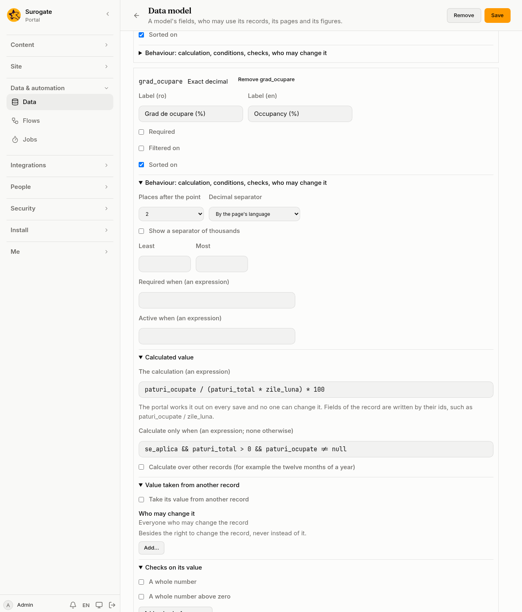
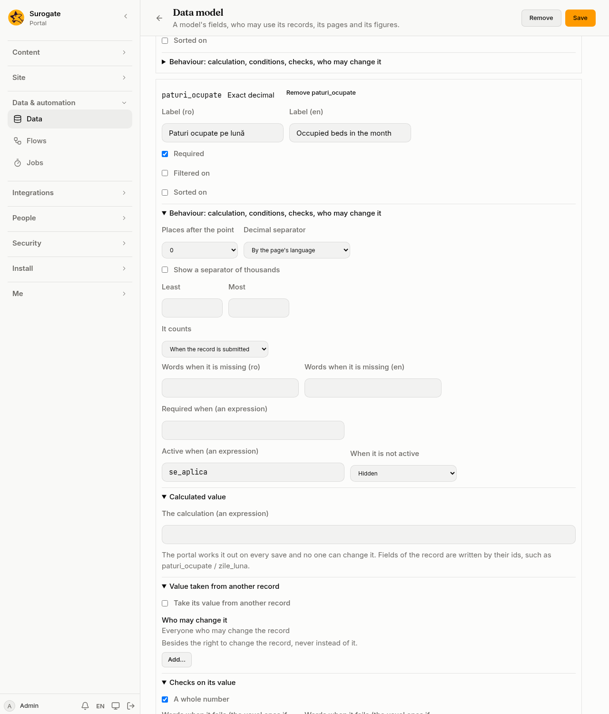
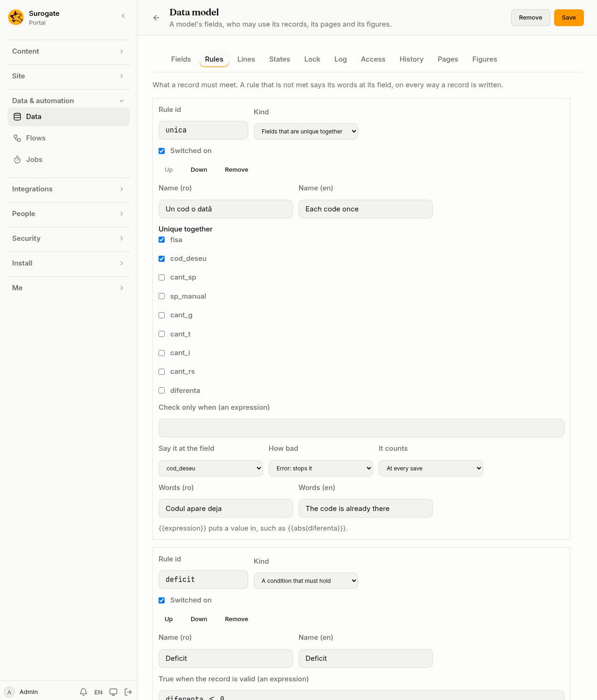
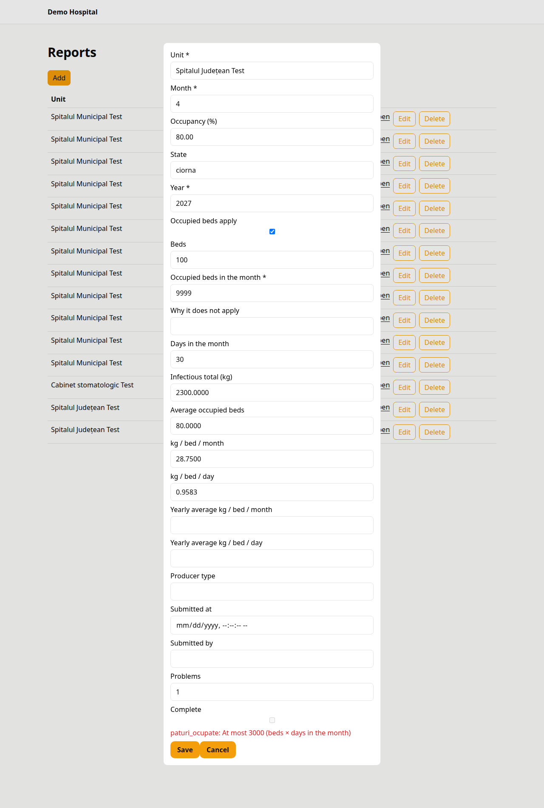
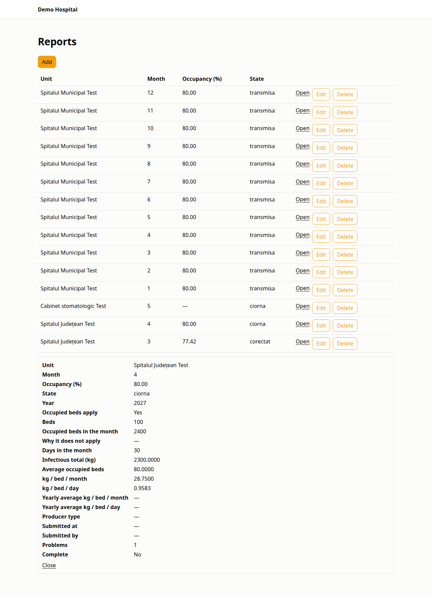
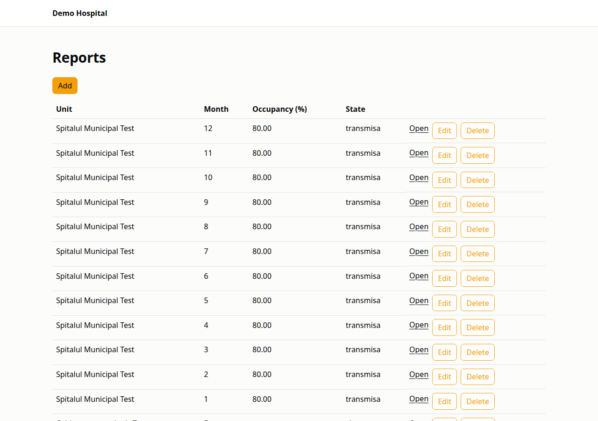
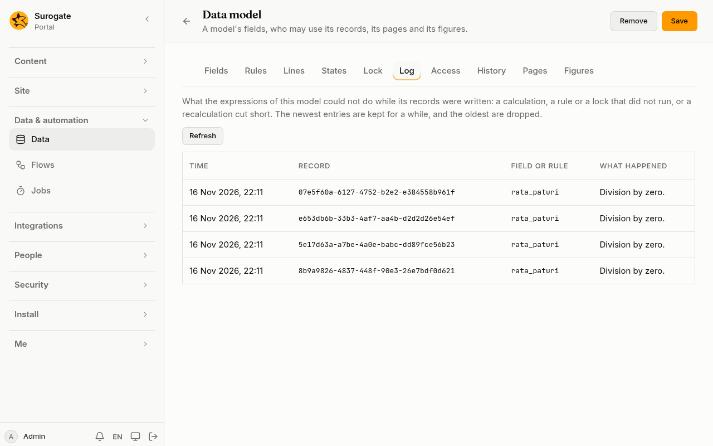
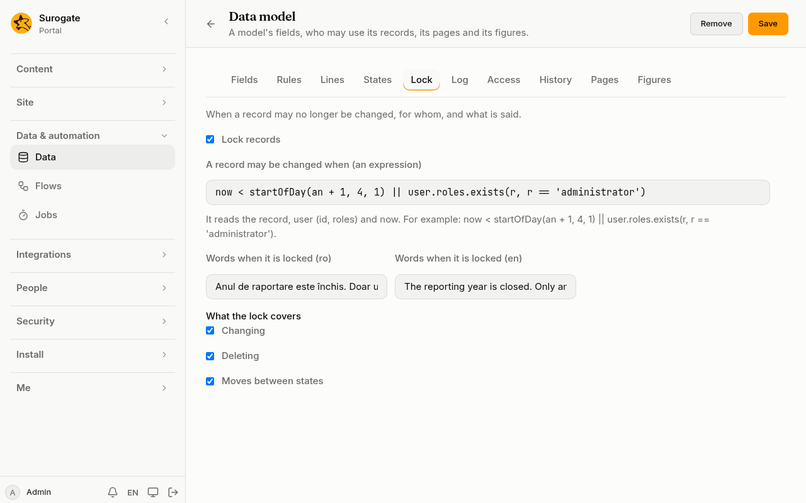

A [data model](/portal/sites/data-models/) can do more than hold values. It can calculate some of them, ask for others only when they apply, check them against each other, say who may change a field, and stop changing a record after a date. All of it is set in the model editor, in **Data**, with no code and no file to write. The portal applies it on every way a record is written: a form, the list's **Add** and **Edit** dialogs, the API, GraphQL, and the actions of forms, flows and jobs. A record that breaks a rule is refused the same way on each of them.

## Exact decimal numbers

**Exact decimal** is a field type for quantities that must add up. It is stored exactly, so 0.1 + 0.2 is 0.3 and a balance of kilograms never drifts. In the field's **Behaviour** area you choose:

- **Places after the point**, from 0 to 6. A value with more places is refused, never rounded.
- **Decimal separator**: the point, the comma, or the page's language.
- **Show a separator of thousands**.
- **Least** and **Most**.

Lists and the detail of a record write the number as the field says: with a point, with a comma, or, by default, as the page's language does (a comma on a Romanian page), with a separator of thousands if you ticked it. Only a point is read as the decimal separator when a number is typed. A pasted `12,5` is refused instead of guessed at, because `1,234` could be a thousand or one and a bit.

A number sent from a program as a number, with more than fifteen digits, is refused: a program rounds such a number before it arrives. Send it as text, such as `"0.1234567890123456"`, and it is kept exactly.

The older **Number** and **Amount** types stay as they are.

## The behaviour area of a field

Each field on the **Fields** tab has a **Behaviour** section that opens. It holds, from top to bottom: the options of a decimal, when the field is required, when it is active, its calculation, a value taken from another record, who may change it, and its checks.



### A value the portal calculates

Write the calculation as an expression. The fields of the record are written by their ids:

```text
paturi_ocupate / (paturi_total * zile_luna) * 100
```

The portal works the value out on every save, rounds it to the field's places (half away from zero) and keeps it. No one can change it by hand: a value sent for it is refused with a message that names the field, unless it is the value the portal would calculate anyway, which a form may send back.

**Calculate only when** is a condition. When it is false the value is empty. A value that cannot be worked out, such as a division by zero, is empty too, and nothing is refused. A calculation that reads a field with no value gives an empty value, unless it says what to use instead, with `coalesce(sp, 0)`.

A calculation may read the fields of the records its links point at, one level down (`cod_deseu.permite_tratare`), the lines of a record, the header of a line, and the person who writes. The model editor checks every expression when you save, and says at the field that has it when a name does not exist or when calculated fields read each other in a circle.

### A field that applies only sometimes

- **Active when** is a condition. A field that is not active is hidden, or shown and switched off, as you choose. It has no value: what was there is emptied when the record is saved, and a value sent for it is refused.
- **Required when** makes a field required only when its condition holds.
- **Required**, on the field, can count **at every save** or **when the record is submitted**. A record kept as a draft can lack the second kind.



### Checks on a value

Under **Checks on its value** tick what the value must be: a whole number, a whole number above zero, an email address, a date. Each has usual words in both languages, which you can replace. **Add a check of your own** takes an expression that is true when the value is valid, its words in both languages, whether a failure is an error or only a warning, and when it counts. An empty value is never a format error: only **Required** deals with empty.

### Who may change a field

**Who may change it** names people, groups or organizations. It narrows the model's right to change a record and never widens it: someone who may not change the record may not change any of its fields. A request that sends the value a field already has changes nothing and is accepted.

## Rules between fields

The **Rules** tab holds what a record must meet. Each rule has:

- a name in each language, and an id;
- either **a condition that must hold** (an expression that is true when the record is valid), or **fields that are unique together**;
- **Check only when**, an optional condition;
- the **field its words are said at**;
- **Words** in each language. `{{expression}}` puts a value in: `Deficit of {{diferenta}} kg`;
- **How bad**: an error stops the save, a warning is only said;
- **It counts**: at every save, or when the record is submitted;
- **Switched on**, so a rule can be paused without being deleted.



A rule that cannot be worked out counts as not met, and says "The rule … could not be evaluated". A rule whose field is not active is not checked.

**Unique together** keeps one record for a combination of values, such as one report per unit, year and month. It holds even when two people save at the same moment: one is accepted and the other is told.

### What is kept of the checks

Under **What is kept of the checks**, name a number field to hold how many checks failed, and a yes-or-no field to hold whether the record is complete: no error that waits for submitting remains. The portal writes both at every save, so lists and reports can show which records are incomplete.

A save is refused for an error that counts at every save. The rest are shown, kept in the count, and checked again when the record is submitted (see [States](/portal/sites/model-lines-states/#states-and-moves)).

## What people see

A person who breaks a rule sees its words at once, in their language, with every problem and not only the first:



The calculated fields show on each record, read-only, in the dialog and on the detail:





## The log of a model

When an expression cannot be worked out, the person saving sees no error: the field stays empty, or the check says it could not be evaluated. The reason is kept in the **Log** tab of the model, for administrators. It lists, newest first, the time, the record, the field or the rule, the line when it was a line, and what happened: a division by zero, a lock that could not be worked out, a recalculation that was cut short. A record that was being made is named once it exists.



A form asking what a save would do writes nothing to the log. The log keeps the newest entries of the portal, and none older than thirty days. The Log tab is not there for a model that is not saved yet.

## A lock on records

The **Lock** tab says when a record may no longer be changed, and for whom. **A record may be changed when** is a condition over the record, the person (`user`) and the time (`now`):

```text
now < startOfDay(an + 1, 4, 1) || user.roles.exists(r, r == 'administrator')
```

reads: until the end of 31 March of the year after, and always for administrators. Times are the portal's own, Bucharest time. The lock says what it covers (changing, deleting, moves between states) and the words shown when it holds a record. A locked record can still be read, and a change that would move a record out of its lock, such as changing its year, is refused too.



## The language of expressions

Expressions are the same everywhere in the portal's logic, and are checked as you write them.

| What | How it reads |
|---|---|
| A field of the record | its id: `paturi_total`, or `record.paturi_total` |
| A field of a linked record | `cod_deseu.permite_tratare` |
| The record before this save | `previous.an`, empty for a new record |
| The person | `user.id`, `user.roles`, `user.attributes` |
| The time | `now`; `startOfDay(2028, 4, 1)` is when that day begins |
| Empty | `null`; `x == null`; `coalesce(x, 0)` is `x`, or 0 when it is empty |
| Numbers | exact; division is exact too, so use `floor(x / 3)` for a whole division |
| Rounding | `round(x, 2)` rounds half away from zero; `floor`, `ceil`, `trunc`, `abs` |
| Days | `daysInMonth(2028, 2)` is 29; `daysInYear(2028)` is 366 |
| Lists | `sum`, `avg`, `min`, `max`, `count`, `first`; empty values are left out |
| Other records | `records.one("model", {"field": value})`, `records.list(…)`, `records.count(…)`; an empty value finds none, and a list of more than 5,000 records cannot be taken in one calculation |
| Intervals | `between(x, least, leastIncluded, most, mostIncluded)`; a missing end is open |

Text, lists and conditions use the usual `&&`, `||`, `!`, `in`, `exists`, `filter` and `map`.
