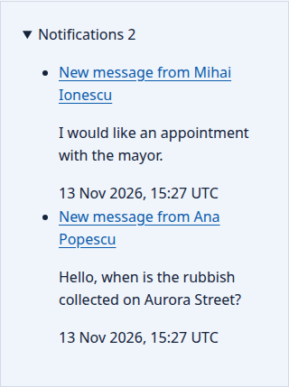
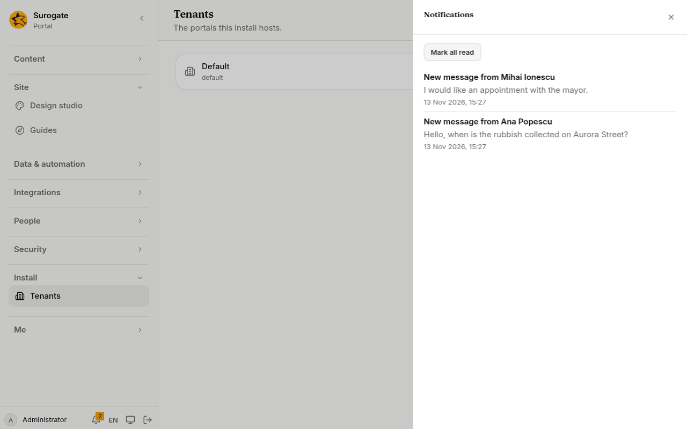
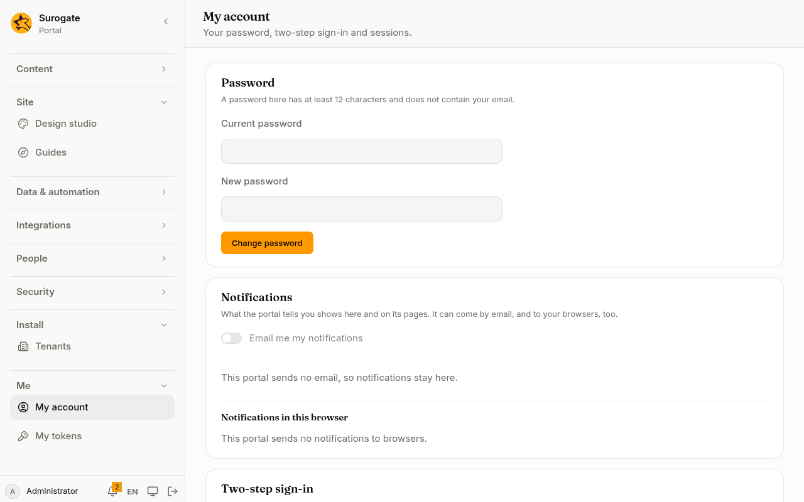

A notification tells one person something: a title, a few words, and a page of the portal it leads to. A form or a job sends it, for example to tell the clerks that someone wrote to the city hall. A notification is kept for 90 days; each person keeps their newest 500.

## Where people find them

**On the site.** A page can show a person's notifications. The heading counts the ones they have not read; opening one marks it read and goes to its page. It shows the newest 5, or another number from 1 to 20 when **Notifications shown** says so.

Only people signed in see theirs. Visitors see nothing, and neither does an administrator seeing the portal as someone else. A page with the widget is made for each person and never kept in a cache.

On [Pages](/portal/console/pages/#the-portals-widgets), add **Notifications** with **Add a widget…**, then set **Notifications shown** in its row. Developers: see [Developer: Notifications](/portal/developer/notifications/#the-widget-on-a-page).

**In the console.** The bell at the bottom of the menu shows how many are unread. Press it to read them, open one, or **Mark all read**.

**By email and in the browser.** On [My account](/portal/console/account/#notifications), everyone chooses whether their notifications also come by email, and turns on notifications in the browser they use.

- **By email.** It is off until the person turns it on. The email has the notification's title as its subject, and its words and link. It goes only when the install sends email, and within the portal's hourly allowance of email; when it sends none, the switch is off and says so, as above.
- **[In the browser](/portal/console/account/#notifications-in-this-browser).** Each notification also appears on that device as the browser's own notification, with its title and words; clicking it opens the notification's page and marks it read. It goes only when the install sends notifications to browsers, through the browsers' own push services.

## Send one

A [form](/portal/sites/forms/) or a [job](/portal/sites/jobs/) sends a notification. It says whom it goes to, a title of up to 200 characters, and a page of the portal to open. It may also have some words, up to 2,000 characters. The link is a page of the portal, such as a request's page: a link to another site is refused when the site is checked, and left off when the notification is made as the run goes. Like an email a form sends, a notification goes out once the run ends well: a run that fails tells no one.

The console has no screen for this yet. For now, this is set in the site's configuration: see [Developer: Notifications](/portal/developer/notifications/#a-forms-message-to-the-clerks).

Whom it goes to: people of the portal, by their id or their email, and groups. Names that are no one of the portal's (another portal's people, service accounts, people disabled, unknown emails) are passed by, saying nothing. A notification reaches at most 100 people; past that, the rest are left out.

A run sends at most 5 notifications; a run for a visitor, such as a public form sent by someone not signed in, at most 2. Visitors' runs share an allowance of 200 notifications an hour, one form or job sends at most 1,000 an hour, and a portal at most 5,000. An endpoint sends no notifications.

A job can also ask an [agent](/portal/sites/actions/#ask-an-agent) and send its answer to the people concerned.
