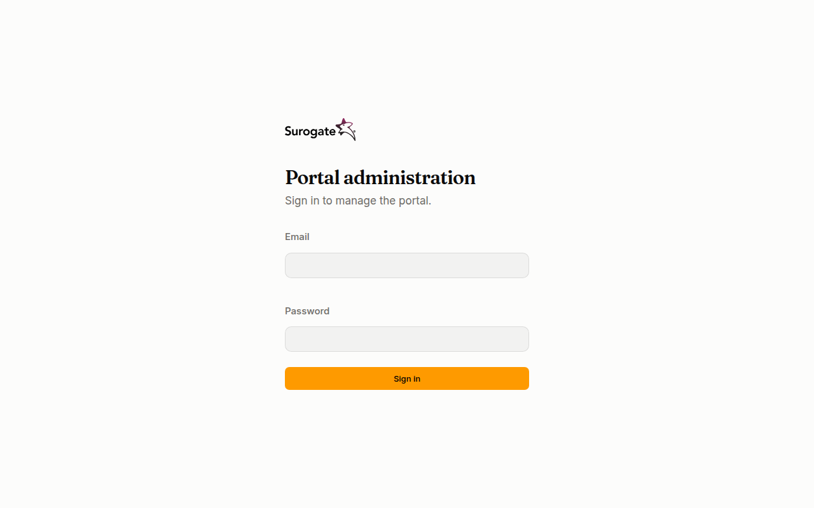
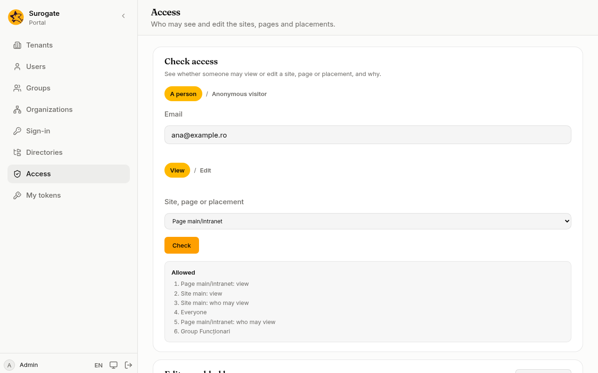

Each site, page and placement (an [app](/portal/sites/apps/) placed on a page) can say who may see it. You write it in the site's files, next to the page itself, so the change is reviewed and published like any other change to the site.

## What people see

A visitor who opens a page meant for people signed in goes to the sign-in page, and comes back to the page after signing in:



Someone signed in who may not see the page reads **You do not have access to this page.** A part of a page that someone may not see is simply left out: they get the page without it.

Administrators check who may see what, and why, on the console's [Access](/portal/console/access/) page:



## Restrict a page

Add `permissions` to the page's file (see the [config example](#a-page-for-a-group)). Only members of the group **Funcționari** see that page. Everyone else:

- if they have not signed in, goes to the sign-in page, and back to the page afterwards;
- if they have signed in, sees **You do not have access to this page.**

## Who you can name

| Write | Means |
|---|---|
| `everyone` | anyone, signed in or not |
| `signed-in` | anyone who has signed in to this portal |
| `user:ana@example.ro` | one person, by email |
| `group:Funcționari` | the members of a [group](/portal/console/groups/) |
| `organization:Primăria/Direcția IT` | the members of an [organization](/portal/console/organizations/) and of every organization below it, named from the top, joined by `/` |
| `role:administrator` | the portal's administrators |

Put several in the list to let any of them in: `view: [group:Funcționari, organization:Primăria/Direcția IT]`.

A group or organization is named as it is in the console. If you rename it there, change the files too: a name that matches nothing lets nobody in.

## Sites, pages and parts of a page

- A **site**'s `permissions` apply to all its pages. Write them in `site.yaml`.
- A **page** can only narrow what its site allows. On a site for signed-in people, a page with `view: [everyone]` is still for signed-in people.
- A **placement** can only narrow its page. People who may not see it get the page without it (see the [config example](#a-part-of-a-page)).

With no `permissions`, everyone may see the site, the page or the placement. `view: []` lets in only editors and administrators.

## Editors

`edit` names who may edit a site or a page (see the [config example](#editors-and-bloggers)). Editors and administrators always see what they edit. `everyone` and `signed-in` cannot be editors. Administrators can also add editors on the console's [Access](/portal/console/access/) page, which also checks who may see what, and why.

## Bloggers

`blog` names who may write [blog posts](/portal/sites/blogs/) on a site or a library, their own only. Bloggers write posts of the blog types alone, and never change anyone else's posts or any other content; editors and administrators may blog too. `everyone` and `signed-in` cannot be bloggers. Bloggers are named in the files only: the Access page adds editors, not bloggers.

## Config example

### A page for a group

In the page's file (`sites/<site>/pages/<page>.yaml`):

```yaml
path: /intranet
title: { ro: Intranet, en: Intranet }
layout: one-column
permissions:
  view: [group:Funcționari]
regions:
  main:
    - { id: news, app: content }
```

- `permissions.view`: who may see the page; see [Who you can name](#who-you-can-name).

### A part of a page

In a placement of the same file:

```yaml
regions:
  main:
    - { id: list, app: content }
    - id: internal-notes
      app: content
      permissions:
        view: [group:Funcționari]
```

- The placement `internal-notes` shows only to members of the group; everyone else gets the page without it.

### Editors and bloggers

In `site.yaml`, in a page's file, or in a library's file:

```yaml
permissions:
  view: [signed-in]
  edit: [group:Redactori]
  blog: [group:Angajati]
```

- `view`: who may see it.
- `edit`: who may edit it.
- `blog`: who may write their own blog posts on a site or a library.
