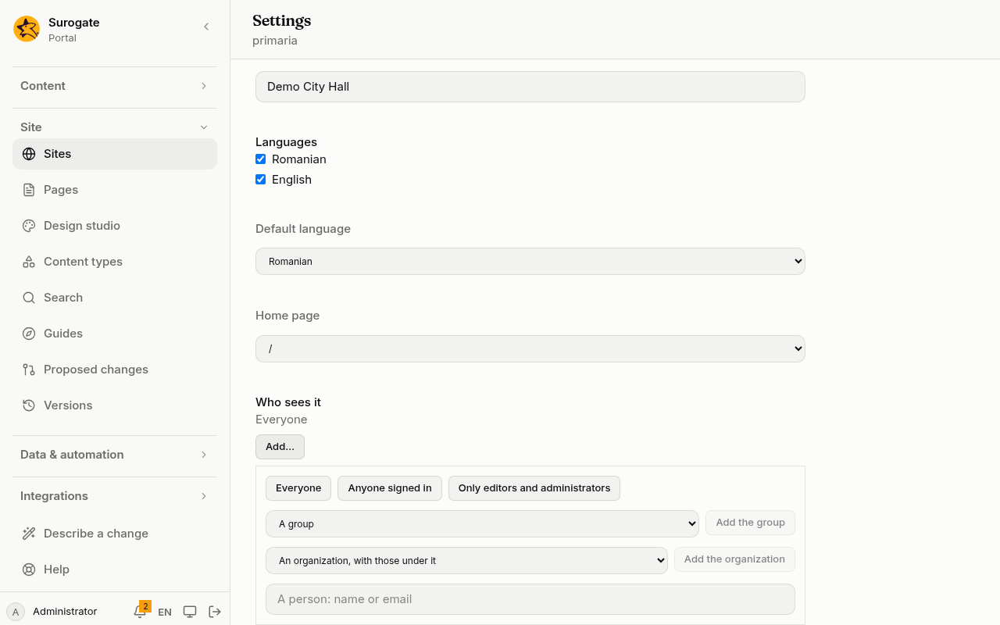

Each site, page and block of a page (such as an [app](/portal/sites/apps/) placed on it) can say who may see it. A site or a page also says who may edit it. You choose in the console. What you choose is part of the site, so a change to it goes live like any other change to the site.

## What people see

A visitor who opens a page meant for people signed in goes to the sign-in page, and comes back to the page after signing in:

Someone signed in who may not see the page reads **You do not have access to this page.** A part of a page that someone may not see is simply left out: they get the page without it.

Administrators check who may see what, and why, on the console's [Access](/portal/console/access/) page:

## Choose who

Wherever the console asks who may see or edit something, it shows the same picker. It lists the ones chosen by name, such as **Staff**, **Primăria / Urbanism**, **Ana Pop (ana@a.ro)**, **Administrators** or **Anyone signed in**. Each has a **Remove** button. When no one is chosen, the list shows the default in grey.

Press **Add…** to choose more:

- **Everyone**, **Anyone signed in** and **Only editors and administrators** are buttons. **Everyone** is offered for a site alone: a page, a block or a form can only narrow who may see or send. **Only editors and administrators** is offered where you choose who sees.
- **A group**: choose one of the portal's [groups](/portal/console/groups/), then press **Add the group**.
- **An organization, with those under it**: choose one of the portal's [organizations](/portal/console/organizations/), then press **Add the organization**. Everyone in it and in every organization below it is included.
- **A person: name or email**: type to search, then press **Add** with their name and email, such as **Add Ana Pop (ana@primarie.ro)**.

The picker is in four places:

- A site's settings: **Who sees it**, **Who edits it** and **Who writes blog posts**. See [Sites](/portal/console/sites/#change-a-sites-settings).
- A page's **Settings** tab: **Who sees this page** and **Who edits this page**. See [Pages](/portal/console/pages/#who-sees-and-who-edits).
- A block's row in the page editor: **Who sees this block**.
- A form's **Who can use it** tab: **Who may send it** and **Who reads what was sent**. See [Forms](/portal/sites/forms/#who-sends-it-and-who-reads-what-was-sent).

### Several choices

Name several to let any of them in.

- **Everyone** replaces the list.
- Adding a narrower choice, such as a group, removes **Everyone** and **Anyone signed in**.
- Adding **Anyone signed in** replaces the groups and people already chosen, since it already lets them in.

### Nothing chosen, and the last one removed

With nothing chosen, the picker shows the default in grey, and the default applies. A site is for everyone. A page is for whoever sees its site. A block is for whoever sees its page.

In a list of who sees, removing the last one chosen does not return to the default. It leaves **Only editors and administrators**, so emptying a list never lets in more people. To return to the default on purpose, press **Back to the default**, which says what the default is, such as **Back to the default: Everyone**.

### A group or organization that is gone

A group or organization that no longer exists shows **(no such group)** or **(no such organization)**. It matches nobody. Remove it, and add the one you mean.

A group or organization is named as it is in the console. If you rename it there, the choice made before stops matching: remove it from the picker and add it again under its new name. A name that matches nothing lets nobody in.

A person is chosen by name, and kept in the site's files by their email. Developers: see [Developer: Who sees a page](/portal/developer/permissions/#who-you-can-name).

## Restrict a page

A page can be limited to a group, such as the group **Funcționari**. Only its members see that page. Everyone else:

- if they have not signed in, goes to the sign-in page, and back to the page afterwards;
- if they have signed in, sees **You do not have access to this page.**

To limit a page:

1. Open **Pages**, then **Edit** the page.
2. Open its **Settings** tab.
3. Under **Who sees this page**, press **Add…**, choose the group under **A group**, and press **Add the group**.
4. Press **Save**.

Developers: see [Developer: Who sees a page](/portal/developer/permissions/#a-page-for-a-group).

## Who you can name

A site, a page or a block can name:

- **Everyone**, signed in or not (a site alone);
- **Anyone signed in** to this portal;
- one person, by name or email;
- the members of a [group](/portal/console/groups/);
- the members of an [organization](/portal/console/organizations/) and of every organization below it;
- the portal's **Administrators**, when the site's files name them.

Name several to let any of them in.

## Sites, pages and parts of a page

- A **site**'s limits apply to all its pages. Set them in the site's settings, under **Who sees it**.
- A **page** can only narrow what its site allows. On a site for signed-in people, a page open to everyone is still for signed-in people. Set it under **Who sees this page**.
- A **block** can only narrow its page, or the group it is in. People who may not see it get the page without it. Set it under **Who sees this block**, in the block's row.

With no limit set, everyone may see the site; a page is for whoever sees its site, and a block for whoever sees its page. A list of who sees that names no one is **Only editors and administrators**: it lets in only editors and administrators.

For an **Assistant** widget, **Who sees this block** is who may chat with the agent. See [Assistants](/portal/sites/assistants/#connect-your-agents).

Developers: see [Developer: Who sees a page](/portal/developer/permissions/#sites-pages-and-parts-of-a-page).

## Editors

A site or a page names who may edit it. Editors and administrators always see what they edit. Everyone, and anyone signed in, cannot be editors.

- **Who edits it**, in the site's settings. By default **Administrators only**. It says: "In addition to administrators and people added on Access."
- **Who edits this page**, on the page's **Settings** tab. By default **The site's editors**. It says: "In addition to the site's editors."

Administrators can also add editors on the console's [Access](/portal/console/access/) page, which also checks who may see what, and why. Developers: see [Developer: Who sees a page](/portal/developer/permissions/#editors-and-bloggers).

## Bloggers

A site or a library names who may write [blog posts](/portal/sites/blogs/), their own only. Bloggers write posts of the blog types alone, and never change anyone else's posts or any other content; editors and administrators may blog too. Everyone, and anyone signed in, cannot be bloggers.

Choose a site's bloggers under **Who writes blog posts**, in the site's settings. By default it is **The site's editors**. The console's Access page adds editors, not bloggers.

A library's bloggers are not set in the console yet. For now, this is set in the site's configuration: see [Developer: Who sees a page](/portal/developer/permissions/#editors-and-bloggers).
