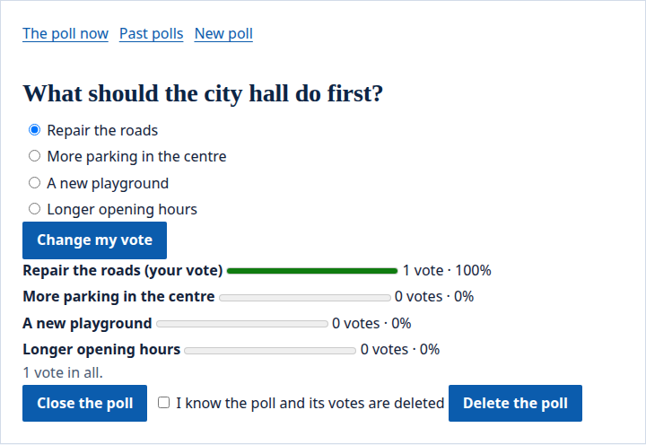
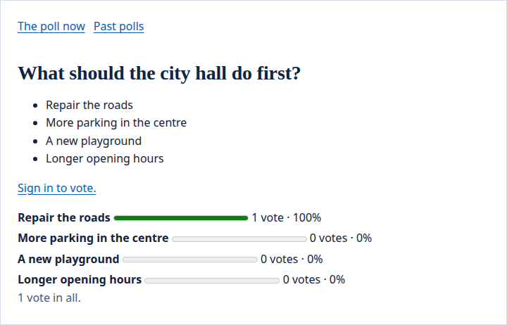
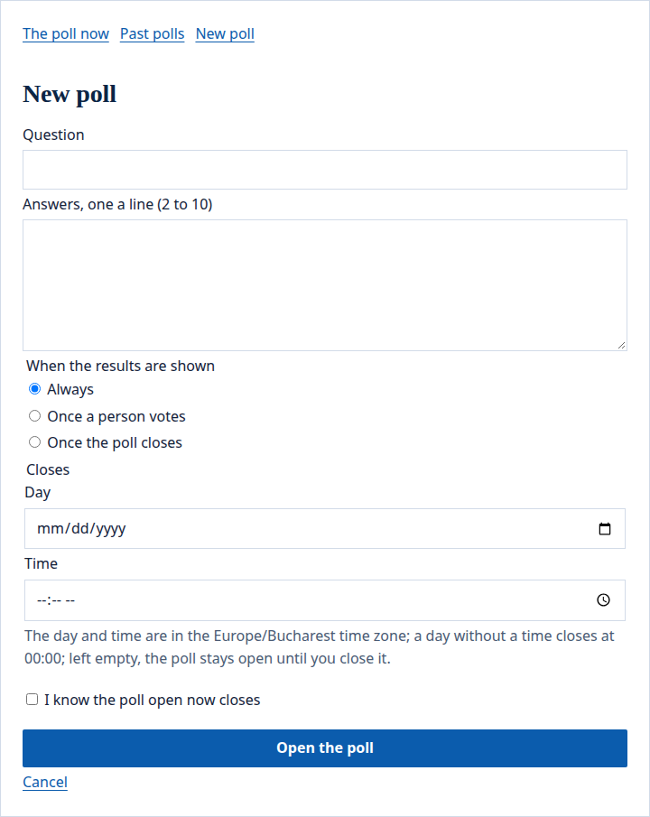

The portal's `poll` widget asks a question with two to ten answers. People signed in vote once each, and the results are shown as the poll says.

## What people see

A person signed in who may see the page chooses an answer and presses **Vote**. While the poll is open, **Change my vote** replaces their answer, and the results show each answer's votes and share:



A visitor sees the question and a link to sign in. Here the poll shows its results always, so a visitor sees them too:



Those who [edit the page](/portal/sites/permissions/) also see **New poll** and **Past polls**.

## Place a poll

Place the `poll` widget on a page (see the [config example](#a-poll-on-a-page)). Its `zone` is the time zone a poll's closing time is read in, such as `Europe/Bucharest` (when left out).

Each `poll` widget keeps polls of its own. Its polls belong to the widget: moving it to another page, or giving it another `id`, leaves them behind. A page with a poll is made for each reader and never kept in a cache.

## Open a poll

Those who [edit the page](/portal/sites/permissions/) see **New poll**:



A poll has:

- a question of up to 300 characters;
- 2 to 10 answers, one a line, each up to 200 characters and each said once, whatever its capitals;
- when the results are shown: **Always**, **Once a person votes**, or **Once the poll closes**;
- when it closes, as a day and a time in the widget's time zone, in the future and within a year; a day given without a time means 00:00. Left empty, it stays open until an editor closes it.

One poll is open at a time. Opening a new one while another is open asks the editor to tick that they know the open one closes; the closed one moves to **Past polls**. A poll cannot be changed once opened: close it and open another. Editors **Close the poll** at any time, and **Delete the poll** with its votes once they tick that they know it goes. A widget keeps at most 200 polls; delete old ones from **Past polls** to open more.

When opening is refused, the widget says what was wrong and the form opens again with what was written, kept for a week.

## Vote

People signed in who may see the page choose an answer and **Vote**; while the poll is open, **Change my vote** replaces their answer. Visitors see the question and a link to sign in. Once the poll closes, no vote is taken.

When no poll is open, the widget shows the latest one with its results; before the first poll, it says none is open.

## Results

Results show each answer's votes and share. Until a poll says they may be seen, they are not in the page at all: a poll shown **Once a person votes** shows them to each person after they vote, and one shown **Once the poll closes** after it closes. Closed polls show their results to everyone, and editors always see them. No one sees who voted for what.

**Past polls**, open to everyone who sees the widget, lists the closed polls with their results, 20 a page.

## What happens to them later

When a person is erased from the portal, their votes stay counted, without them, and their drafts go. The answers they gave are part of what they get when they ask for their data.

## Config example

### A poll on a page

In a page's file (`sites/<site>/pages/<page>.yaml`):

```yaml
regions:
  aside:
    - id: question
      app: portal
      widget: poll
      preferences: { zone: Europe/Bucharest }
```

- `zone`: the time zone a poll's closing time is read in, such as `Europe/Bucharest` (when left out).
