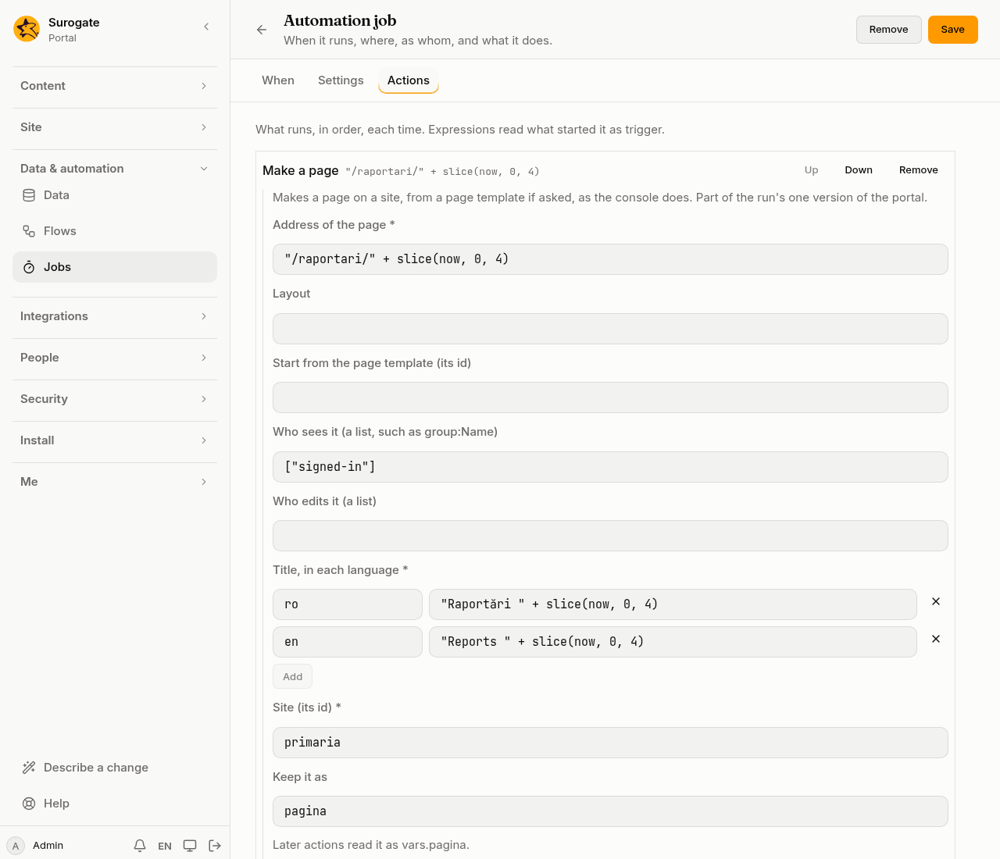

The **Portal administration** actions do from an action list what an administrator does in the console: make a page, add a block to it, make a folder and say who may use it, give someone a role. A yearly job can make next year's page and the folder for its archive; a form for administrators can make a site for a new office.

## How they work

- **The same way as the console.** Each action checks what the console checks and refuses what it refuses, in the same words, which are in `error.message` of the action. A change that would break the site is refused.
- **One version for a whole run.** All the changes a run makes are kept together in one version, written when the run ends well, described as "From job … : …", and **Undo** in **Versions** takes it back. If the run fails, nothing is written: a job that makes a page and then fails to add a block to it leaves no page. A later action reads what an earlier one of the same run made.
- **At most 20 changes** to the portal in a run. If someone saved the site in the meantime, the run fails with "Someone saved this site meanwhile" and can be tried again.
- **Who may run them.** A **job** only when **Runs as** is an administrator; a **form or endpoint** only when the person who sends it is one, checked when it runs: the action fails with "You are not allowed to do this." and the refusal is in the audit log. They are never allowed in a form anyone may send or a public endpoint, and a job started by anything but time may not use them.
- **Audit and review.** Each change is in the audit log as done **by an action**, naming the job, form or endpoint. Proposed changes lists these actions among what to look at closely.

The actions that only read (**Read a page**, **Read a portal (a site)**, **Read a text block's HTML**) run anywhere, and give only what the person may see.

## Pages

- **Make a page:** the site, the address (`/` or lower-case words joined by hyphens), a title in each language, optionally a layout or a **page template** to start from (its blocks and style are copied), and who sees and who edits it. It keeps `{site, path}`.
- **Change a page:** its title (the languages you give change, the others stay), layout, description, who sees and edits it, or its address. A new address that another page has is refused.
- **Remove a page:** the home page is never removed, and neither is a page that has pages under it ("The page has pages under it."); nothing is removed in a cascade.
- **Read a page:** keeps its site, address, title, layout, description, `parts` (each with its blocks: `id`, `kind` and `settings`) and who sees it. Blocks the person may not see are left out.

## Portals (sites)

- **Make a portal:** a name in each language, one of the portal's own hosts, a path on it, the languages, who sees it, and optionally **Copy the structure of this site**: its pages, layouts, fragments, templates and design are copied as they are. A portal has at most 50 sites. It keeps `{site, url}`.
- **Change a portal:** its name, languages, home page, who sees and edits it, and its description.
- **Remove a portal:** refused while a job uses the site, and when it is the only one with an address.
- **Read a portal:** its id, name, languages, home page, who sees it and the addresses of its pages.

## Blocks

A block has an **id** that stays the same, which the actions name. **Add a block to a page** takes the site, the page, the part of its layout (the first when left out), where (**At the start**, **At the end**, or **After** a block's id), and the **kind**: a **text** (HTML, in each language), a **widget of the portal** (with its settings), a **form** or a **fragment**. It keeps `{blockId}`. **Change a block** changes its settings, its text in the languages given, or who sees it; **Remove a block** removes it by its id. Text goes through the same checks as **Edit as HTML**: a `<script>` or anything else a block cannot hold is refused, and never reaches the page. **Read a text block's HTML** keeps the cleaned HTML and the text without its tags, of a text block or a fragment.

## Folders

- **Make a folder:** an id, a name in each language, **Public** or **Secure**, who sees and edits it, and what to do **If it exists** (an error, or use it).
- **Change who may use a folder:** for **who sees** and **who edits**, replace the list, add to it or take from it; and make the folder public or not. A secure folder left with no one in **Who sees it** is for its editors only, never public. A person named by email must already exist: an action never makes a person. Making a folder public is a separate event in the audit log.
- **Remove a folder:** refused while it holds files ("The folder holds files: move or remove them first."), or a form or an action names it.

## Roles and people

**Give or take roles** gives a person roles and takes others, by their email, as the console does. A run never gives a role it does not hold, and never leaves the portal without an active administrator; roles a directory gives are not taken. **Make a role**, **Change a role** and **Remove a role** work with the roles an organisation defines; a portal that has only the two fixed roles says "no roles of its own to define". Deleting a person is in [Managing people from steps](/portal/sites/people-actions/).
