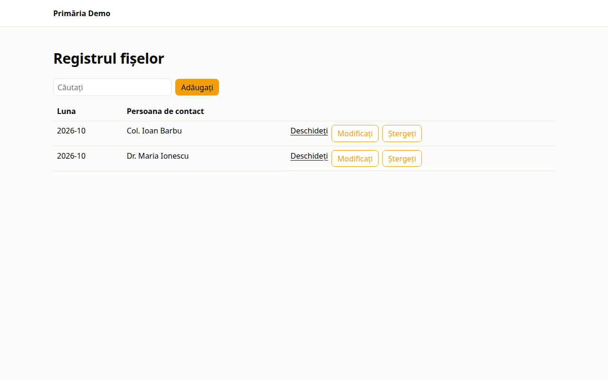
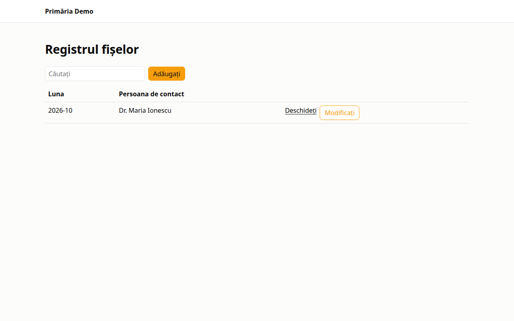
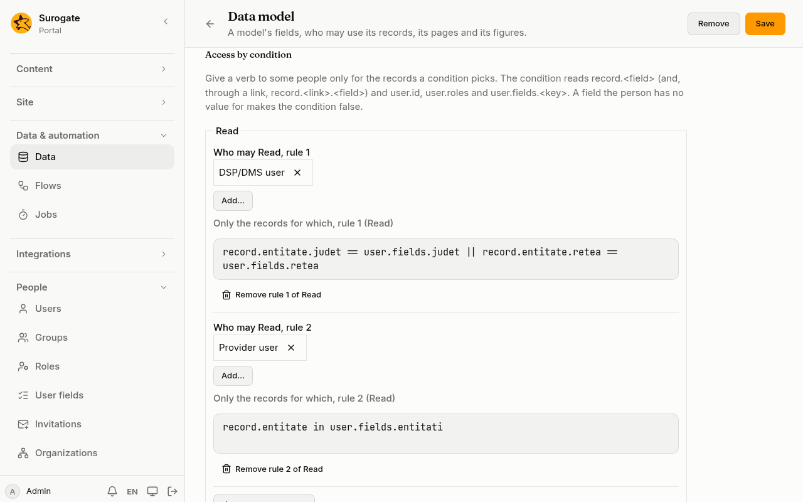
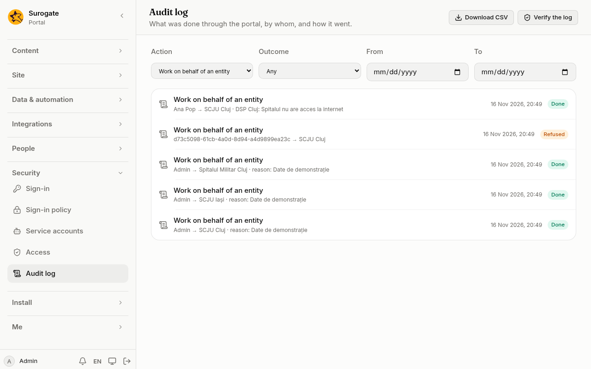
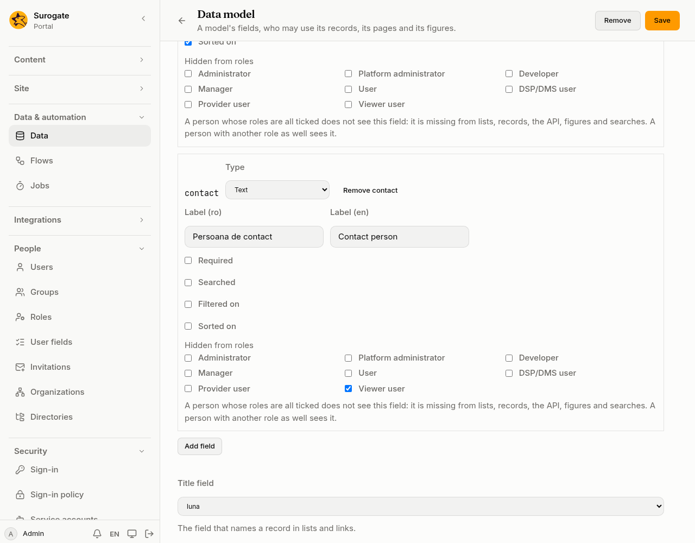
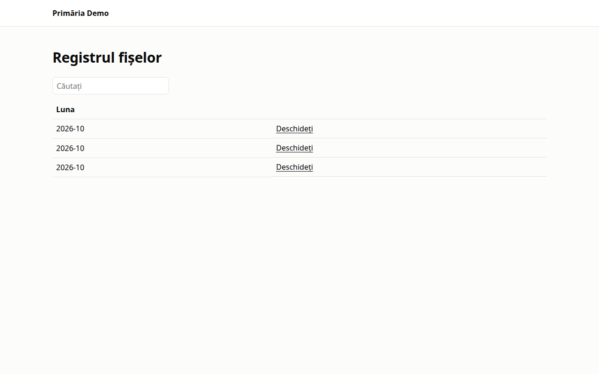

A model can give a verb to some people only for the records a condition picks: a DSP user reads the sheets of their own county, a provider edits the sheets of their own entities. The portal holds to it everywhere records are read or written. You write the conditions in the console, on a model's **Access** tab, under **Data**. You need the **Administrator** role, or a [role](/portal/console/roles/) that opens **Data** at **Edit**.

## What people see

A person only ever sees the records their rules reach. The same list, as two people:

A record out of reach is answered as one that does not exist, wherever it is asked for: in a list, in a search, in the one record's address, in a [KPI](/portal/sites/kpis/), over the [API](/portal/sites/data-models/#the-api) and [GraphQL](/portal/sites/data-models/#graphql), in an [action list](/portal/sites/actions/#records) and in the choices of a link field. A list's page is full of rows the person may see, and what is counted is what is seen.

A model's own rules, calculated fields and checks that look at other records (`records.count("fisa1", {})`, say) are held to the same: they find only the records the person who saves may see, and only the fields they see. A look that names a field the person does not see fails as for a field the model does not have. What a model takes from another record by its own say (a field filled from a reference table) and the check that a code is unique are the portal's own reads: they see every record, whoever saves.

## Write the conditions

On the model's **Access** tab, under **Access by condition**, each verb (**Read**, **Add**, **Change**, **Remove**) has its own rules:

1. Under the verb, press **Add a rule to** it.
2. Under **Who may**, press **Add…** and choose **A role**, a group, an organization or a person.
3. Under **Only the records for which**, write the condition.
4. Press **Save**. A condition that is wrong is not saved: the message shows under it.

A person with several rules for a verb, or several roles, gets the records any of them reaches. The grants above the rules (read every record, read their own) still work as before: a rule adds to them.

### What a condition says

A condition is true or false for each record. It can read:

- `record.<field>` — a field of the record. Through a link, `record.<link>.<field>` reads a field of the record it points at, such as `record.entitate.judet`.
- `user.id` and `user.roles` — who asks, and the codes of their roles.
- `user.fields.<key>` — the person's own [user fields](/portal/console/user-fields/).

It can compare with `==`, `!=`, `<`, `<=`, `>` and `>=`, join with `&&` and `||`, negate with `!`, and ask `in` a list: `record.entitate in user.fields.entitati`.

| For | Write |
|---|---|
| A DSP user reads their county's entities, or their network's | `record.entitate.judet == user.fields.judet \|\| record.entitate.retea == user.fields.retea` |
| A provider reads and changes the sheets of their own entities | `record.entitate in user.fields.entitati` |
| Only the records the person added | `record.owner == user.id` |

When the person has no value for a field the condition reads, the condition is false for every record: a DSP user with no county sees nothing. It is never an error. The same holds for a record that has no value for a field the condition reads. Turning the condition round does not make it true: `!(record.judet == user.fields.judet)` is also false for a person with no county, and for the records with no county. To ask whether a field is set, compare with `null`: `user.fields.judet != null`, or `record.judet == null` for the records with no county.

A text field can be compared with a link, a date or a time: they are compared as the text they are written as, so a text that is not a valid id is simply not equal to one.

The console refuses a condition with a syntax error, a field the model does not have, a user field the portal does not have, a comparison of values of different kinds, or a read through a field that is not a link. The message names the model and the rule.

### Writing

- **Add**: the new record must satisfy the rule of the person's role. A DSP user in Cluj cannot add a sheet for an entity in Iași.
- **Change**: the condition must be true before the change and after it, so nobody moves a record out of their own reach.
- A change the rules do not allow on a record the person cannot see is answered as a record that does not exist; one they can see but may not make is refused with **Nu aveți drept asupra acestei înregistrări.**

An administrator is not narrowed by any rule. The [data console](/portal/console/data-console/) runs SQL for administrators and does not follow these rules.

## Working on behalf of an entity

A record can be about an entity (a hospital, a provider) that is not the person who fills it in. On the **Access** tab, under **The entity a record is about**, choose the **Holder field**: the link that says which entity the record is about. The holder is that entity, not the person who added the record.

A change is made on behalf of an entity when the record's holder is not one of the person's [own entities](/portal/console/user-fields/). Then:

1. Only the people named under **Who may work on behalf** may, and only where the entry's condition holds, such as `user.fields.judet != null` so that a person with no county cannot. Administrators may too. Anyone else is refused: **Nu puteți opera în numele acestei entități.**
2. The person gives a **reason**, 5 to 1,000 characters. On a page's list the portal asks for it; without it the change does not happen: **Motivul intervenției este obligatoriu.** The model can offer **Reasons offered**, one a line, besides free text.
3. The change is kept with the holder, the person, their institution, the day and time, what was done and the reason.
4. The person cannot change which entity the record is about while working for it, unless the record is in the state it starts in (see below).

A person who works on a record of one of their own entities is not asked for a reason, and nothing is kept.

Every version the change makes, in the record's history, says which entity it was done for and why, next to the person who did it.

### The entity changes only in the first state

Where the model has states, the entity a record is about can be changed only while the record is in the state it starts in (Draft, say), and only to an entity the person may write, by the rules above. Once the record has left that state, nobody changes it, administrators included: the answer is **Entitatea titulară se schimbă doar cât înregistrarea este în starea în care începe.** The refused attempt is kept in the audit log. A model without states has no such rule.

Through the API, give the reason as the `reason` parameter, or as the `X-Portal-Reason` header written as percent-encoded text; through GraphQL, as the `reason` argument of the change; in an [action list](/portal/sites/actions/#records), in the action's **Reason** expression.

### Find what was done on behalf of an entity

In the [audit log](/portal/console/audit/), choose the action **Work on behalf of an entity**:

Each entry names the entity, the person, the institution and the reason. An attempt that was refused, for no reason given or no right to work for the entity, is there too, as **Refused**, and nothing was written. The CSV download has the institution and the reason as columns.

Developers: see [Developer: Data models](/portal/developer/data-models/#access-by-condition).

## Fields hidden from a role

Some fields are for some roles only: a viewer sees the sheets but not the contact person's phone. On the model's **Fields** tab, each field has **Hidden from roles**: tick the roles that do not see it.

A person who does not see a field has no such field, anywhere:

- It is missing, not empty, from lists, from the record, from its history and past versions, from the [API](/portal/sites/data-models/#the-api) and [GraphQL](/portal/sites/data-models/#graphql) (the schema does not have it), from the fields of a form to add or change a record, and from what an [action list](/portal/sites/actions/#records) or a [job](/portal/sites/jobs/) reads.
- A filter, a sort or a search that names it is refused, as for a field the model does not have; a search in the listing looks only in the fields the person sees.
- It cannot be written by them. What it holds is kept when they save the rest of the record.
- A [KPI](/portal/sites/kpis/) that groups, sums or filters by it is not shown to them; the figures that do not read it are.
- A form's check of a record before it is saved (`evaluate`) leaves it out of its answer, and refuses a value for it. So does a save that has rules or calculated fields: what it answers says nothing of the field, nor of what is wrong with it.
- A form that is bound to the model (a model's own form, or a listing's dialog) is drawn without it: no input, no column, no label. A form that asks for every field of its model leaves the hidden ones empty for them, and the record is made all the same.
- Going back to an earlier version of a record is refused to someone who does not see every field of it, as it would write the fields they cannot see.

Access is the union of a person's roles: a field is hidden from a person only when each of their roles is ticked. A person with the Viewer role and the DSP role, with the field ticked for Viewer only, sees it. The role **User**, which every account has, counts only when it is all they hold, and a visitor counts as holding it: tick **User** to hide a field from every person with no other role and from visitors. Administrators see every field.
