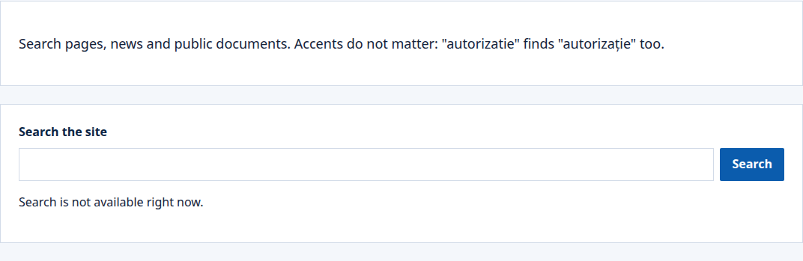

A site's search box finds its pages and its published content, in the visitor's language. Each person finds only what they may view.

## What people see

A search box sits on a page of its own, or in the site's layout. A person types what they look for and the results show below the box, with links to narrow them. When search is not available, the box says so, as here; the rest of the page shows as usual:

## What search finds

- **Pages:** each page's title, its description for search engines, and the text of its text blocks. Text in a part of a page that only some people may see is left out, and so are fragments, which repeat on many pages. Display pages and personal dashboards are not found themselves.
- **Content:** each published entry that has its own address, through a [display page](/portal/sites/content-types/#display-pages): its title and its text. An entry from a library is found on every site whose display page shows it.
- **Files:** the files in the tenant's [folders](/portal/console/files/), by the words of their names and by their text: PDF, Word, Excel and PowerPoint documents, OpenDocument files, text, CSV and JSON. Images and ZIP archives are found by their names. A file is found only by people who may download it: anyone for a public folder, the people the folder names (and its editors) for a secure one. A result opens the file.

Search follows the site: a page saved, an entry published, unpublished or deleted, or a file uploaded or removed, shows in the results within moments.

## How words match

- Words without diacritics find words with them: `sedinta` finds `Ședința`.
- Forms of a word find each other, in Romanian and in English: `ședințele` finds `ședința`.
- A small typo still finds the word.
- Every word must appear, in the title or the text. Quotes, stars and other signs are read as plain words.

## Suggestions while typing

After two letters, the search box suggests up to five titles under it. Use the arrow keys to choose one and Enter to open it, or Enter to search for what you typed; Escape closes the list. Without script, the box searches as usual.

## Who finds what

A person finds a page or an entry only when they may view it. Visitors find what visitors may view; people signed in also find what their groups and organizations may view, and what they edit. The counts beside the results count only what the person may see.

## Put a search box on a page

In the [page editor](/portal/console/pages/#search), choose **Add a search box** in a part of the page. A page of its own, such as `/cautare`, works well, with a link to it in the site's layout.

The box shows its results below it, with links to narrow them to pages or content, to one content type or one tag, and to the next page of results. It works without script. A page of results shows 10 results; a box can be set to show from 1 to 50. The page editor does not set that yet. For now, this is set in the site's configuration: see [Developer: Search](/portal/developer/search/#a-search-box-on-a-page).

When search is not available, the box says so; the rest of the page shows as usual.

## Documents in the DMS

A search box can also show the documents of the [DMS](/portal/sites/documents/) that match, beside the site's own results. The page editor does not set that yet. For now, this is set in the site's configuration: see [Developer: Search](/portal/developer/search/#documents-of-the-dms-in-the-search-box).

- **What shows:** after the site's results, a section "In the DMS" lists up to five documents (a box can be set to show 1 to 10), each with its folder, state, version and up to two passages where the words match, and a link to all the results in the DMS.
- **Who sees what:** the DMS searches as the person signed in, so they find only the documents they may read there, and the DMS records each search, naming the portal. Visitors see no DMS section.
- **What the DMS gets:** the words of the search, never the site's results or anything else about the person's visit. A document's fields and values never show in the portal.
- **When the DMS does not answer**, the site's results show as usual, and the section says the documents cannot be searched now.
- It shows on the first page of results with no filter chosen.

## Tune search

Each site can weigh titles against text, give words that mean the same, pin results to a search, leave pages and content types out, and turn typos and word starts on or off. Administrators do it on the console's [Search](/portal/console/search/) page. The same settings, as files in the site's configuration, are in [Developer: Search](/portal/developer/search/#tune-search-in-searchyaml).

## From an app

An app's backend can search a site through the SDK, and finds what a visitor finds. Each result has a title, an address on the portal, its kind and, for content, its type, and a snippet with the words found marked. An app's searches are not counted in [what people search for](/portal/console/search/#what-people-search-for). How an app makes the call is in [Developer: Search](/portal/developer/search/#from-an-app).
