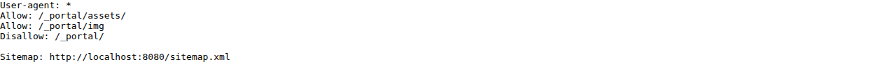

Every page of a site tells search engines and link previews what it is. The portal writes all of this itself, so a page needs nothing more than its title to be found. A site can say more.

## What people see

Visitors see nothing of this on the page: it is what search engines and link previews read. The one part anyone can open is the list of what crawlers are told, at `/robots.txt` on the site's address:

## What each page says

- **Its description**: the page's own, else the site's.
- **Its address**: one address per language. The home page's address is the site's root, such as `https://example.ro/` and `https://example.ro/en`.
- **The same page in the site's other languages**, so search engines show each visitor theirs.
- **How it looks when shared**: its title, the site's name, its description and its image.
- **Structured data** about the site and the page, and about the organization behind the site when it names one.

## Describe a page

Administrators set how a page shows to search engines and link previews in the [page editor](/portal/console/pages/), under **Search and sharing**:

- **Description**: at most 300 characters, in each language of the site. Once it is given in one language, give it in all of the site's languages.
- **Share image**: an `https:` address. It shows when the page is shared.
- **Hide from search engines**: asks search engines not to list the page.

The same settings, as files in the site's configuration, are in [Developer: Search engines and link previews](/portal/developer/seo/#a-pages-seo).

## Describe a site

A site can say the same for all its pages, and who is behind it: the organization, with its name, address and logo. A page's own description and image win over the site's. A site can also ask search engines to leave the whole site out. The console does not set these yet. For now, this is set in the site's configuration: see [Developer: Search engines and link previews](/portal/developer/seo/#a-sites-seo).

## What crawlers are told

Each address the portal serves answers two files:

- **`/robots.txt`** keeps crawlers away from the portal's own paths, but not from what pages need to show, and names the sitemap.
- **`/sitemap.xml`** lists every page anyone may see, in each language, with its other-language addresses. It leaves out:
  - pages only signed-in people may see;
  - pages hidden from search engines;
  - the pages of a site that asks search engines to leave it out.

Previews are never listed: their robots.txt keeps every crawler out.
