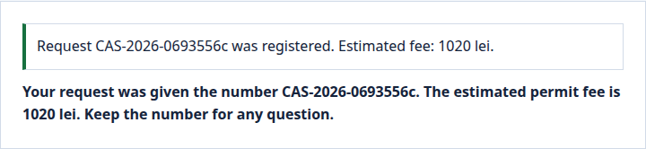
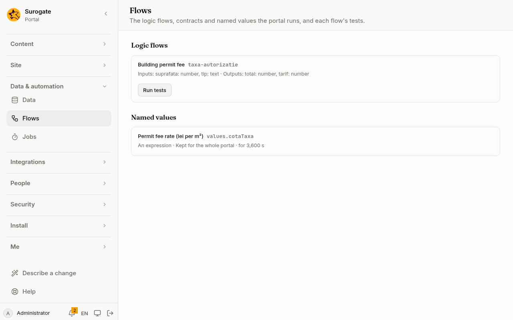

A named value is a value worked out by the portal and read by its name in any [action list](/portal/sites/actions/) or [logic flow](/portal/sites/flows/). A VAT rate, a greeting, a price list from a flow: each is written once and kept for a while.

## What people see

A named value has no screen of its own: people see what the lists and flows that read it work out. Here the fee of a new dwelling's building permit is the surface times the rate per square metre, and the rate is the named value `cotaTaxa`, 8.5. A request for 120 square metres is told its fee, 1020 lei:

Administrators see the portal's named values on the console's [Flows](/portal/console/flows/) page, under **Named values**, with the expression, who it is kept for and for how long:

## A value

A value has a name: letters, digits and `_`, starting with a lower-case letter. The console shows the portal's values; it does not write them yet. For now, this is set in the site's configuration: see [Developer: Named values](/portal/developer/values/#a-value).

A value is one of:
- An expression.
- A flow's outputs: the flow and the inputs it is given. One output of it can be read on its own.
- A web call's answer: what a service answers.
  - It is a GET through a web [connector](/portal/sites/connectors/).
  - The value is the answer's body.
  - An answer that is not 2xx fails it.
  - A value kept for the whole portal or a site cannot use a connector that each person connects themselves.
- A collection's entries: the published entries of a content collection.
  - Each entry has its id, its slug and its values.
  - It is read before the list runs, and is as fresh as the time the value is kept for.
  - Only a public collection that visitors may read can be a value, since a value may reach anyone. Each entry's values are shown in the run's language.

A value never reaches the portal's files: a value kept for others must not hold what only some people may read.

## How long it is kept

A value is kept for the whole portal, for each site, for each signed-in person, or for nobody. It is kept for a number of seconds, from 1 to 86,400; 300 when not set:

| Kept for | Its expression may read |
|---|---|
| The whole portal | the language, the time, other values kept for the whole portal |
| Each site | as above, and the site and values kept for a site |
| Each signed-in person | as above, and the person and values kept for a person |
| Nobody: worked out every time | everything above |

A value is kept per language too. A value kept for a site or the whole portal never sees the person, even inside a flow it calls: what it keeps is the same for everyone. A value cannot read a value kept for fewer people than it is, and values cannot read each other in a circle. The portal refuses either when the site's configuration is saved. A value kept for each signed-in person is never kept for visitors.

Kept values start afresh whenever the site's configuration changes.

For now, this is set in the site's configuration: see [Developer: Named values](/portal/developer/values/#how-long-it-is-kept).

## When a value fails

Every value a list can reach is worked out before the list runs, each after the values it reads. A value that fails is left out, and the run's log says why. Reading it is then the action's error, which the list's error handling can catch.

A value can only be read by its name, written plainly. Any other way of reading it is refused when the site's configuration is saved.
