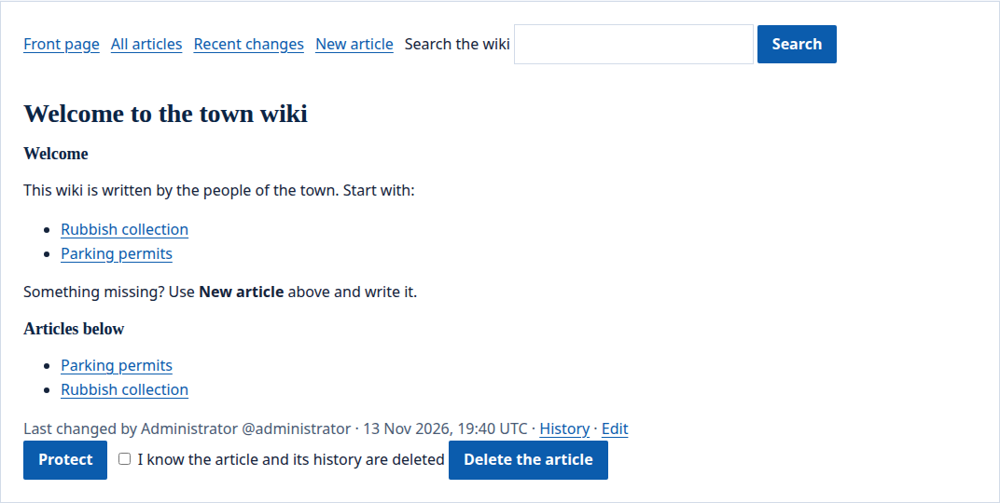
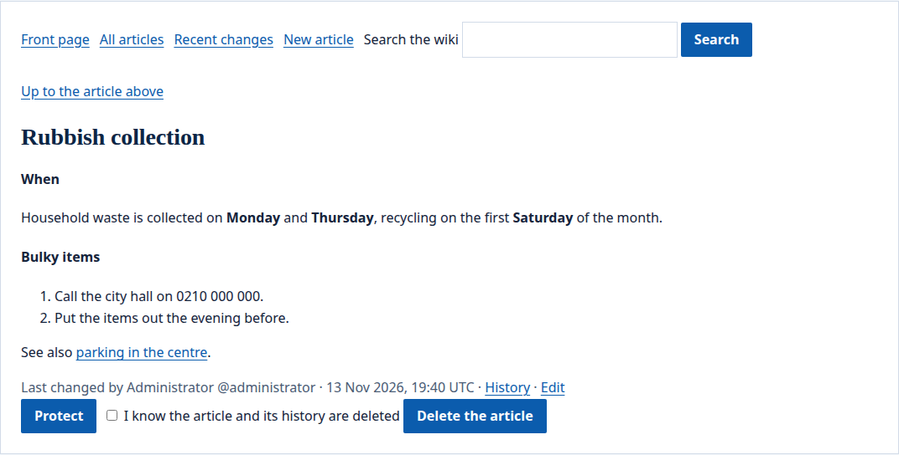
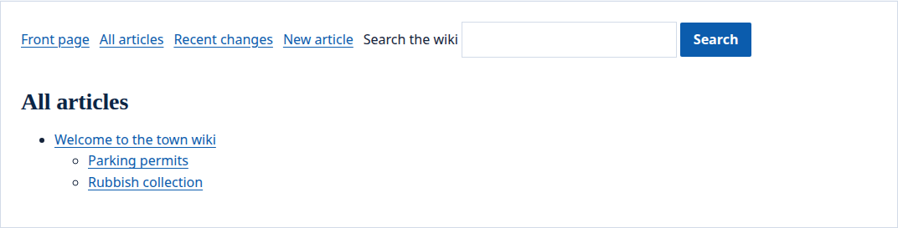
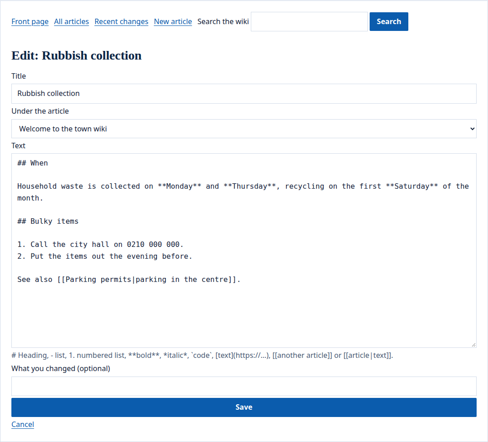

The portal's `wiki` widget is a wiki: articles linked to one another by name, each with its history. As a knowledge base, the site's editors keep its articles in a tree, and readers say whether an article helped them.

## What people see

The wiki opens on its first article. Above every article are the ways around the wiki: **Front page**, **All articles**, **Recent changes**, **New article** and a search box. Below the text are who changed it last, its **History** and, for those who write, **Edit**:



An article that sits under another shows a link to the article above, and its text in the wiki's small markup:



**All articles** shows the articles as a tree:



Those who write edit an article in a form, with the markup shown under the text:



## Place a wiki

Place the `wiki` widget on a page (see the [config example](#a-wiki-on-a-page)). Its `kind` is `wiki` (when left out), or `knowledge` for a knowledge base. Who writes a wiki is `members` (when left out), everyone signed in who may [see the widget](/portal/sites/permissions/), or `editors`, the site's editors only; a knowledge base is always written by the site's editors. `home` is the address of the article the wiki opens on (`home` when left out).

Each `wiki` widget is a wiki of its own. Its articles belong to the widget: moving it to another page, or giving it another `id`, leaves them behind, and they come back if it returns. A page with a wiki is made for each person and never kept in a cache.

## Read and find

The wiki opens on its first article. Above every article, **Front page**, **All articles** (the articles as a tree, each under the one it belongs to), **Recent changes** (the latest 50 saves) and **Search the wiki**, which finds articles by the words of their titles and texts, with or without accents.

An article shows its text, the articles below it, who changed it last and when, and its **History**: every version kept, each of which can be read.

## Write

Those who write see **Edit** on an article and **New article** above the wiki; following a link to an article that does not exist yet offers **Write this article**. An article has a title of up to 200 characters, a text of up to 50,000, and may sit under another article, at most ten levels deep. Its address is the name it was linked by, lower case, with hyphens for spaces and without accents: `[[Întrebări frecvente]]` is the article `intrebari-frecvente`. A new article written from **New article** takes the address you type, or one made from its title. An article's address cannot be changed later.

The text is written in a small markup:

| Write | To get |
| --- | --- |
| `# Heading`, `## Smaller`, `### Smallest` | headings, under the article's title |
| a blank line | a new paragraph |
| `- item` | a list |
| `1. item` | a numbered list |
| `**bold**`, `*italic*`, `` `code` `` | bold, italic and code |
| `[text](https://example.ro)` | a link to a web page, an e-mail (`mailto:`) or a page of the site (`/…`) |
| `[[Another article]]`, `[[another-article\|text]]` | a link to another article; one that does not exist yet is marked |

Nothing else is markup: HTML shows as text.

When two people edit the same article and the second saves after the first, the second save is refused: their text is kept as their draft, and the form opens again with it and with the text now saved, so they can bring the two together. Any save the wiki refuses keeps the text the same way, for a week. A draft opens whenever its writer edits the article again, marked as their unsaved draft; saving it over a version newer than the one it was written on is refused again, and **Discard the draft** lets it go.

A version can be brought back from the history, as a new version; when the article it sat under is gone, it comes back where the article is now. Each person saves at most 30 times an hour; a wiki holds at most 2,000 articles, and each keeps its newest 50 versions.

## Look after a wiki

On a wiki its members write, an article people save shows at once: there is no review first. The site's editors watch **Recent changes**, and:

- **Protect** an article, so only the site's editors change it;
- bring back an earlier version, or **Remove this version's text** from the history (its title goes too), when a version must not stay readable;
- **Delete the article**, with its history, once they tick that they know it goes; the articles under it move up.

## Knowledge bases

A knowledge base is a wiki its site's editors write, its articles arranged in a tree. Under each article, readers signed in answer **Did this article help you?** with yes or no; each reader's last answer counts once, and the editors see the counts.

## What happens to them later

When a person is erased from the portal, the articles and versions they saved stay, as the wiki's shared text, without their name and without the notes they wrote; their answers to "Did this article help you?" go. The versions they saved are part of what they get when they ask for their data.

## Config example

### A wiki on a page

In a page's file (`sites/<site>/pages/<page>.yaml`):

```yaml
regions:
  main:
    - id: wiki
      app: portal
      widget: wiki
      preferences: { kind: wiki, edit: members, home: home }
```

- `kind`: `wiki` (when left out), or `knowledge` for a knowledge base.
- `edit`: who writes a wiki: `members` (when left out), everyone signed in who may [see the widget](/portal/sites/permissions/), or `editors`, the site's editors only. A knowledge base is always written by the site's editors.
- `home`: the address of the article the wiki opens on (`home` when left out).

