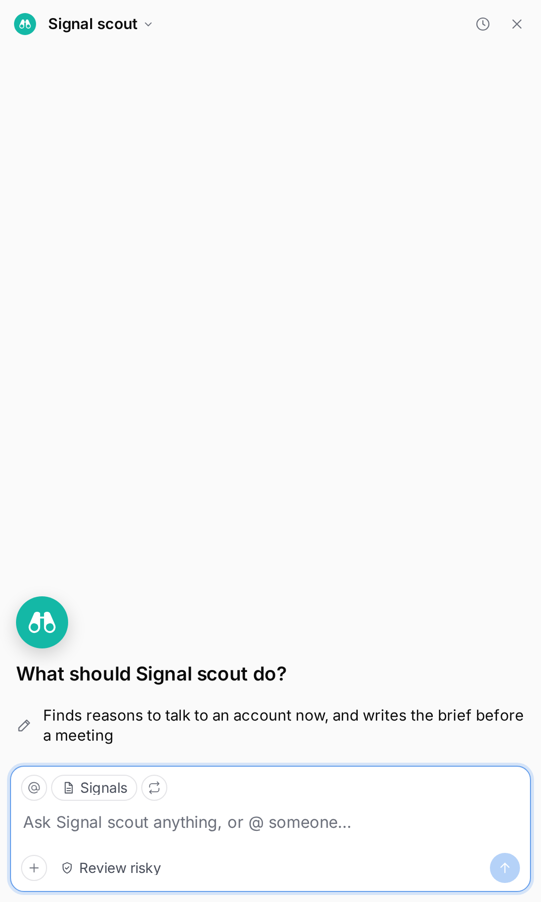

Each agent has one job. Ask the one made for the work, or ask Superstar and it picks. What each one never does is written into its instructions, and you can rely on it.



## Superstar

**Does:** answers anything you ask through **Ask** or `@Superstar`. Small, clear jobs it does itself: a row, a page, a draft, an answer from what is already in the workspace. Bigger jobs it splits into one to-do per part, each for the agent made for it, and tells you who does what. It looks in **Templates** before building a desk or a campaign from scratch.

**Never:** hands one part to two agents, sends an email, or fills a research table from memory and calls it research.

**Starts:** **Ctrl J**, or a block that starts with `@Superstar`.

```text title="Try it in Ask"
Which inbound leads from this week still have no reply? List them by owner.
```

## Inbound qualifier

**Does:** for each new lead, checks **Do not contact**, researches the company, scores enterprise fit and self-serve fit from 1 to 5 with a reason each, sets **Status** (Qualified, Not a fit or Spam) and **Owner** from the Owners table, adds the person to **People** and a **Deals** row at New, and drafts the first reply on the lead's page with the owner as sender.

**Never:** answers a lead itself. If what it finds doesn't match what the lead wrote, it says so instead of copying public data over theirs.

**Starts:** a row in **Inbound leads** at Status **New**, or an @mention.

```text title="On Inbound leads"
@Inbound qualifier Qualify the new leads in Inbound leads, route each one by How we work and draft the first reply.
```

## Signal scout

**Does:** for your Tier 1 and 2 accounts, finds what changed: leadership, strategy, funding, hiring, regulation, news, partners. One **Signals** row per finding, with its source, a **Strength** (Act now, Watch or Background) and the account's owner. Before a meeting, a one-page brief on the company's page: who they are, what they likely want, three questions, the risks, sources at the end.

**Never:** writes a row without a source, contacts anyone, or works public tenders.

**Starts:** an @mention, or a weekday repeat a person sets.

```text title="On a company's page"
@Signal scout Brief me for Thursday's call with Marisol Energy: what changed in the last 90 days, what they're likely trying to do, and three questions to ask.
```

## Relationships

**Does:** maps warm paths into an account: who on your team, which partner or customer, knows someone there. One **Paths in** row per path, with how they know each other and a **Confidence** of Confirmed or Inferred. For the strongest path, drafts the intro request to the connector, sent by the teammate who knows them.

**Never:** writes to the target directly, logs in to a teammate's LinkedIn, or quotes partner terms that aren't written on How we work.

**Starts:** an @mention, or a weekly repeat for Tier 1 accounts.

```text title="On Paths in"
@Relationships Find a warm path to Elena Varga at Castell Bank. I worked with Daniel Ruiz at Northwind; he was on her team at Danube Bank. Draft the intro request to Daniel.
```

## Follow-up keeper

**Does:** turns meeting notes into the follow-up email (thanks, what we heard, what we agreed, the next step with a date) on the deal's page, with the deal owner as sender. Sets **Next buyer action** and **Next action date** on the deal when the notes say clearly what was agreed, and asks the owner when they don't. Every day it lists deals with no next action or a date in the past, by owner. When a contact writes in, it drafts the answer in the same thread.

**Never:** adds what the notes don't say.

**Starts:** an @mention or an assignment after a call, a meeting ending on a connected calendar, mail from a contact, and its daily check.

```text title="In a deal room, under your notes"
@Follow-up keeper Turn the notes above into the follow-up email to Anna and update the deal.
```

## Strategist

**Does:** reads Deals, Signals and Inbound leads and writes the plan you ask for: the deals to push and why, each owner's next step, what's missing. On a Monday repeat it counts the week into a Scorecard row first.

**Never:** sets a target the team didn't write down, or counts a number it can't point to.

**Starts:** an @mention, or a Monday repeat.

```text title="On a new page"
@Strategist Review the pipeline (Deals, Signals, Inbound leads) and write this week's plan: the three deals to push, what each owner does next, and what's missing.
```

## Content producer

**Does:** turns one source (a customer story, a release note, a webinar, a film) into posts, threads, a newsletter section or an article, each fitted to its place. Uses only facts on the source pages, and copies every number with its condition. Puts the links that matter in a post's first reply.

**Never:** posts. It drafts, and a person validates.

**Starts:** an @mention on the source.

```text title="On a page with the source"
@Content producer Three LinkedIn posts for this week from the Kestrel Insurance kickoff (we can name them) and our new anomaly alerts, in Maya's voice. One per day, Tue to Thu.
```

## Comment scout

**Does:** finds public posts by the people you sell to where a comment from you would add something real, and drafts it in your voice, under the post it answers. A comment adds a fact, a question or a counterexample.

**Never:** writes "great post", pitches, links to your product unless asked, or posts.

**Starts:** an @mention, or a weekday repeat.

```text title="On a social page"
@Comment scout Find three LinkedIn posts this week by data leaders in logistics or banking where a comment from Maya would add something real, and draft the comments.
```

## Visual maker and Video producer

**Visual maker** makes social cards, carousels and figures from the brand kit and real screenshots, and uploads them to the page. It never invents a number for a chart. **Video producer** writes video briefs, scripts and cutdowns from the real product. It never publishes.

```text title="On a campaign page"
@Visual maker A LinkedIn card for the anomaly alerts post, from the product screenshot in Storage. One image.
```

## Publisher

**Does:** posts validated posts on your company profiles when they are due. Minutes before, it checks the login and fills the composer without posting (the post shows **Ready**). At the time, it posts and reads the post's link back. A post it can't confirm is marked **Didn't go out** and never retried on its own, so nothing posts twice.

**Never:** changes a word, posts anything that wasn't validated, likes, follows or messages.

**Starts:** a validated post coming due. You don't ask it for anything.
