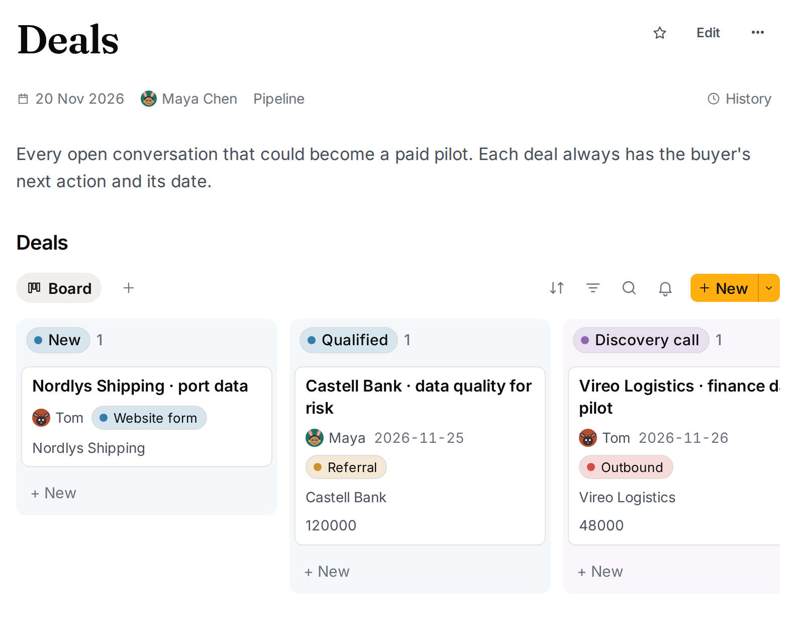
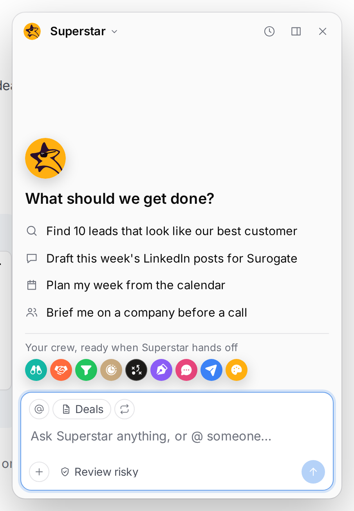
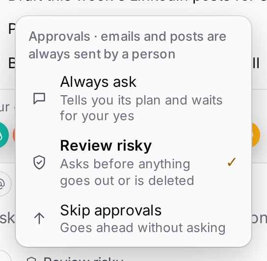

import { Aside } from '@astrojs/starlight/components';

Everything in Superstar is a page made of blocks. Agents work on the same pages you do, and everything they change is kept under one run you can undo.

## Pages and blocks

- **A page** holds blocks: text, headings, to-dos, tables, emails, posts and articles. Click **New page** at the top of the sidebar, or the **+** next to a section's name. It saves as you type.
- **The / menu.** On an empty line type **/** and pick a block. Type to narrow the list, Enter to pick.
- **The ⋮ handle.** Hover a block and click **⋮** for **Comment**, **Assign**, **Duplicate**, **Versions**, **Move**, **Delete** and **Turn into**.
- **History.** Page **⋯** → **History** shows every earlier version and deleted blocks. Deleted pages wait 30 days in **Trash**.

## Tables and views

A table is a small database. Each column has a type (text, a choice, a person, a date, a checkbox), and each row opens as its own page, where drafts and mail for that row live.

- The column header **▾** sets its type, sort and filter.
- **+** next to the view tabs adds a **Board**, **List**, **Calendar** or **Timeline** of the same rows. Deals opens as a board by Stage.
- The bell is a **watch**: when a column reaches a value, someone is told. **Inbound leads** ships with one: a row at Status **New** goes to the Inbound qualifier.

## Asking and @mentions

There are three ways to give an agent work:

1. **Ask.** Click **Ask** at the bottom right, or press **Ctrl J** (**⌘ J** on a Mac). Type what you want and press **Enter**. Superstar does small jobs itself and splits bigger ones across the crew, one to-do per part, and tells you who does what.
2. **A block that starts with @Name.** Type `@Signal scout` at the start of a line, then the job. The agent answers under that block. An @name in the middle of a sentence, or in a comment, is only a mention: it starts nothing.
3. **Assign a to-do.** Make a to-do (**/** → To-do), then **⋮** → **Assign** → the agent.

Write an ask the way you would brief a colleague: what, for whom, from which source, by when. Name the table or page it should use. Click an agent's name on a page's **Agents** strip to open its panel, with what it is for and its own ask box.

## Runs: watch, steer, undo

Every ask starts a **run**. While it works:

- Its steps show live, in plain words. **Now**, in the sidebar, lists who is working on what.
- **Steer** tells it something it reads before its next step. **Stop** ends it.

When it finishes, its answer lands as a comment under your ask, and you get it in your **Inbox**.

**Undo all** on a run puts back everything that run created or changed, newest first, except anything a person has touched since. You don't have to check every row an agent wrote before you trust the next ask.

## Inbox

**Inbox** (the tray icon at the top of the sidebar) holds what is addressed to you: mentions, assignments, agents' answers, and notices like an email that was held. Below it, what everyone else did.

Keys: **j** and **k** move, **Enter** opens, **e** marks done, **u** toggles read.

## Approvals

The shield under the Ask box sets how much an agent checks with you before it acts. Each person picks their own.

| Setting | What the agent does |
|---|---|
| **Always ask** | Tells you its plan and waits for your yes. |
| **Review risky** (default) | Asks before anything goes out or is deleted. |
| **Skip approvals** | Goes ahead without asking. Admins only. |

Whatever you pick, sending stays with people.

## Validation: posts

A post on a company profile moves through **Draft** → **Needs validation** → **Validated** → **Scheduled** → **Ready** → **Going out** → **Posted** (or **Failed**). The badge on the post says where it is.

- Only a person validates, by pressing **Validate**. An agent never does, and neither does scheduling or copying.
- Validation covers the post exactly as it reads. Any change to its text, files or first reply needs a new **Validate**.
- **Who validates…** names the people who may validate it.
- A post with a time that nobody validated waits. It never goes out late on its own.
- The **Publisher** posts validated posts on the company's profiles at their time, and nothing else.

<Aside type="caution" title="Autopilot profiles">
Each profile in **Setup** → **Profiles** is **Ask first** or **Autopilot**. On Autopilot, a post an agent writes or schedules there is validated as Autopilot and goes out at its time. Keep sales profiles on **Ask first**.
</Aside>

Posts on your personal account are yours: **Open LinkedIn** fills in the text, you post it, then click **Mark posted**.

## Email

An email block has **To**, **Subject** and the message. **Send now** sends it from your own mailbox; **Schedule** picks a time. Agents never send. A draft names the person who should send it: the owner of the row, the deal or the account.

When someone writes to you, Superstar reads your mailbox and shows the mail on the page of any row that has the sender's address, with the row's owner told. Anything still scheduled to that address is held. See [the cold sequence playbook](/superstar/playbooks/cold-outbound/).

## The rules

These are the rules the Sales desk writes on **How we work**, and the ones every agent's instructions carry. Each playbook links here instead of repeating them.

### A person sends every message to a prospect

Agents research, score and draft. Emails go from your mailbox when you press **Send now** or **Schedule**. Posts, replies and comments go out through the Publisher on your profiles, only once a person validated them. Agents also like, follow and invite on those profiles. Direct messages you send yourself.

### Do not contact is checked first

Before any draft, the agent reads **Do not contact**. Someone who said no is never written to again, on any channel. When someone opts out, add them the same day.

### Every deal carries the buyer's next action and a date

A deal without **Next buyer action** and **Next action date** is a deal nobody is moving. The Follow-up keeper checks daily for deals with neither, or with a date in the past, and tells each owner.

### A reply stops the sequence

When a prospect writes back, every email still scheduled to them is held, with the reason on the email and in the owner's inbox. A person reads the reply and decides what still fits.

### Owners come from How we work

Leads, signals and deals go to the person on the matching role in the **Owners** table. With a role empty, the agent leaves the owner empty and says so.

### No source, no row

A signal, a path in or a fit score says where it came from. The agents mark what they inferred from public pages as inferred, and you open the link before you quote it.

### Every run can be undone

**Undo all** on a run reverts what it did. Ask freely.
