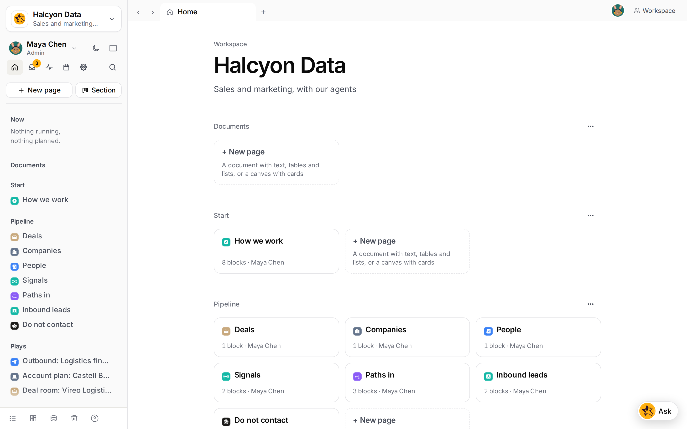
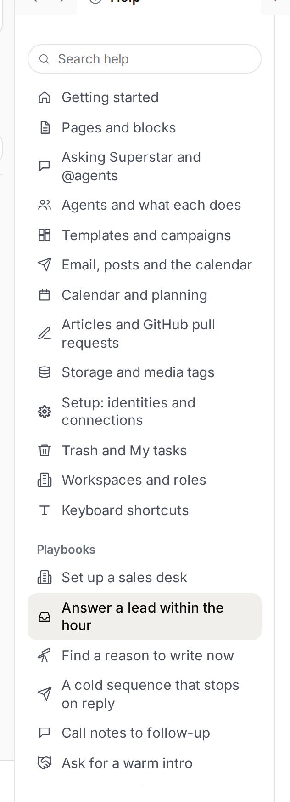

import { Card, CardGrid, LinkCard } from '@astrojs/starlight/components';
import { PLAYBOOKS } from '../../../data/superstar-playbooks.mjs';

Superstar is a workspace for sales and marketing: pages, live tables and one calendar, shared with a crew of agents. The agents research, score and draft. A person sends every email and every message to a prospect.

Every example in these docs comes from one fictional company, **Halcyon Data**: three people (Maya, Tom and Lina) selling data-quality checks to finance and risk teams, a week into using Superstar.

## The crew at a glance

Each agent has one job, a face in the sidebar and an inbox. You ask one by starting a block with its name, like `@Signal scout`. Or press **Ask** and Superstar picks who.

| Agent | What it does for you |
|---|---|
| **Superstar** | Answers anything you ask, does small jobs itself, hands bigger ones to the crew. |
| **Inbound qualifier** | Researches each new lead, scores the fit, routes it and drafts the first reply. |
| **Signal scout** | Finds sourced reasons to write to an account now, and briefs you before a meeting. |
| **Relationships** | Finds who can introduce you, and drafts the ask to that person. |
| **Follow-up keeper** | Turns call notes into the follow-up email and the deal's next step. |
| **Strategist** | Reviews the pipeline and writes the week's plan. |
| **Content producer** | Turns one source into posts, a newsletter section or an article. |
| **Comment scout** | Finds posts worth a real comment from you, and drafts it. |
| **Visual maker** | Makes social cards, carousels and figures from real screenshots. |
| **Video producer** | Writes video briefs, scripts and cutdowns. |
| **Publisher** | Posts validated posts on your company profiles at their time. Nothing else. |

[What each one does and never does](/superstar/crew/).

## I want to…

Each playbook is one job, end to end. The same playbooks are in Superstar's Help (the **?** at the bottom of the sidebar), with **Start it with this prompt** and a link back here.

{['Sales', 'Marketing', 'Content', 'Growth ops'].map((grp) => (
  <>
    <h3>{grp}</h3>
    <CardGrid>
      {PLAYBOOKS.filter((p) => p.grp === grp).map((p) => (
        <LinkCard title={p.t} description={p.lead} href={`/superstar/playbooks/${p.id}/`} />
      ))}
    </CardGrid>
  </>
))}

## Where to start

<CardGrid>
  <Card title="Ten minutes" icon="rocket">
    The [quickstart](/superstar/quickstart/) takes you from an empty workspace to a sales desk with owners, a first lead and a first ask.
  </Card>
  <Card title="How it works" icon="open-book">
    [Pages, tables, asks, runs and approvals](/superstar/how-it-works/), and the rules every agent keeps.
  </Card>
  <Card title="Copy a prompt" icon="pencil">
    The [prompt library](/superstar/prompts/): every prompt from the playbooks, grouped by job.
  </Card>
  <Card title="Stay inside the rules" icon="warning">
    [Outreach rules](/superstar/outreach-rules/) for B2B email and LinkedIn in the EU and Romania, with sources.
  </Card>
</CardGrid>
