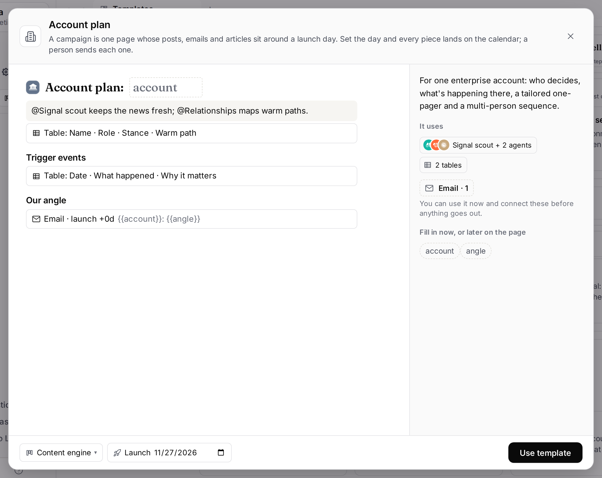
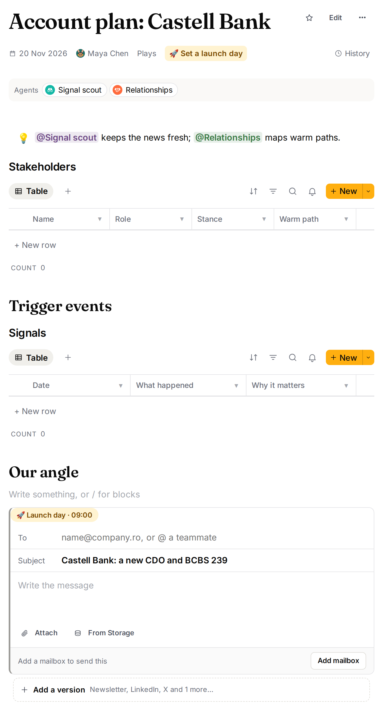

import { Aside, Steps } from '@astrojs/starlight/components';
import Tutorial from '../../../../components/Tutorial.astro';

One page per big account: the buying group, the reasons now, the plays and who runs each.

- **Time:** 45 min
- **Crew:** Signal scout, Relationships, Strategist
- **Template:** Account plan

<Tutorial id="account-plan" />

## Before you start

- The account in **Companies**, ideally with a few **Signals** already.
- An hour with the account's owner to read the plan together.
- The [rules](/superstar/how-it-works/#the-rules) every agent keeps.

## Steps

<Steps>

1. **Start the plan**

   **Templates** → **Account plan**, name the account and the angle.

   

2. **Map the buying group**

   Ask **@Signal scout** for the people by role: who decides, who uses it, who can block it.

3. **Find the ways in**

   Ask **@Relationships** for paths to each one.

4. **Write the plays**

   Three plays with an owner and a date each: an intro, an event, a piece of proof. Review it every two weeks.

</Steps>

## The template

**Account plan** is a page. Open it from **Templates** in the sidebar. It makes a **Stakeholders** table (Name, Role, Stance: Champion, Neutral, Blocker or Unknown, Warm path), a **Signals** table (Date, What happened, Why it matters), **Our angle**, and a first email.

## Prompts

Copy one and change the names. A prompt that starts with an @name goes in a block on the page; the others go in **Ask** (**Ctrl J**).

```text title="A block that starts with @Signal scout"
@Signal scout Map the buying group at Castell Bank for data quality in risk reporting: names, roles, what each cares about, sources.
```

```text title="A block that starts with @Strategist"
@Strategist Turn this account plan into three plays for the next six weeks, each with an owner and a date.
```

## What good looks like

Every role in the buying group has a name, a way in and a next step with a date.

A filled **Stakeholders** table for Castell Bank would read like this. Every row says how you reach the person, and the stance comes from something someone said, not a guess:

| Name | Role | Stance | Warm path |
|---|---|---|---|
| Elena Varga | Chief Data Officer | Unknown | Daniel Ruiz (Danube Bank), Confirmed |
| Head of risk data | Uses it daily | Unknown | Ask Elena in the first call |
| Procurement | Can block | Unknown | Ask Elena who runs it |

Unknown is honest. It turns into Champion, Neutral or Blocker after a conversation.



## Watch for

- One champion is not a buying group.
- A plan nobody reviews is a document: put the review on the calendar.

## What to count

- Roles engaged in the buying group
- Meetings with the economic buyer
- Pipeline created at the account

Count the roles in Stakeholders with a stance other than Unknown, and the meetings logged on the account's deal.

## Next

[Run the weekly pipeline review](/superstar/playbooks/pipeline-review/): three deals to push, each owner's next step, and what's missing, ready before the meeting.
