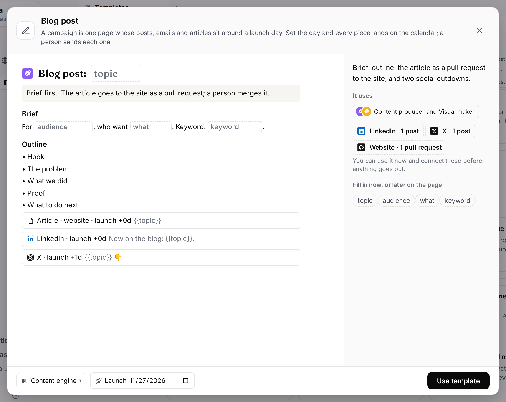

import { Aside, Steps } from '@astrojs/starlight/components';
import Tutorial from '../../../../components/Tutorial.astro';

An article drafted from your material, reviewed, and opened as a pull request on your website.

- **Time:** 2 h
- **Crew:** Content producer, Visual maker
- **Template:** Blog post

<Tutorial id="blog-article" />

## Before you start

- A website connected in **Setup** → **Websites**, with its repository.
- The notes or source on a page.
- The [rules](/superstar/how-it-works/#the-rules) every agent keeps.

## Steps

<Steps>

1. **Brief it**

   **Templates** → **Blog post**: the topic. Give the producer the source and who it's for.

   

2. **Draft and figures**

   **@Content producer** drafts it; **@Visual maker** makes the figures.

3. **Publish**

   With a website connected (Setup → **Websites**), the article opens as a pull request. A person merges it.

</Steps>

## The template

**Blog post** is a campaign. Open it from **Templates** in the sidebar. It makes a **Brief**, an **Outline**, the article for your website (it opens as a pull request) and two social cutdowns.

## Prompts

Copy one and change the names. A prompt that starts with an @name goes in a block on the page; the others go in **Ask** (**Ctrl J**).

```text title="A block that starts with @Content producer"
@Content producer Write a 900-word article on why month-end close slips because of data, for finance leaders, from the notes on this page.
```

```text title="A block that starts with @Visual maker"
@Visual maker A figure showing where the two lost days of the close go.
```

## What good looks like

The first paragraph says what the reader will be able to do after reading it.

A first paragraph that says what the reader gets:

> After this, you'll know which two days of your month-end close are lost to data, and the three checks that win them back.

## Watch for

- A person merges every pull request.

## What to count

- Readers
- Time on page
- Leads citing it

Readers and time on page from your site's analytics; leads that cite the article in Inbound leads.

## Next

[Turn one source into many pieces](/superstar/playbooks/content-engine/): one talk, customer story or release becomes posts, a newsletter section and an article, each written for where it goes.
