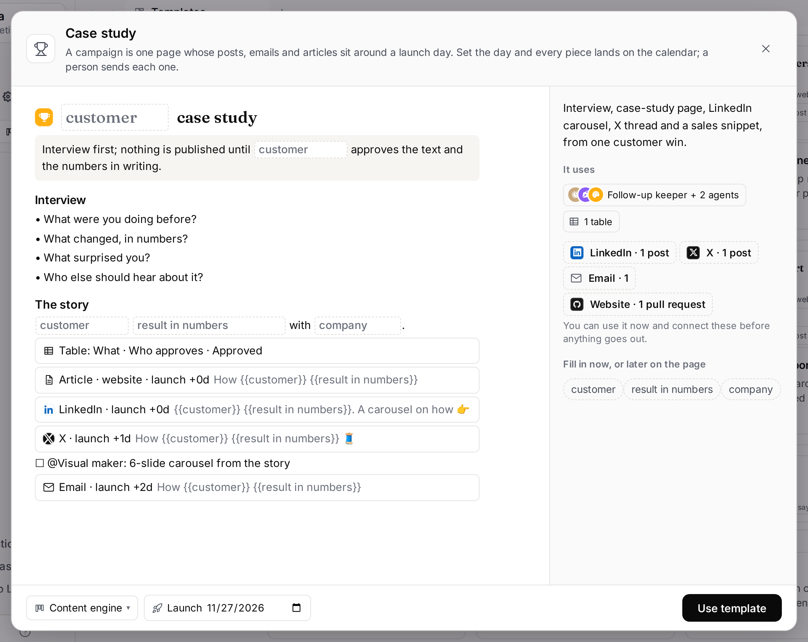

import { Aside, Steps } from '@astrojs/starlight/components';
import Tutorial from '../../../../components/Tutorial.astro';

One customer story with a real number, then posts, an email and a sales one-pager from it.

- **Time:** 1 h
- **Crew:** Content producer, Visual maker
- **Template:** Case study

<Tutorial id="case-study" />

## Before you start

- The customer's yes, in writing, to be named and to each number. The **Customer proof** section template has a **Logo permissions** table for this.
- The call notes and the numbers.
- The [rules](/superstar/how-it-works/#the-rules) every agent keeps.

## Steps

<Steps>

1. **Get permission first**

   What you may say and name, in writing. **Templates** → **Customer proof** gives you **Logo permissions** to keep it, next to **Case studies**.

   

2. **Write the story**

   **Templates** → **Case study**. Give **@Content producer** the call notes and the numbers. Problem, what changed, the result with its number.

3. **Spread it**

   The kit places the posts, the email to prospects in the same industry and the article.

4. **Give it to sales**

   Ask for a one-page version for deal rooms.

</Steps>

## The template

**Case study** is a campaign. Open it from **Templates** in the sidebar. It makes interview questions, **The story** line, an **Approvals** table, the article for your website, a LinkedIn post, an X post, a to-do for a carousel and an email for sales.

## Prompts

Copy one and change the names. A prompt that starts with an @name goes in a block on the page; the others go in **Ask** (**Ctrl J**).

```text title="A block that starts with @Content producer"
@Content producer Write the Kestrel Insurance case study from these notes: the problem, the 37 rules, 412 failed records on day one and 380 fixed by Friday.
```

```text title="A block that starts with @Content producer"
@Content producer Make a one-page version of the Kestrel story for deal rooms in insurance.
```

## What good looks like

"412 records failed on day one. 380 were fixed by Friday." A number the customer agreed to, with its time frame.

The numbers from Halcyon Data's Kestrel Insurance pilot, as the customer agreed them:

> Kestrel Insurance's claims team wrote 37 rules in the first week of their pilot. 412 records failed on day one. 380 were fixed by Friday.

One story, three numbers, each with its time frame.

## Watch for

- Never a number the customer didn't approve.
- One story, one number: more dilutes it.

## What to count

- Deals where it was sent
- Replies to the industry email

Ask Superstar which Deals pages carry the one-pager, and count replies to the industry email.

## Next

[Plan a week on LinkedIn](/superstar/playbooks/linkedin-week/): three posts in your voice from real material, comments where you add something, nothing posted unvalidated.
