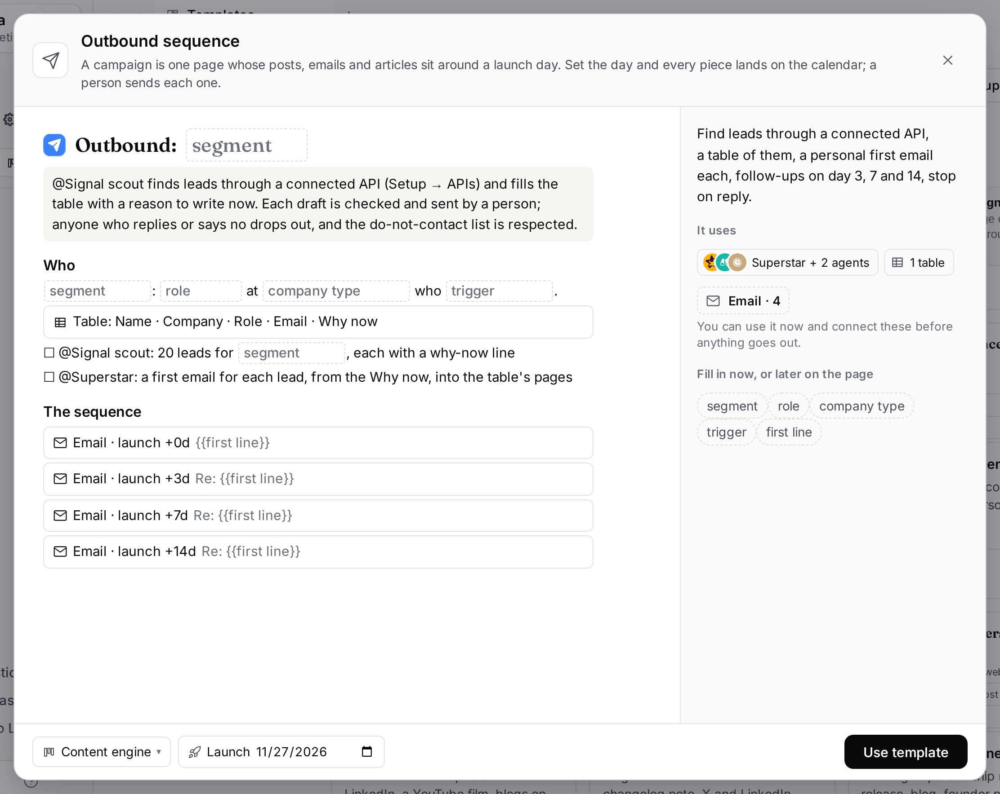
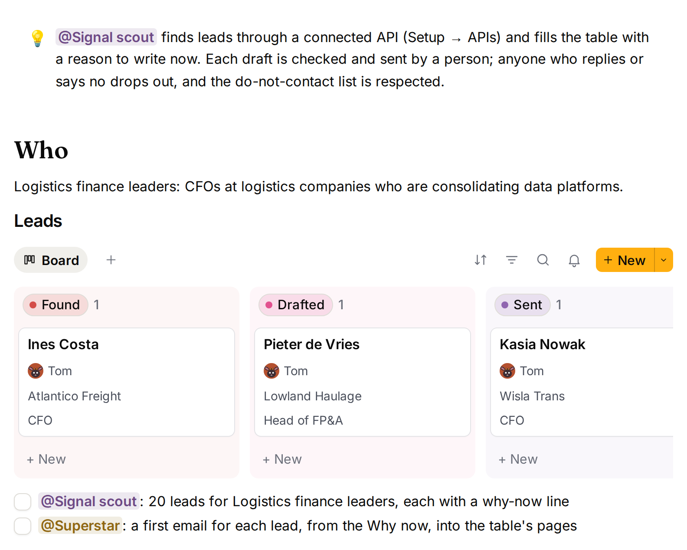
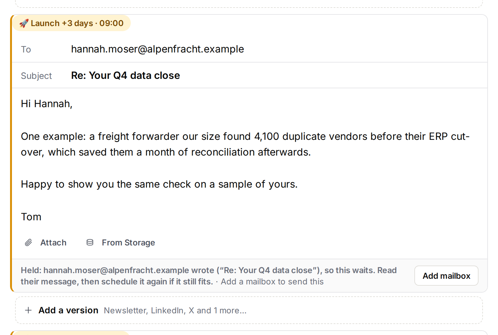
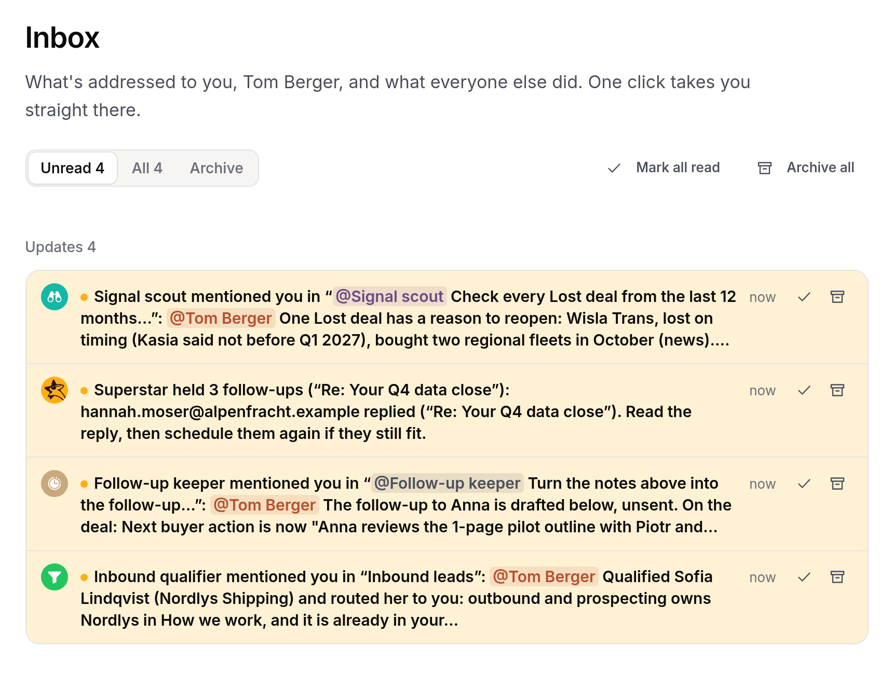

import { Aside, Steps } from '@astrojs/starlight/components';
import Tutorial from '../../../../components/Tutorial.astro';
import PlaybookMeta from '../../../../components/superstar/PlaybookMeta.astro';

Four short emails over two weeks to people with a real reason to hear from you, and none after they write back.

<PlaybookMeta id="cold-outbound" template="Outbound sequence" />

<Tutorial id="cold-outbound" />

## Before you start

- Your mailbox connected. Each email goes from the person who sends it.
- **Do not contact** filled in. Every draft is checked against it.
- A segment you can describe in one line, and a reason each person in it would care now.
- If you write to people in Romania, read [Outreach rules](/superstar/outreach-rules/) first.
- The [rules](/superstar/how-it-works/#the-rules) every agent keeps.

## Steps

<Steps>

1. **Pick a segment**

   **Templates** → **Outbound sequence**: name the segment and the first line. You get a leads board (Found, Drafted, Sent, Follow-up, Replied) and emails for day 0, 3, 7 and 14.

   

2. **Fill the leads**

   Ask **@Signal scout** for people with a **Why now** line each. No why-now, no email: that is what makes it not spam.

   

3. **Write short**

   Day 0: the trigger, the problem, an interest question, under 80 words, a line to say no. Day 3: one proof. Day 7: something useful. Day 14: a polite close.

4. **Schedule from your mailbox**

   A person reads each draft and schedules it. When the prospect writes back, every follow-up still scheduled to them is **held**, with who wrote and why.

   

</Steps>

<Aside type="caution" title="When it holds">
A hold needs your mailbox connected: Superstar reads it every two minutes. Any mail from that address holds the sequence, an out-of-office included. Read it, then schedule again if it still fits.
</Aside>

## The template

**Outbound sequence** is a campaign. Open it from **Templates** in the sidebar. It makes a **Who** line, a **Leads** board (Found, Drafted, Sent, Follow-up 1, Follow-up 2, Replied, Meeting, Not now), two to-dos for the crew, and four emails placed at day 0, 3, 7 and 14.

## Prompts

Copy one and change the names. A prompt that starts with an @name goes in a block on the page; the others go in **Ask** (**Ctrl J**).

```text title="A block that starts with @Signal scout"
@Signal scout Find 20 logistics CFOs with a reason to write now and add them to the Leads board with a Why now line.
```

```text title="Ask (Ctrl J)"
Write the day 0 email for each lead in Drafted: cite their Why now, under 80 words, end with an interest question and a way to say no.
```

```text title="Ask (Ctrl J)"
Rewrite this day 3 email so it adds a new reason instead of "just following up".
```

```text title="Ask (Ctrl J)"
Which sequences were held this week because the prospect replied? List the replies I haven't answered.
```

## What good looks like

"Alpenfracht's annual report says you're moving three ERPs onto one in 2027. Teams doing that usually find the bad master data the week before go-live. Worth 15 minutes to see what we'd flag in yours? If this isn't for you, say so and I won't write again."

Tom's day-0 email to Hannah Moser at Alpenfracht went out on 17 November. The three follow-ups were scheduled for day 3, 7 and 14:

> **Subject:** Your Q4 data close
>
> Hi Hannah,
>
> Alpenfracht's annual report says you're moving three ERPs onto one in 2027. Teams doing that usually find the bad master data the week before go-live.
>
> We check cost-centre, vendor and shipment records continuously and flag what would break the migration, so the clean-up happens months earlier.
>
> Worth 15 minutes to see what we'd flag in yours?
>
> If this isn't for you, say so and I won't write again.
>
> Tom Berger
> Halcyon Data

Hannah replied. Superstar read Tom's mailbox, and each follow-up still scheduled to her stopped with this on it:

> Held: hannah.moser@alpenfracht.example wrote ("Re: Your Q4 data close"), so this waits. Read their message, then schedule it again if it still fits.

Tom got one inbox notice per held email.



<Aside type="note" title="What the numbers say">
Instantly's 2026 benchmark (emails sent 1 January to 18 December 2025) found the best first emails run under 80 words, and that 58% of replies came from the first email and 42% from follow-ups ([Instantly](https://instantly.ai/cold-email-benchmark-report-2026)). In Gong's analysis of 304,174 cold emails, an interest question ("Worth a look?") did best as the ask ([Gong](https://www.gong.io/blog/this-surprising-cold-email-cta-will-help-you-book-a-lot-more-meetings)), and generic "did you see my email?" follow-ups were 15 times less likely to book a meeting ([Gong](https://www.gong.io/blog/7-tips-for-writing-the-perfect-follow-up-sales-email-according-to-science)). These are vendors measuring their own users: read them as direction, not promises.
</Aside>

## Watch for

- Romania: cold commercial email to company addresses needs prior consent (Law 506/2004 art. 12). Use a warm intro, inbound or LinkedIn there.
- Every opt-out goes to Do not contact the same day.
- Never "did you see my email?": add a reason or stop.

## What to count

- Positive reply rate (not opens)
- Meetings per 100 prospects
- Opt-out and complaint rate

The Leads board shows how many reached **Replied** and **Meeting**. Count opt-outs from rows you add to Do not contact.

## Next

[Turn call notes into the follow-up](/superstar/playbooks/follow-ups/): paste the notes; get the follow-up email and the deal's next buyer action with its date.
