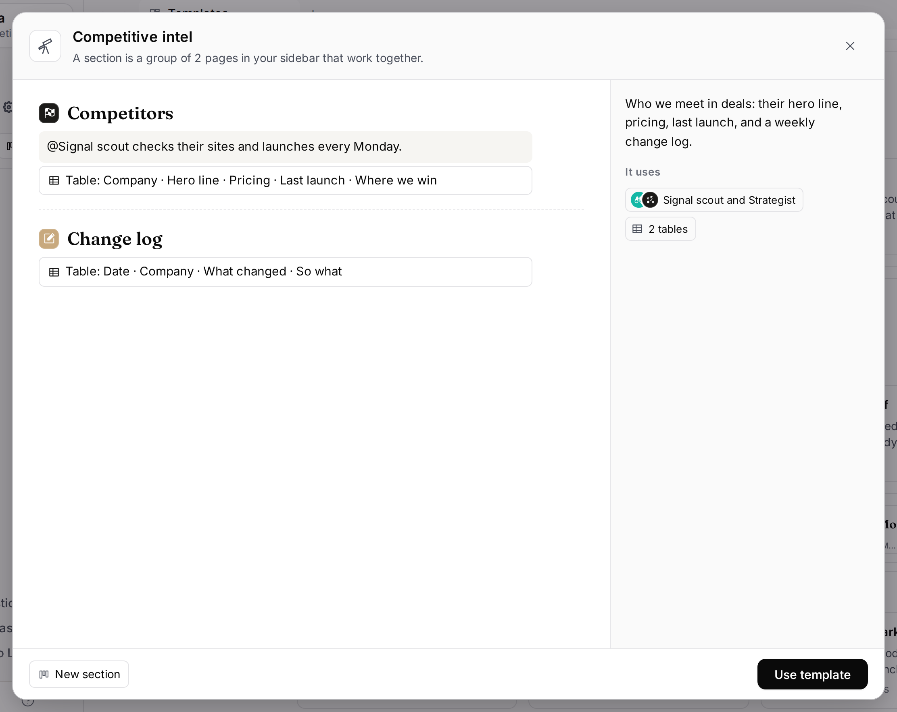

import { Aside, Steps } from '@astrojs/starlight/components';
import Tutorial from '../../../../components/Tutorial.astro';
import PlaybookMeta from '../../../../components/superstar/PlaybookMeta.astro';

What each competitor changed this week, with sources, and what it means for your deals.

<PlaybookMeta id="competitive-intel" template="Competitive intel" />

<Tutorial id="competitive-intel" />

## Before you start

- The two or three competitors you meet in deals, not every company in your space.
- The [rules](/superstar/how-it-works/#the-rules) every agent keeps.

## Steps

<Steps>

1. **List them**

   **Templates** → **Competitive intel**: one row per competitor in **Competitors**.

   

2. **Weekly check**

   Ask **@Signal scout** every Friday for changes: pricing, releases, hires, customers, messaging. Each goes to **Change log** with its source.

3. **So what**

   Ask **@Strategist** what it means for open deals and your messaging.

</Steps>

## The template

**Competitive intel** is a section. Open it from **Templates** in the sidebar. It makes two pages: **Competitors** (Company, Hero line, Pricing, Last launch, Where we win) and **Change log** (Date, Company, What changed, So what).

## Prompts

Copy one and change the names. A prompt that starts with an @name goes in a block on the page; the others go in **Ask** (**Ctrl J**).

```text title="A block that starts with @Signal scout"
@Signal scout What changed at our three competitors this week: pricing, releases, hires, customers? With sources, into Change log.
```

```text title="A block that starts with @Strategist"
@Strategist Which open deals does this pricing change affect, and what should each owner say?
```

## What good looks like

"Pricing page changed on 14 Nov: the entry plan now caps at 5 tables (link). Two of our open deals compared us on that plan."

A useful Change log row:

| Date | Company | What changed | So what |
|---|---|---|---|
| 2026-11-14 | (competitor) | Entry plan now caps at 5 tables (pricing page) | Two open deals compared us on that plan |

The **So what** is the column that earns the row its place.

## Watch for

- Public sources only. No pretending to be a buyer.

## What to count

- Changes logged a week
- Deals where it changed what we said

Count Change log rows a week, and ask the Strategist which deals each one touched.

## Next

[Write your ICP and messaging](/superstar/playbooks/positioning/): who you sell to, what they struggle with, and the words you use, written once for the team and the crew.
