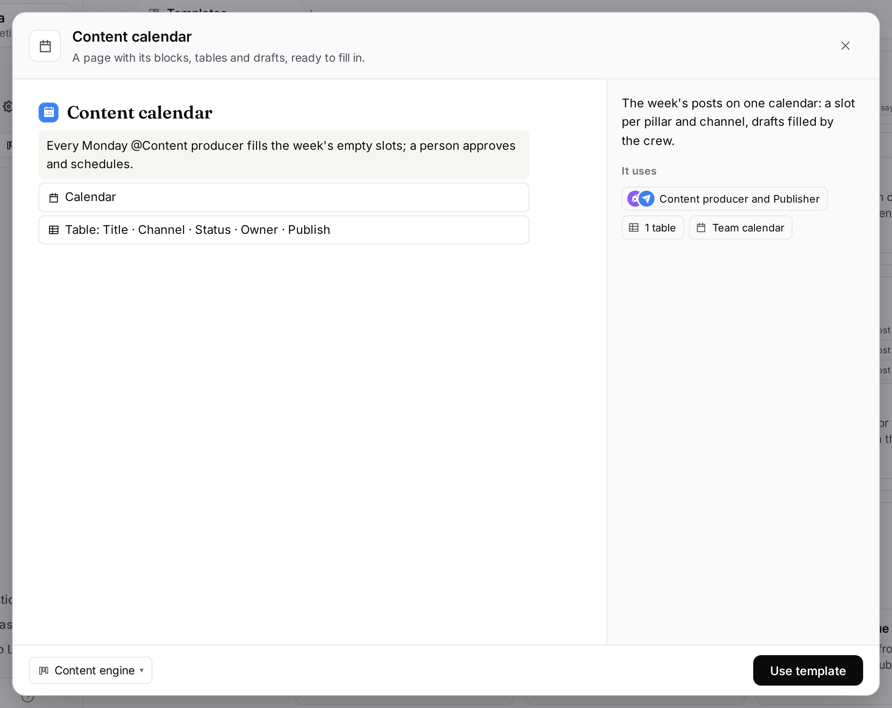
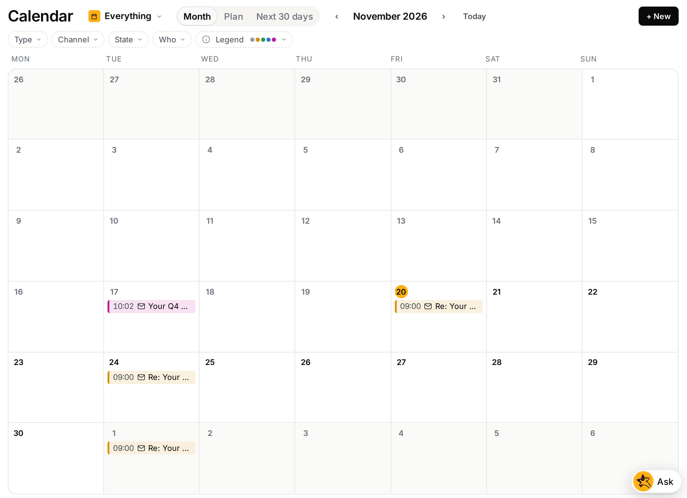

import { Aside, Steps } from '@astrojs/starlight/components';
import Tutorial from '../../../../components/Tutorial.astro';

A month on the calendar: themes per week, pieces per platform, owners and dates.

- **Time:** 1 h a month
- **Crew:** Strategist, Content producer
- **Template:** Content calendar

<Tutorial id="content-calendar" />

## Before you start

- Last month's best posts, and the month's goals in writing.
- The [rules](/superstar/how-it-works/#the-rules) every agent keeps.

## Steps

<Steps>

1. **Themes**

   **Templates** → **Content calendar**. Ask **@Strategist** for four weekly themes from your goals and what performed.

   

2. **Pieces**

   **@Content producer** drafts the pieces into each week.

3. **Check the calendar**

   **Calendar** shows every piece by day and profile. Drag to move; Validate all, then they go out.

   

</Steps>

## The template

**Content calendar** is a page. Open it from **Templates** in the sidebar. It makes a calendar of the team's pieces and a **Content** board by Status.

## Prompts

Copy one and change the names. A prompt that starts with an @name goes in a block on the page; the others go in **Ask** (**Ctrl J**).

```text title="A block that starts with @Strategist"
@Strategist Plan December's content: one theme a week from our goals and last month's best posts.
```

```text title="A block that starts with @Content producer"
@Content producer Draft week 1's pieces: two LinkedIn posts, one X thread, one newsletter section.
```

## What good looks like

Each week has one theme, one owner and pieces on at most three platforms.

A week planned well:

| Week | Theme | Owner | Pieces |
|---|---|---|---|
| 1 | The close is a data problem | Maya | 2 LinkedIn posts, 1 X thread, 1 newsletter section |

One theme, one owner, three platforms at most.

## Watch for

- Leave room for news: plan 70%, keep 30% open.

## What to count

- Pieces planned vs published

The Calendar shows planned against posted, by state. Filter **State** to Posted at the end of the month.

## Next

[Turn one source into many pieces](/superstar/playbooks/content-engine/): one talk, customer story or release becomes posts, a newsletter section and an article, each written for where it goes.
