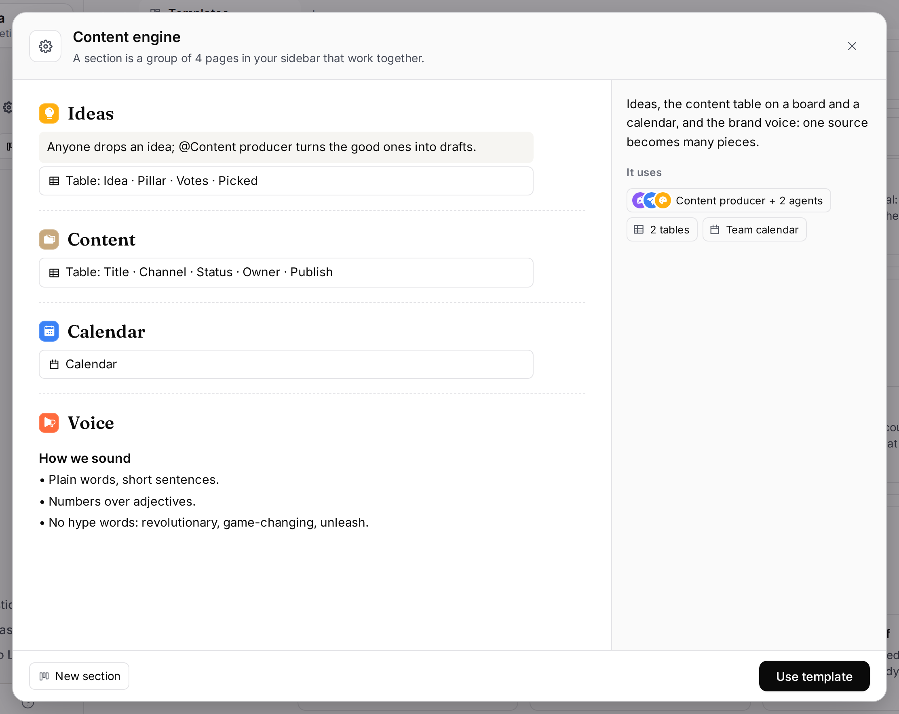
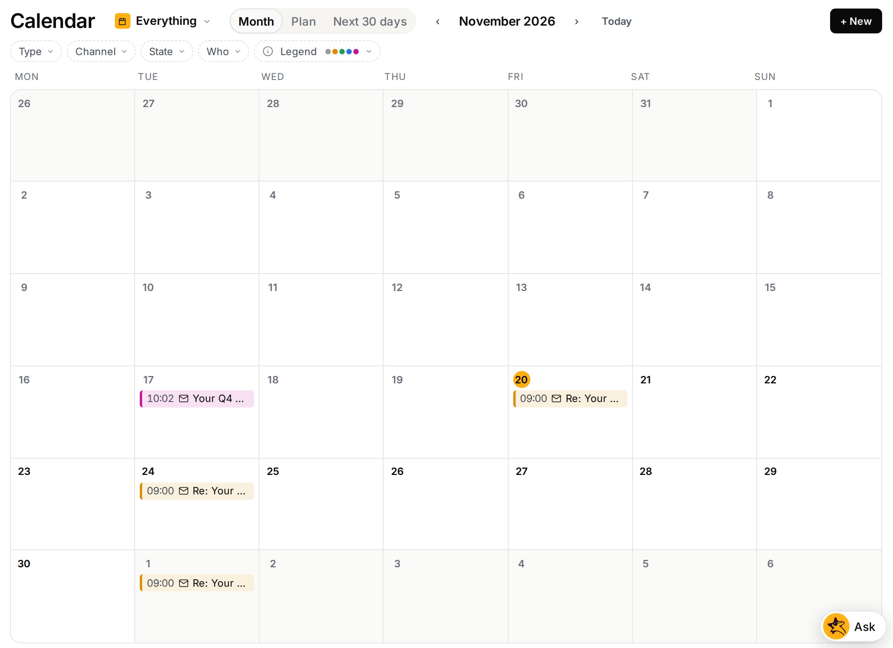

import { Aside, Steps } from '@astrojs/starlight/components';
import Tutorial from '../../../../components/Tutorial.astro';
import PlaybookMeta from '../../../../components/superstar/PlaybookMeta.astro';

One talk, customer story or release becomes posts, a newsletter section and an article, each written for where it goes.

<PlaybookMeta id="content-engine" template="Content engine" />

<Tutorial id="content-engine" />

## Before you start

- One source a week or a fortnight: a customer call, a talk, a release, a founder memo.
- A **Voice** page the producer can follow.
- The [rules](/superstar/how-it-works/#the-rules) every agent keeps.

## Steps

<Steps>

1. **Set it up**

   **Templates** → **Content engine**: Ideas, Content, Calendar and Voice.

   

2. **Feed Ideas**

   Anyone adds a source to **Ideas**: a call, a number, a question a customer asked.

3. **Ask for the pieces**

   Ask **@Content producer** to turn one idea into the pieces you need. **@Visual maker** and **@Video producer** add cards and short videos.

4. **Calendar**

   Pieces land on **Calendar**. Validate, then the Publisher posts them at their times: LinkedIn, X (a thread is one post with its parts), Facebook, Instagram, TikTok and YouTube.

   

</Steps>

## The template

**Content engine** is a section. Open it from **Templates** in the sidebar. It makes four pages: **Ideas** (Idea, Pillar, Votes, Picked), **Content** on a board by Status (Idea, Drafting, In review, Approved, Scheduled, Live), **Calendar** and **Voice**.

## Prompts

Copy one and change the names. A prompt that starts with an @name goes in a block on the page; the others go in **Ask** (**Ctrl J**).

```text title="A block that starts with @Content producer"
@Content producer Turn the Kestrel kickoff notes into: 2 LinkedIn posts, an X thread, a newsletter section and a 600-word article.
```

```text title="A block that starts with @Video producer"
@Video producer Write a 30-second video brief from the anomaly alerts launch post.
```

```text title="Ask (Ctrl J)"
What did we publish this month, and which pieces did best?
```

## What good looks like

Every piece makes one point from the source and stands on its own.

From one source, Halcyon Data's Kestrel kickoff, the pieces each take a different angle:

- A LinkedIn post on the 37 rules, from the claims team's side.
- A question post on why the close is slow: "it's the two days it takes to find which of 40,000 rows is wrong."
- A newsletter section with the numbers: 412 failed on day one, 380 fixed by Friday.

None repeats another's text.

## Watch for

- Never the same text twice: X drops duplicates, and Instagram and YouTube favour originals. Each piece makes its own point from the source.
- Pieces on one profile keep its gap: spread them over the week.

## What to count

- Pieces shipped per source
- Engagement per piece
- Leads that mention content

The **Content** board counts pieces by Status. Ask Superstar the third prompt at the end of the month.

## Next

[Send a newsletter people read](/superstar/playbooks/newsletter/): a monthly issue from what happened, sent only to people who asked for it.
