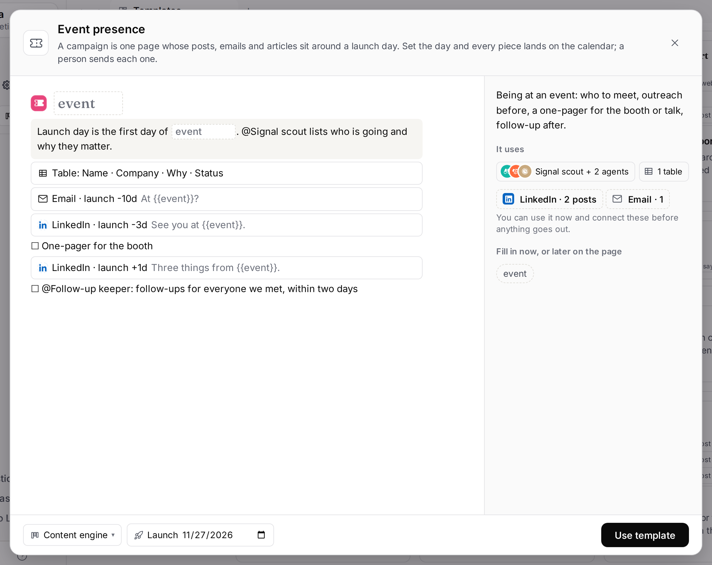

import { Aside, Steps } from '@astrojs/starlight/components';
import Tutorial from '../../../../components/Tutorial.astro';
import PlaybookMeta from '../../../../components/superstar/PlaybookMeta.astro';

Every conversation from the stand followed up within two days, while they still remember you.

<PlaybookMeta id="event-follow-up" template="Event presence" />

<Tutorial id="event-follow-up" />

## Before you start

- The event's dates, and who from your team is going.
- A way to add people at the stand: Superstar works on a phone browser.
- The [rules](/superstar/how-it-works/#the-rules) every agent keeps.

## Steps

<Steps>

1. **Before**

   **Templates** → **Event presence**: the posts and the invite email around the day.

   

2. **At the stand**

   Add each person to **People** with one line on what you talked about. A photo of the badge is fine.

3. **Within two days**

   Ask **@Follow-up keeper** to draft each follow-up from that line. Send them yourself.

4. **After**

   Ask **@Content producer** for a post on what you learned there.

</Steps>

## The template

**Event presence** is a campaign. Open it from **Templates** in the sidebar. It makes a **Who to meet** table (Name, Company, Why, Status: To reach, Reached, Meeting set, Met), an invite email ten days before, a LinkedIn post three days before and one the day after, a to-do for the booth one-pager and one for the Follow-up keeper.

## Prompts

Copy one and change the names. A prompt that starts with an @name goes in a block on the page; the others go in **Ask** (**Ctrl J**).

```text title="A block that starts with @Follow-up keeper"
@Follow-up keeper Draft a follow-up for everyone we met at LogiMAT, from the notes in People, each one referring to what we talked about.
```

```text title="A block that starts with @Content producer"
@Content producer Write a LinkedIn post on the three things we heard most at LogiMAT, in Maya's voice.
```

## What good looks like

"Good to meet you at the stand on Tuesday. You mentioned your close slips on cost-centre codes; here's the two-page check we talked about."

The line you add at the stand is what makes the follow-up personal. "Head of FP&A, close slips on cost-centre codes, wants the two-page check" becomes:

> Good to meet you at the stand on Tuesday. You mentioned your close slips on cost-centre codes; here's the two-page check we talked about.

Without the line, the keeper has nothing to say except that you met.

## Watch for

- Only people who agreed to hear from you. A scanned badge is not consent to a newsletter.
- The invite before the event goes only to people you already talk to. Strangers you'd like to meet: a warm intro, or a comment on their post first.

## What to count

- Follow-ups sent within two days
- Meetings booked from the event

Count People rows with the event as **Source**, how many got a follow-up within two days, and the deals that name the event.

## Next

[Turn call notes into the follow-up](/superstar/playbooks/follow-ups/): paste the notes; get the follow-up email and the deal's next buyer action with its date.
