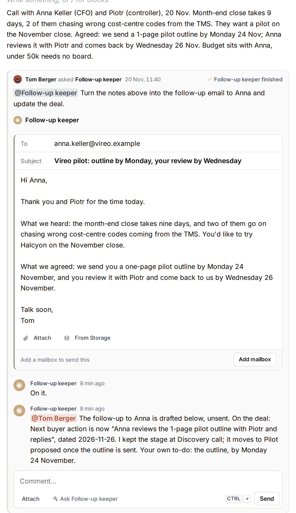
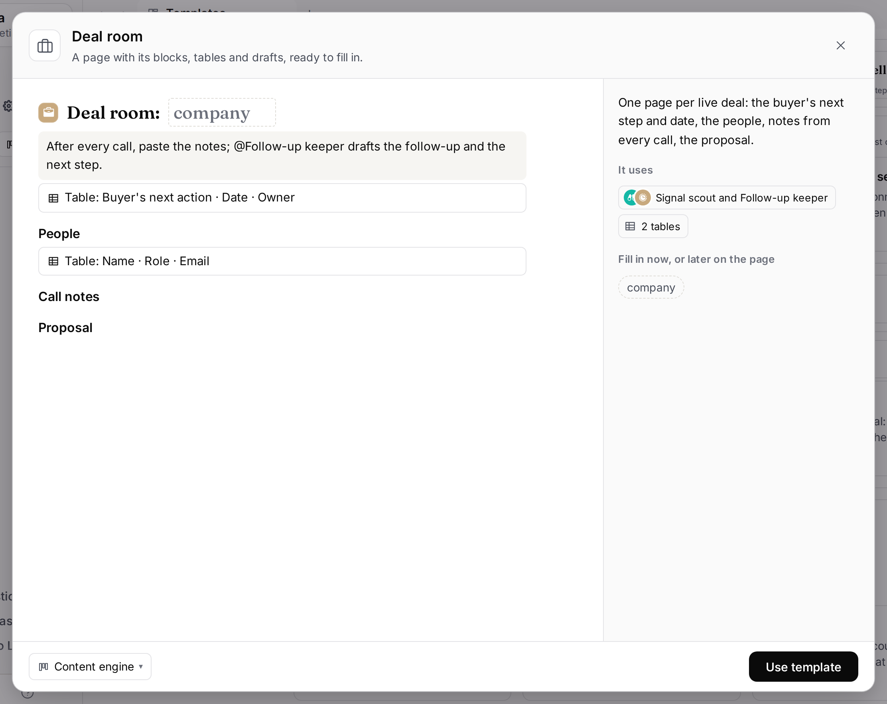

import { Aside, Steps } from '@astrojs/starlight/components';
import Tutorial from '../../../../components/Tutorial.astro';

Paste the notes; get the follow-up email and the deal's next buyer action with its date.

- **Time:** 2 min a call
- **Crew:** Follow-up keeper
- **Template:** Deal room

<Tutorial id="follow-ups" />

## Before you start

- A **Deals** row for the deal, and a deal room page (Templates → **Deal room**) for its notes.
- Your mailbox connected.
- The [rules](/superstar/how-it-works/#the-rules) every agent keeps.

## Steps

<Steps>

1. **After the call**

   On the deal room page, paste your notes as they are. Who was there, what hurts, what was agreed, by when.

2. **Ask the keeper**

   Ask **@Follow-up keeper**. It drafts the email (what we heard, what we agreed, dates) and sets the deal's **Next buyer action** and **Next action date** on **Deals**.

   

3. **Send it today**

   Read, fix, send from your mailbox. Your own to-dos land in **My tasks**.

4. **Every morning**

   The keeper checks for deals whose date has passed and tells their owner what to do.

</Steps>

## The template

**Deal room** is a page. Open it from **Templates** in the sidebar. It makes a **Next step** table (Buyer's next action, Date, Owner), a **People** table, and headings for **Call notes** and the **Proposal**.



## Prompts

Copy one and change the names. A prompt that starts with an @name goes in a block on the page; the others go in **Ask** (**Ctrl J**).

```text title="A block that starts with @Follow-up keeper"
@Follow-up keeper Turn the notes above into the follow-up email to Anna and update the deal.
```

```text title="A block that starts with @Follow-up keeper"
@Follow-up keeper Which deals have no buyer action or a date in the past? Draft a nudge for each.
```

```text title="A block that starts with @Follow-up keeper"
@Follow-up keeper Write a mutual action plan for Ostra Retail from today to signature.
```

## What good looks like

Next buyer action: "Anna reviews the 1-page pilot outline with Piotr and replies", 26 Nov. A step the buyer takes, not "follow up".

Tom's notes, pasted as they were:

> Call with Anna Keller (CFO) and Piotr (controller), 20 Nov. Month-end close takes 9 days, 2 of them chasing wrong cost-centre codes from the TMS. They want a pilot on the November close. Agreed: we send a 1-page pilot outline by Monday 24 Nov; Anna reviews it with Piotr and comes back by Wednesday 26 Nov. Budget sits with Anna, under 50k needs no board.

The keeper's draft, for Tom to send:

> **Subject:** Vireo pilot: outline by Monday, your review by Wednesday
>
> Hi Anna,
>
> Thank you and Piotr for the time today.
>
> What we heard: the month-end close takes nine days, and two of them go on chasing wrong cost-centre codes coming from the TMS. You'd like to try Halcyon on the November close.
>
> What we agreed: we send you a one-page pilot outline by Monday 24 November, and you review it with Piotr and come back to us by Wednesday 26 November.
>
> Talk soon,
> Tom

On **Deals**, it set Next buyer action to "Anna reviews the 1-page pilot outline with Piotr and replies", dated 2026-11-26. It kept the stage at Discovery call and said why: the stage moves to Pilot proposed once the outline is sent.

<Aside type="note" title="The ask changes once a deal is live">
In Gong's analysis of 304,174 emails, a specific day and time did better than an interest question once a deal was active (37% against 25%) ([Gong](https://www.gong.io/blog/this-surprising-cold-email-cta-will-help-you-book-a-lot-more-meetings)). A follow-up ends on a date.
</Aside>

## Watch for

- The buyer's step, not yours: "send proposal" is your to-do, "reviews it with legal" is theirs.
- A stage moves on evidence, not hope: the keeper won't move it without one.

## What to count

- Hours from call to follow-up sent
- Open deals with a future buyer date
- Buyer steps done on time

On **Deals**, filter **Next action date** before today. The keeper's daily comment on the Deals table lists the same, by owner.

## Next

[Run the weekly pipeline review](/superstar/playbooks/pipeline-review/): three deals to push, each owner's next step, and what's missing, ready before the meeting.
