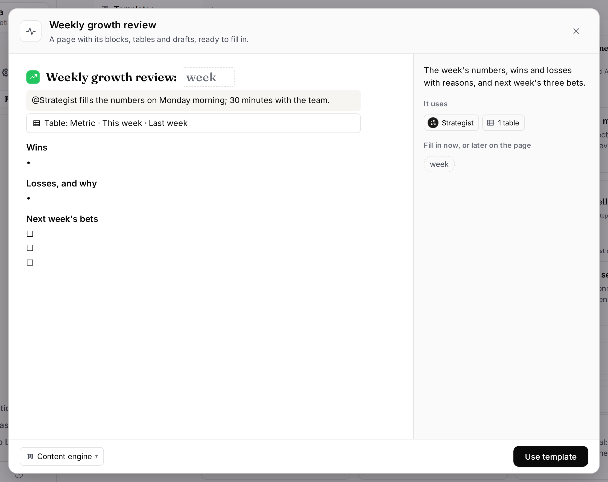

import { Aside, Steps } from '@astrojs/starlight/components';
import Tutorial from '../../../../components/Tutorial.astro';

The week's numbers, what worked, what didn't, and next week's plan, on one page.

- **Time:** 30 min a week
- **Crew:** Strategist
- **Template:** Weekly growth review

<Tutorial id="growth-review" />

## Before you start

- A **Scorecard** table, and an **Experiments** table for what you try. The Strategist counts into them; the weekly review template starts with a Numbers table you can use instead.
- Targets written down by the team. The Strategist never sets one.
- The [rules](/superstar/how-it-works/#the-rules) every agent keeps.

## Steps

<Steps>

1. **Monday morning**

   **@Strategist** adds this week's row to **Scorecard**, then writes the plan on a **Weekly growth review** page.

   

2. **Read it together**

   What moved and why. Keep, stop, try.

3. **Experiments**

   Each try gets a row in **Experiments**: what, the expected result, the owner, the end date.

</Steps>

## The template

**Weekly growth review** is a page. Open it from **Templates** in the sidebar. It makes a **Numbers** table (Metric, This week, Last week), **Wins**, **Losses, and why**, and three to-dos for **Next week's bets**.

## Prompts

Copy one and change the names. A prompt that starts with an @name goes in a block on the page; the others go in **Ask** (**Ctrl J**).

```text title="A block that starts with @Strategist"
@Strategist Write this week's growth review: the Scorecard, what worked, what didn't, and three things to try.
```

```text title="A block that starts with @Strategist"
@Strategist Which experiments ended this month and what did each show?
```

## What good looks like

"LinkedIn question posts got 3 times the comments of announcements this month: two more next week."

A line worth keeping, because it ends in a decision:

> LinkedIn question posts got 3 times the comments of announcements this month: two more next week.

Every number in the review links to where it came from.

## Watch for

- Numbers from the source, not memory: the strategist links each.

## What to count

- Experiments started and finished
- The one number you grow this quarter

Experiments started and finished, from the Experiments table.

## Next

[Run the weekly pipeline review](/superstar/playbooks/pipeline-review/): three deals to push, each owner's next step, and what's missing, ready before the meeting.
