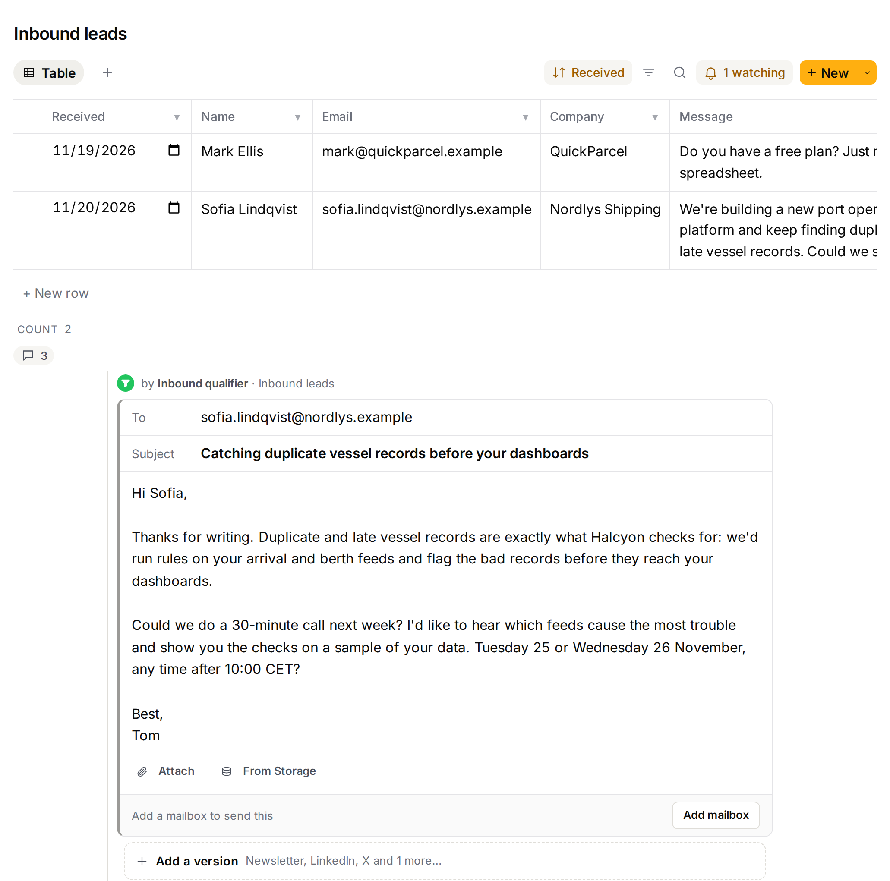
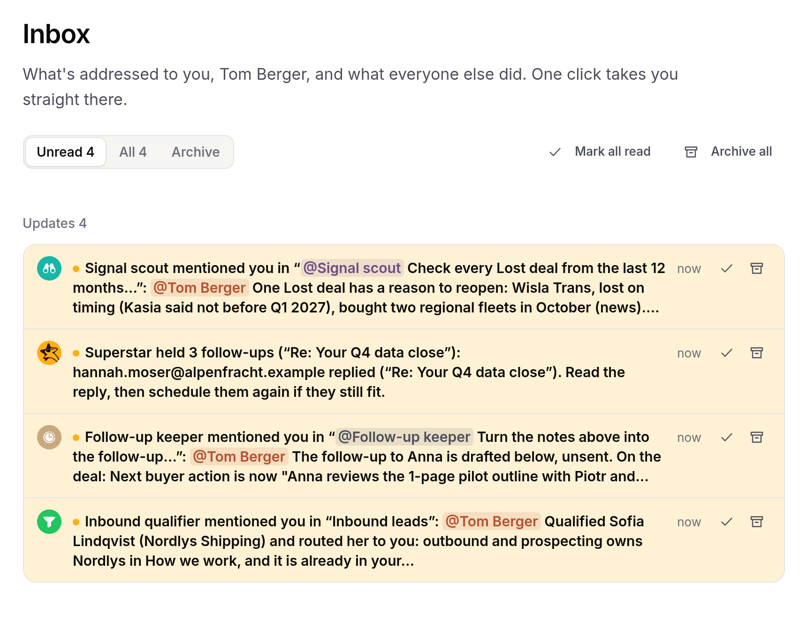
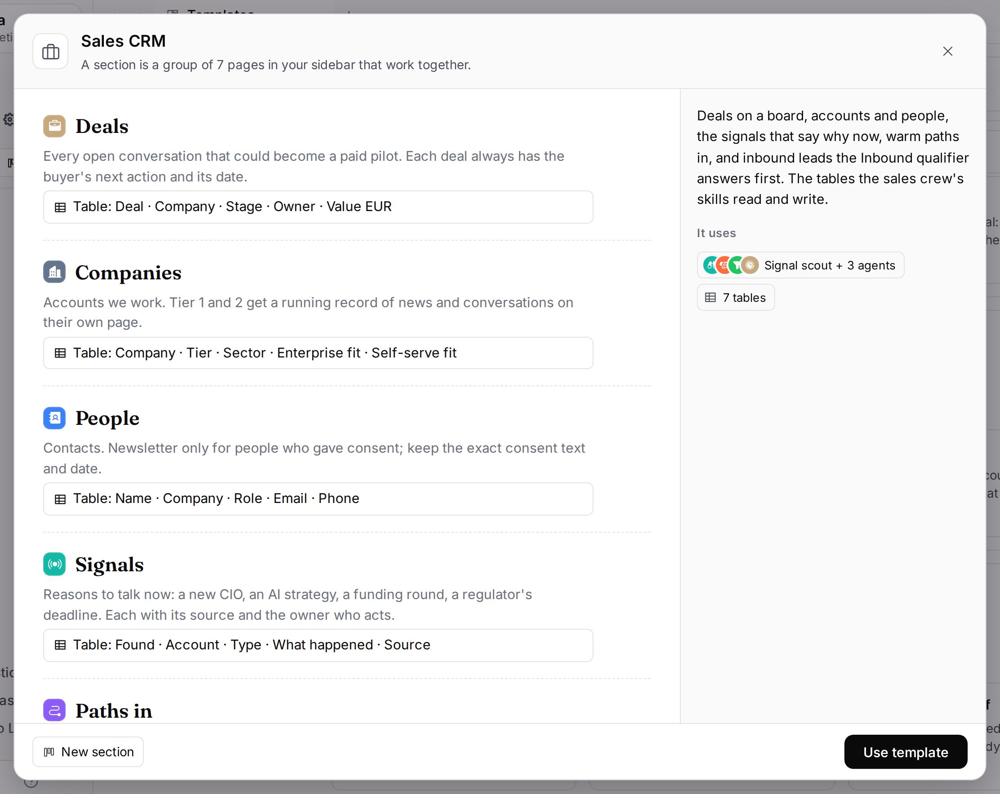

import { Aside, Steps } from '@astrojs/starlight/components';
import Tutorial from '../../../../components/Tutorial.astro';
import PlaybookMeta from '../../../../components/superstar/PlaybookMeta.astro';

A new lead is researched, scored, routed and has its reply drafted before anyone opens it.

<PlaybookMeta id="inbound-leads" template="Sales CRM" />

<Tutorial id="inbound-leads" />

## Before you start

- The [Sales desk](/superstar/playbooks/sales-desk/) or the **Sales CRM** section, so **Inbound leads** exists with its watch.
- A person on **Growth ops and inbound** in the Owners table (and on the other roles, for leads that fit them).
- Your mailbox connected (**Setup** → **Mail**), so the owner can send the reply.
- The [rules](/superstar/how-it-works/#the-rules) every agent keeps.

## Steps

<Steps>

1. **Where leads land**

   The website form writes a row to **Inbound leads**. Leads from hello@ or a call: add the row yourself with Status **New**.

   

2. **The watch hands it on**

   A row with Status New starts **Inbound qualifier** on its own. It checks **Do not contact**, researches the company, scores enterprise and self-serve fit, sets Status and Owner by **How we work** and adds the person to **People**.

   

3. **Reply the same hour**

   Its comment says why the lead fits and what to ask on the call. The reply is drafted on the page: read it, fix it, send it from your mailbox.

4. **Not a fit**

   It marks the lead **Not a fit** with the reason and drafts a kind, short answer pointing to what fits them instead.

</Steps>

## The template

**Sales CRM** is a section of seven pages. Open it from **Templates** in the sidebar (the **Sales desk** workspace includes it). Its **Inbound leads** table is where the website form writes: Received, Name, Email, Company, Message, Consent, Consent text, Status (New, Qualified, Not a fit, Spam), Owner and Source. The table watches **Status**: a row set to **New** starts Inbound qualifier on its own.



## Prompts

Copy one and change the names. A prompt that starts with an @name goes in a block on the page; the others go in **Ask** (**Ctrl J**).

```text title="A block that starts with @Inbound qualifier"
@Inbound qualifier Qualify the new leads in Inbound leads, route each one by How we work and draft the first reply.
```

```text title="A block that starts with @Inbound qualifier"
@Inbound qualifier This lead came by phone: Sofia Lindqvist, Nordlys Shipping, wants to catch duplicate vessel records. Add her and draft the reply.
```

```text title="Ask (Ctrl J)"
Which inbound leads from this week still have no reply sent?
```

## What good looks like

"Thanks for writing. Duplicate and late vessel records are exactly what we check for. Could we do 30 minutes next week? Tuesday 25 or Wednesday 26, after 10:00 CET?" Specific to what they wrote, one ask, two real times.

Sofia Lindqvist from Nordlys Shipping wrote through the website form: duplicate and late vessel records, a team of six data engineers. The Inbound qualifier routed her to Tom, because outbound and prospecting owns Nordlys in How we work, and drafted this on the lead's page:

> **Subject:** Catching duplicate vessel records before your dashboards
>
> Hi Sofia,
>
> Thanks for writing. Duplicate and late vessel records are exactly what Halcyon checks for: we'd run rules on your arrival and berth feeds and flag the bad records before they reach your dashboards.
>
> Could we do a 30-minute call next week? I'd like to hear which feeds cause the most trouble and show you the checks on a sample of your data. Tuesday 25 or Wednesday 26 November, any time after 10:00 CET?
>
> Best,
> Tom

Its comment to Tom gave the fit (enterprise 4 of 5, a named pain on a platform they are building now), a signal the Signal scout had already found (three data engineering roles for the same platform), and four questions for the call.

<Aside type="note" title="Why the hour">
An HBR audit of 2,241 US companies (2011) found that firms that tried to reach a lead within an hour were nearly 7 times as likely to qualify it as those that waited longer. The article is paywalled and we could only read summaries of it ([HBR](https://hbr.org/2011/03/the-short-life-of-online-sales-leads)). If nobody has emailed a lead one working hour after it came in, Superstar reminds the owner.
</Aside>

## Watch for

- A person sends every reply. The agent never emails a lead.
- Consent: keep the form's consent text in the row. No consent, no newsletter.

## What to count

- Median time from lead to first reply sent
- Share of leads answered within one working hour
- Lead to meeting rate

Add a **Replied** check or date to your Inbound leads view, or ask Superstar the third prompt above each Friday.

## Next

[Turn call notes into the follow-up](/superstar/playbooks/follow-ups/): paste the notes; get the follow-up email and the deal's next buyer action with its date.
