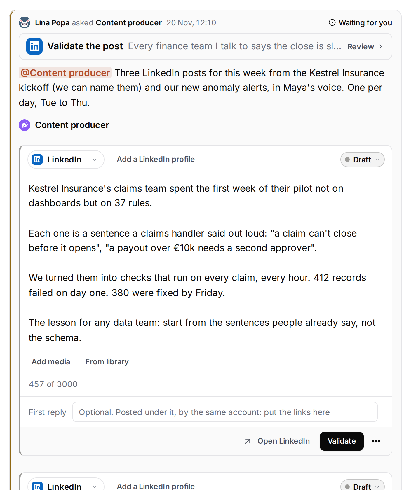
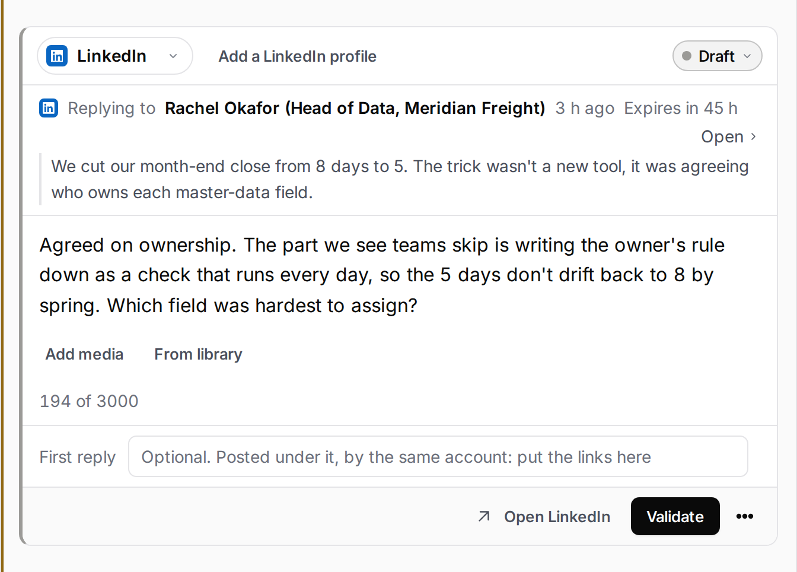
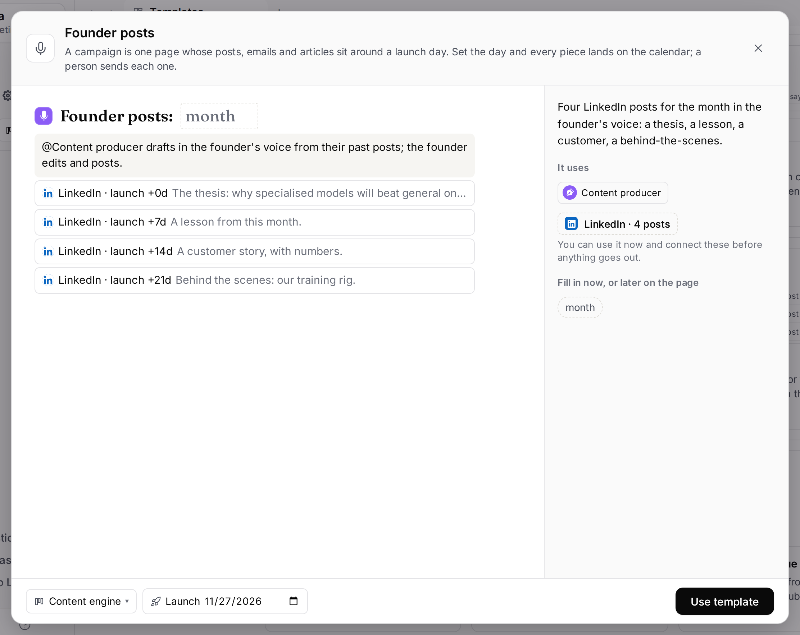

import { Aside, Steps } from '@astrojs/starlight/components';
import Tutorial from '../../../../components/Tutorial.astro';

Three posts in your voice from real material, comments where you add something, nothing posted unvalidated.

- **Time:** 30 min on Monday
- **Crew:** Content producer, Comment scout, Publisher
- **Template:** Founder posts

<Tutorial id="linkedin-week" />

## Before you start

- One piece of real material: a customer story you may name, a release, a number.
- A **Voice** page (the Content engine section has one), so drafts sound like the person.
- For posts on a company page: the profile in **Setup** → **Profiles**. For your own account: you post it.
- The [rules](/superstar/how-it-works/#the-rules) every agent keeps.

## Steps

<Steps>

1. **Give it material**

   A customer story, a release, a number from this week. Ask **@Content producer** for one post a day.

   

2. **Keep the voice**

   The **Voice** page holds how you write. Fix a draft and say why: the producer learns it.

3. **Comments**

   **@Comment scout** drafts comments under posts by the people you sell to. You post comments yourself.

   

4. **Validate**

   Each post waits for its person. Then **Schedule**, or let the Publisher post it at its time.

</Steps>

## The template

**Founder posts** is a campaign. Open it from **Templates** in the sidebar. It makes four LinkedIn posts a week apart: a thesis, a lesson, a customer story and a behind-the-scenes.



## Prompts

Copy one and change the names. A prompt that starts with an @name goes in a block on the page; the others go in **Ask** (**Ctrl J**).

```text title="A block that starts with @Content producer"
@Content producer Three LinkedIn posts for this week from the Kestrel kickoff and our anomaly alerts, in Maya's voice. One a day, Tue to Thu.
```

```text title="A block that starts with @Content producer"
@Content producer Rewrite this post shorter, with the number first and no hashtags.
```

## What good looks like

"Kestrel's claims team spent the first pilot week not on dashboards but on 37 rules. Each one is a sentence a claims handler said out loud."

The first of the three drafts, from the Kestrel Insurance kickoff:

> Kestrel Insurance's claims team spent the first week of their pilot not on dashboards but on 37 rules.
>
> Each one is a sentence a claims handler said out loud: "a claim can't close before it opens", "a payout over €10k needs a second approver".
>
> We turned them into checks that run on every claim, every hour. 412 records failed on day one. 380 were fixed by Friday.
>
> The lesson for any data team: start from the sentences people already say, not the schema.

The producer noted that Kestrel's name is used as agreed on their logo permission, and that the drafts wait for Maya's validation.

<Aside type="note" title="What LinkedIn says it wants">
LinkedIn's March 2026 feed update says it favours "genuine insight, actionable ideas, and thoughtful perspectives", and works against comment automation, engagement pods and comment-to-agree bait ([LinkedIn](https://news.linkedin.com/2026/ImprovingTheFeed)).
</Aside>

## Watch for

- Name a customer only with their permission (Logo permissions).
- One idea per post.

## What to count

- Posts a week
- Comments received per post
- Profile visits to conversations

The Strategist reads each posted post's numbers at 24 and 72 hours on its Monday run, when its run is signed in to the profile.

## Next

[Turn one source into many pieces](/superstar/playbooks/content-engine/): one talk, customer story or release becomes posts, a newsletter section and an article, each written for where it goes.
