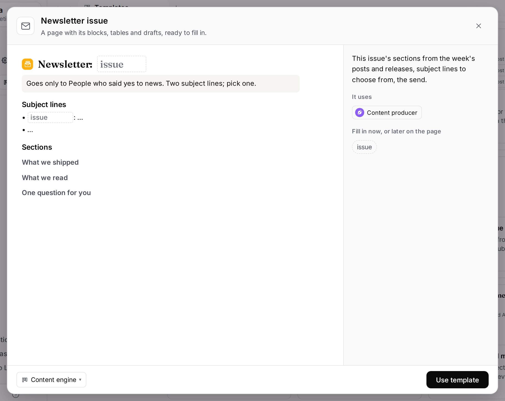

import { Aside, Steps } from '@astrojs/starlight/components';
import Tutorial from '../../../../components/Tutorial.astro';

A monthly issue from what happened, sent only to people who asked for it.

- **Time:** 1 h a month
- **Crew:** Content producer
- **Template:** Newsletter issue

<Tutorial id="newsletter" />

## Before you start

- People with **Newsletter consent** ticked, and the consent text and date kept in their rows.
- This month's releases and best posts.
- The [rules](/superstar/how-it-works/#the-rules) every agent keeps.

## Steps

<Steps>

1. **Start the issue**

   **Templates** → **Newsletter**: the issue's name.

   

2. **Fill it**

   Ask **@Content producer** for the issue from this month's releases, posts and one story.

3. **Send**

   **Send** on the issue goes to everyone in **People** with newsletter consent. A restart mid-send stops it; **Send the rest** reaches only those it missed.

</Steps>

## The template

**Newsletter issue** is a page. Open it from **Templates** in the sidebar. It makes two subject lines to choose from and three sections: **What we shipped**, **What we read** and **One question for you**.

## Prompts

Copy one and change the names. A prompt that starts with an @name goes in a block on the page; the others go in **Ask** (**Ctrl J**).

```text title="A block that starts with @Content producer"
@Content producer Write this month's newsletter from our releases, best two posts and the Kestrel story. Under 400 words.
```

```text title="Ask (Ctrl J)"
Write three subject lines for this issue, under 6 words each.
```

## What good looks like

One story at the top, three short items, one link each.

An issue with one story on top:

> **Kestrel's first week: 37 rules, 412 failures, 380 fixed**
> What a claims team learned when they wrote their rules as sentences.
>
> Also this month: anomaly alerts are live; the close question from LinkedIn; one event in December.

One link each, and the unsubscribe line at the foot.

## Watch for

- Consent only: no consent, no newsletter.
- Every issue carries a way to unsubscribe.

## What to count

- Opens and clicks per issue
- Unsubscribes
- Replies

Opens, clicks and unsubscribes per issue.

## Next

[Turn one source into many pieces](/superstar/playbooks/content-engine/): one talk, customer story or release becomes posts, a newsletter section and an article, each written for where it goes.
