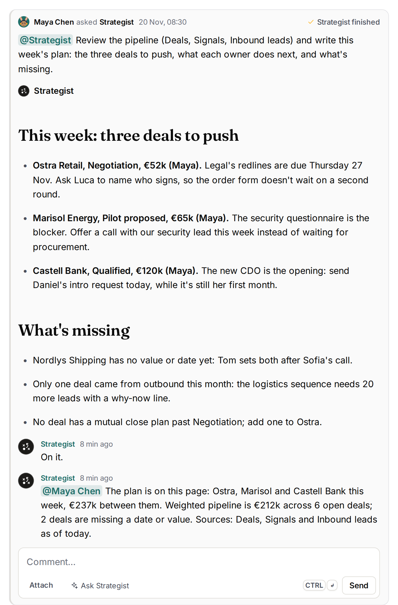
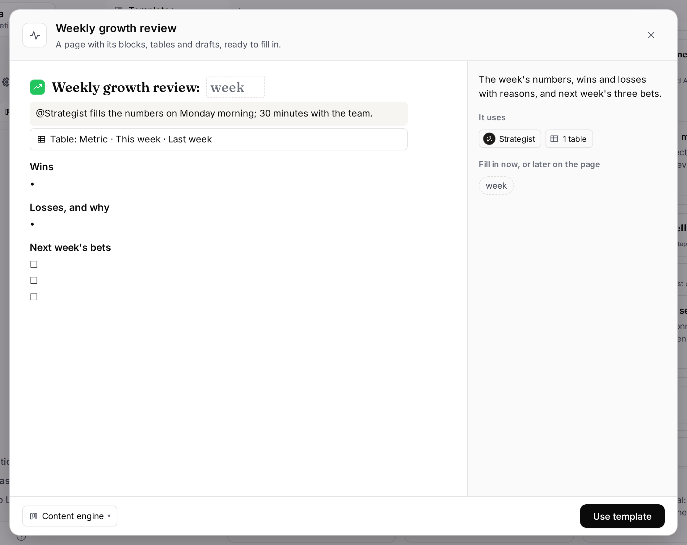

import { Aside, Steps } from '@astrojs/starlight/components';
import Tutorial from '../../../../components/Tutorial.astro';
import PlaybookMeta from '../../../../components/superstar/PlaybookMeta.astro';

Three deals to push, each owner's next step, and what's missing, ready before the meeting.

<PlaybookMeta id="pipeline-review" template="Weekly growth review" />

<Tutorial id="pipeline-review" />

## Before you start

- **Deals** with a stage, an owner, a value and a buyer action on each open deal.
- Thirty minutes on Monday with whoever owns deals.
- The [rules](/superstar/how-it-works/#the-rules) every agent keeps.

## Steps

<Steps>

1. **Before the meeting**

   On a new page, ask **@Strategist** to review **Deals**, **Signals** and **Inbound leads**. Or set it as a Monday repeat.

2. **What you get**

   The deals to push this week and why, what each owner does next, and the gaps: deals with no value or date, plays with too few leads.

   

3. **In the meeting**

   Go through the three deals only. Fix stages and dates on **Deals** as you talk.

4. **After**

   Hand each next step out as a to-do with an owner and a date.

</Steps>

## The template

**Weekly growth review** is a page. Open it from **Templates** in the sidebar. It makes a **Numbers** table (Metric, This week, Last week), **Wins**, **Losses, and why**, and three to-dos for **Next week's bets**.



## Prompts

Copy one and change the names. A prompt that starts with an @name goes in a block on the page; the others go in **Ask** (**Ctrl J**).

```text title="A block that starts with @Strategist"
@Strategist Review the pipeline (Deals, Signals, Inbound leads) and write this week's plan: the three deals to push, what each owner does next, and what's missing.
```

```text title="A block that starts with @Strategist"
@Strategist Compare this month's pipeline with last month's: created, won, lost, stuck, and why.
```

## What good looks like

"Ostra Retail, Negotiation, €52k: legal's redlines are due Thursday. Ask Luca to name who signs, so the order form doesn't wait on a second round."

The Strategist's plan for Halcyon Data's week of 17 November:

> **This week: three deals to push**
> - **Ostra Retail, Negotiation, €52k (Maya).** Legal's redlines are due Thursday 27 Nov. Ask Luca to name who signs, so the order form doesn't wait on a second round.
> - **Marisol Energy, Pilot proposed, €65k (Maya).** The security questionnaire is the blocker. Offer a call with our security lead this week instead of waiting for procurement.
> - **Castell Bank, Qualified, €120k (Maya).** The new CDO is the opening: send Daniel's intro request today, while it's still her first month.
>
> **What's missing**
> - Nordlys Shipping has no value or date yet: Tom sets both after Sofia's call.
> - Only one deal came from outbound this month: the logistics sequence needs 20 more leads with a why-now line.
> - No deal has a mutual close plan past Negotiation; add one to Ostra.

Each line names the deal, the stage, the value, the owner and one action.

## Watch for

- Review deals, not people.
- A deal stuck 14 days with no buyer step is a deal to requalify or close.

## What to count

- Deals with a future buyer date
- Deals stale over 14 days
- Stage-to-stage conversion

The Strategist reads them from Deals each time. On a Monday repeat, it also adds the week's row to a Scorecard if your workspace has one.

## Next

[Reopen lost and quiet deals](/superstar/playbooks/win-back/): lost deals and quiet customers get a new reason to talk when something changes on their side.
