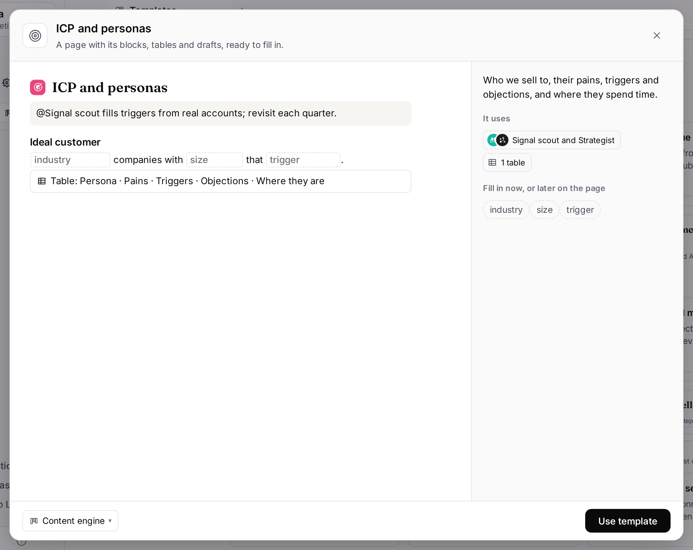
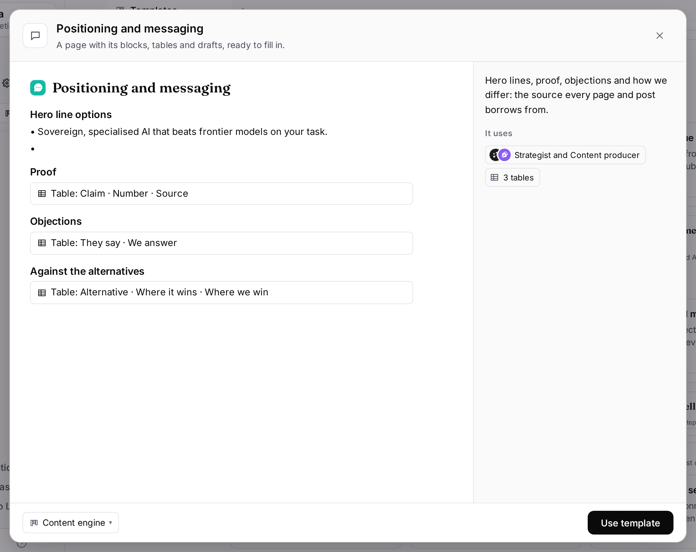

import { Aside, Steps } from '@astrojs/starlight/components';
import Tutorial from '../../../../components/Tutorial.astro';
import PlaybookMeta from '../../../../components/superstar/PlaybookMeta.astro';

Who you sell to, what they struggle with, and the words you use, written once for the team and the crew.

<PlaybookMeta id="positioning" template="ICP and personas" />

<Tutorial id="positioning" />

## Before you start

- Ten or more Won and Lost deals with their reasons written down.
- The [rules](/superstar/how-it-works/#the-rules) every agent keeps.

## Steps

<Steps>

1. **Start from deals**

   **Templates** → **ICP and personas**. Ask **@Strategist** to read Won and Lost deals and draft the ideal customer and the personas.

   

2. **Messaging**

   **Positioning and messaging**: one line, the problems, the proof for each, the words to avoid.

3. **Use it everywhere**

   Agents read these pages before they write. Change a line and the next draft follows it.

</Steps>

## The template

**ICP and personas** is a page. Open it from **Templates** in the sidebar. It makes an **Ideal customer** line and a **Personas** table (Persona, Pains, Triggers, Objections, Where they are). Its partner template, **Positioning and messaging**, holds hero lines, proof, objections and the alternatives.

## Prompts

Copy one and change the names. A prompt that starts with an @name goes in a block on the page; the others go in **Ask** (**Ctrl J**).

```text title="A block that starts with @Strategist"
@Strategist Read our Won and Lost deals and draft the ICP: company size, sector, trigger, buyer, why they buy, why they don't.
```

```text title="A block that starts with @Content producer"
@Content producer Check our last ten posts against Positioning and messaging and list where we drifted.
```

## What good looks like

"Finance teams at mid-size logistics companies whose close takes over a week because of data, buying when a new CFO or an ERP change arrives."

An ICP line built from Halcyon Data's deals:

> Finance teams at mid-size logistics companies whose close takes over a week because of data, buying when a new CFO or an ERP change arrives.

Every part can be checked against a deal: the sector, the size, the pain, the trigger.



## Watch for

- Write it from real deals, not from who you wish you sold to.

## What to count

- Win rate inside the ICP vs outside it

Compare win rate for deals inside the ICP and outside it, from Deals, once a quarter.

## Next

[Run a cold sequence that stops on reply](/superstar/playbooks/cold-outbound/): four short emails over two weeks to people with a real reason to hear from you, and none after they write back.
