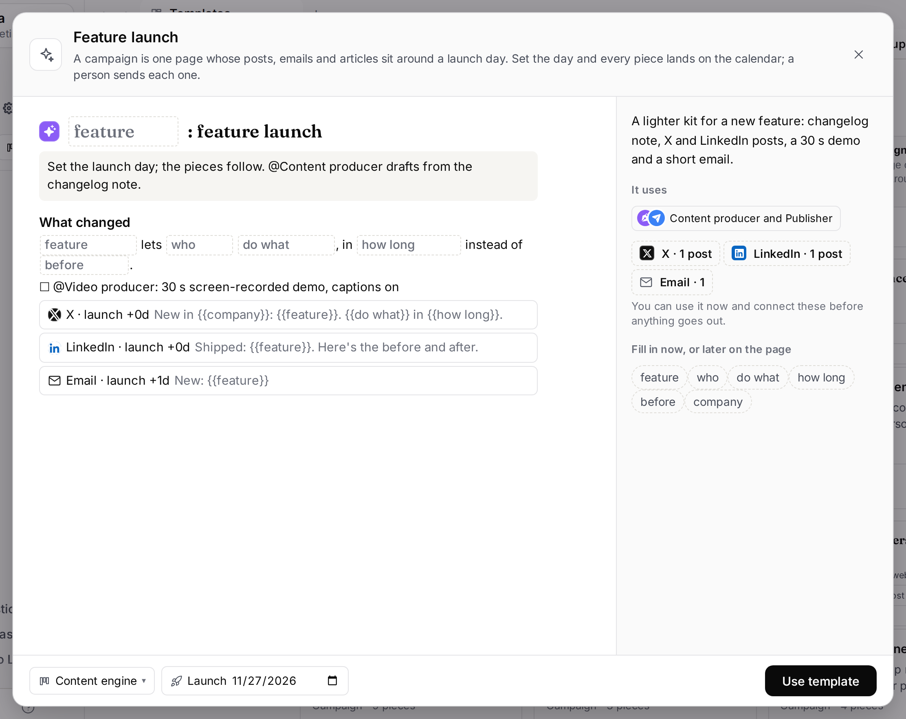
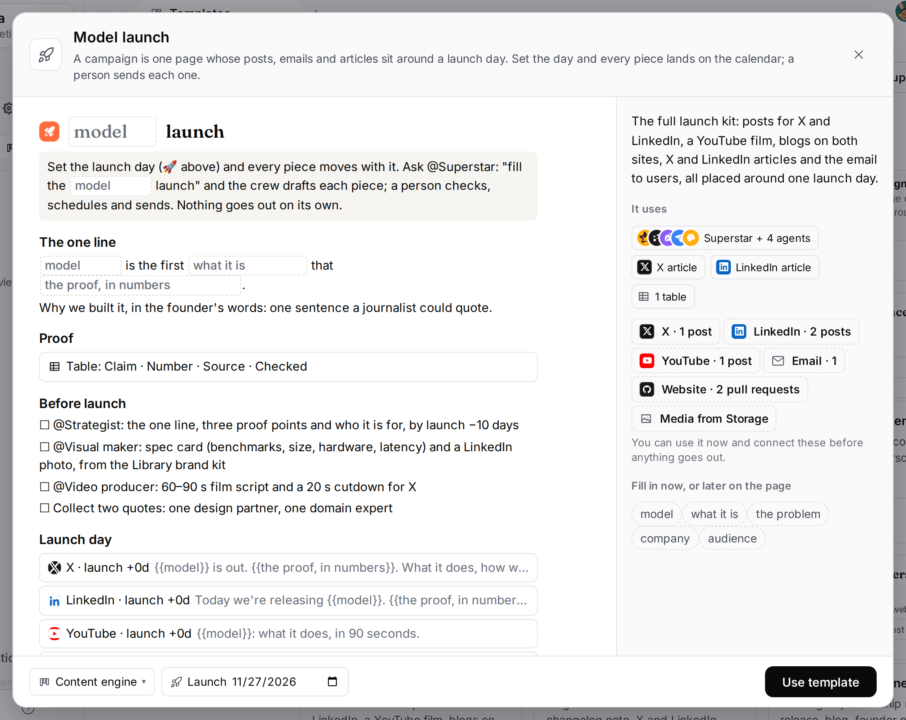

import { Aside, Steps } from '@astrojs/starlight/components';
import Tutorial from '../../../../components/Tutorial.astro';
import PlaybookMeta from '../../../../components/superstar/PlaybookMeta.astro';

Posts, emails and an article placed around one launch day; move the day and everything moves with it.

<PlaybookMeta id="product-launch" template="Feature launch" />

<Tutorial id="product-launch" />

## Before you start

- A launch day, and the release notes or spec in Storage or on a page.
- Company profiles connected in **Setup** → **Profiles**, set to **Ask first**.
- Who validates the posts.
- The [rules](/superstar/how-it-works/#the-rules) every agent keeps.

## Steps

<Steps>

1. **Use the kit**

   **Templates** → **Feature launch** (or **Model launch**). Fill the feature and the launch day.

   

2. **Write from one source**

   Give **@Content producer** the changelog note. The kit already places an X post and a LinkedIn post on the day and an email the day after; it drafts each one, and you add more pieces with their 🚀 chip.

3. **Make the visuals**

   **@Visual maker** makes the social cards and a figure that shows the feature working.

4. **Validate and schedule**

   Each post waits for a person's Validate, then goes out at its time. Move the 🚀 launch day and every unsent piece moves.

</Steps>

## The template

**Feature launch** is a campaign. Open it from **Templates** in the sidebar. It makes a **What changed** line, a to-do for a 30-second demo, an X post and a LinkedIn post on launch day, and an email the day after.

## Prompts

Copy one and change the names. A prompt that starts with an @name goes in a block on the page; the others go in **Ask** (**Ctrl J**).

```text title="A block that starts with @Content producer"
@Content producer Fill this launch kit from the changelog note: the X and LinkedIn posts on the day and the email to customers the day after.
```

```text title="A block that starts with @Visual maker"
@Visual maker Make the launch card for anomaly alerts: the alert as it appears, with the rows it flags.
```

```text title="Ask (Ctrl J)"
Move the launch to Thursday and tell me which pieces moved.
```

## What good looks like

Every piece says one concrete thing the feature does, with the product on screen. None of them says "excited to announce".

One of Halcyon Data's anomaly-alerts posts, drafted by the Content producer from the release notes:

> New in Halcyon: anomaly alerts.
>
> Instead of a rule you write, Halcyon learns what a normal day looks like for each table and tells you when today isn't one: a feed that's 40% short, a currency column that suddenly has three values, a vendor that appears twice.
>
> The alert lands where the owner already works, with the rows that look wrong.

It says what the feature does, with three concrete cases, and stops.



## Watch for

- Validate the numbers before the copy.
- Posts on one profile go out its gap apart; plan launch-day posts on different profiles or minutes.

## What to count

- Clicks to the launch page per channel
- Sign-ups or demo requests in launch week
- Replies answered the same day

Each post shows **Posted** with its link once it goes out. Ask the Strategist for the launch week's numbers per channel.

## Next

[Run a launch on X and LinkedIn](/superstar/playbooks/x-launch/): a thread on X, a post on LinkedIn and answers to every reply, each written for its platform.
