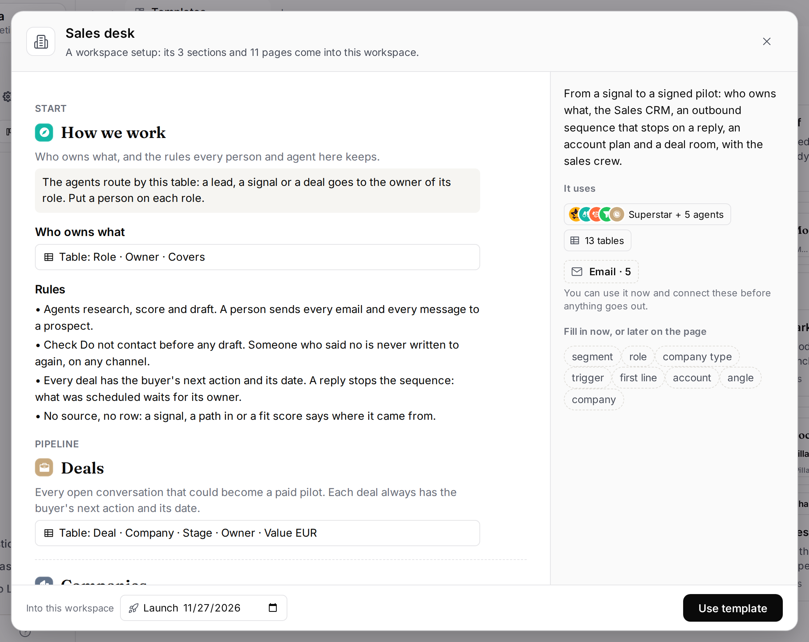
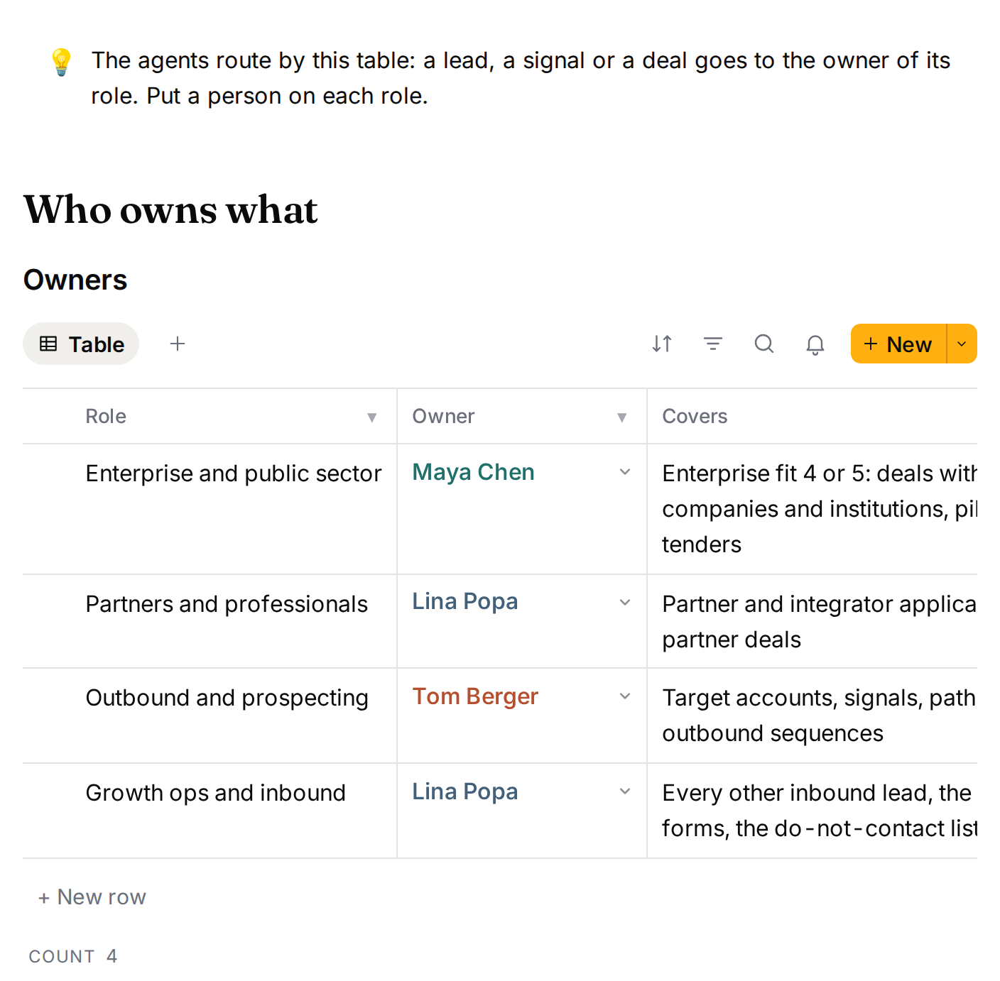
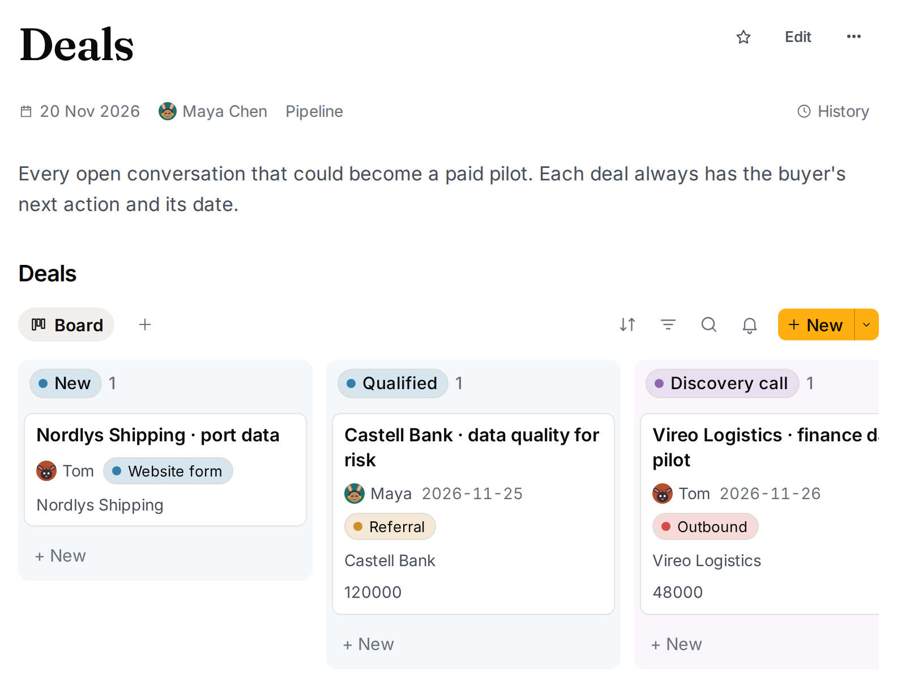

import { Aside, Steps } from '@astrojs/starlight/components';
import Tutorial from '../../../../components/Tutorial.astro';
import PlaybookMeta from '../../../../components/superstar/PlaybookMeta.astro';

A workspace with the CRM, the plays and the rules, where every lead, signal and deal reaches its owner.

<PlaybookMeta id="sales-desk" template="Sales desk" />

<Tutorial id="sales-desk" />

## Before you start

- A Member or Admin role in the workspace.
- The names of the people who own enterprise deals, partners, outbound and inbound. One person can hold several roles.
- Your list of people who asked not to be contacted, from any tool you used before.
- The [rules](/superstar/how-it-works/#the-rules) every agent keeps.

## Steps

<Steps>

1. **Use the template**

   Sidebar → **Templates** → **Sales desk**. Fill your segment, the company type and the role you sell to, then **Use template**. You get **How we work**, the CRM (Deals, Companies, People, Signals, Paths in, Inbound leads, Do not contact) and three plays.

   

2. **Name the owners**

   On **How we work**, put one person on each row of **Owners**. Agents route by this table: a lead for a role nobody owns waits where nobody looks.

   

3. **Read the rules together**

   The **Rules** list is what every agent keeps: research and draft, never send; check Do not contact first; every deal has the buyer's next action and a date. Change a rule there and the crew follows it.

4. **Bring what you have**

   Paste your current deals and accounts into **Deals** and **Companies** (one row per line), or ask Superstar to import a CSV from **Storage**.

</Steps>

## The template

**Sales desk** is a workspace. Open it from **Templates** in the sidebar. It makes three sections: **Start** (How we work, with the Owners table and the Rules), **Pipeline** (Deals, Companies, People, Signals, Paths in, Inbound leads, Do not contact) and **Plays** (an outbound sequence, an account plan and a deal room).

## Prompts

Copy one and change the names. A prompt that starts with an @name goes in a block on the page; the others go in **Ask** (**Ctrl J**).

```text title="Ask (Ctrl J)"
Set up a sales desk for us: we sell data-quality software to CFOs at logistics companies. Tell me what to fill in on How we work.
```

```text title="Ask (Ctrl J)"
Import deals.csv from Storage into Deals. Map Stage to our stages and leave anything unclear empty, then list what you skipped.
```

## What good looks like

Every row of Owners has a person. Deals has a Next buyer action and a date on every open deal. Do not contact holds everyone who ever said no.

At Halcyon Data, a week in, **Deals** looks like this. Every open deal has a buyer action and a date, except the one that just arrived:

| Deal | Stage | Owner | Next buyer action | Date |
|---|---|---|---|---|
| Ostra Retail, loyalty data | Negotiation | Maya | Legal sends redlines on the order form | 2026-11-27 |
| Castell Bank, data quality for risk | Qualified | Maya | Elena books a scoping call with the risk data team | 2026-11-25 |
| Vireo Logistics, finance data pilot | Discovery call | Tom | Anna reviews the pilot outline with their controller | 2026-11-26 |
| Nordlys Shipping, port data | New | Tom | | |

The empty row is what the [weekly review](/superstar/playbooks/pipeline-review/) catches.



## Watch for

- An empty owner is the most common reason an agent's work goes unseen.
- Keep select options (Stage, Tier, Status) as they are: agents only use values that exist.

## What to count

- Open deals with a buyer action and a future date (aim for all of them)
- Leads with an owner within five minutes

Open **Deals** and add a filter on **Next action date**. The Strategist counts both in its Monday review.

## Next

[Answer a lead within the hour](/superstar/playbooks/inbound-leads/): a new lead is researched, scored, routed and has its reply drafted before anyone opens it.
