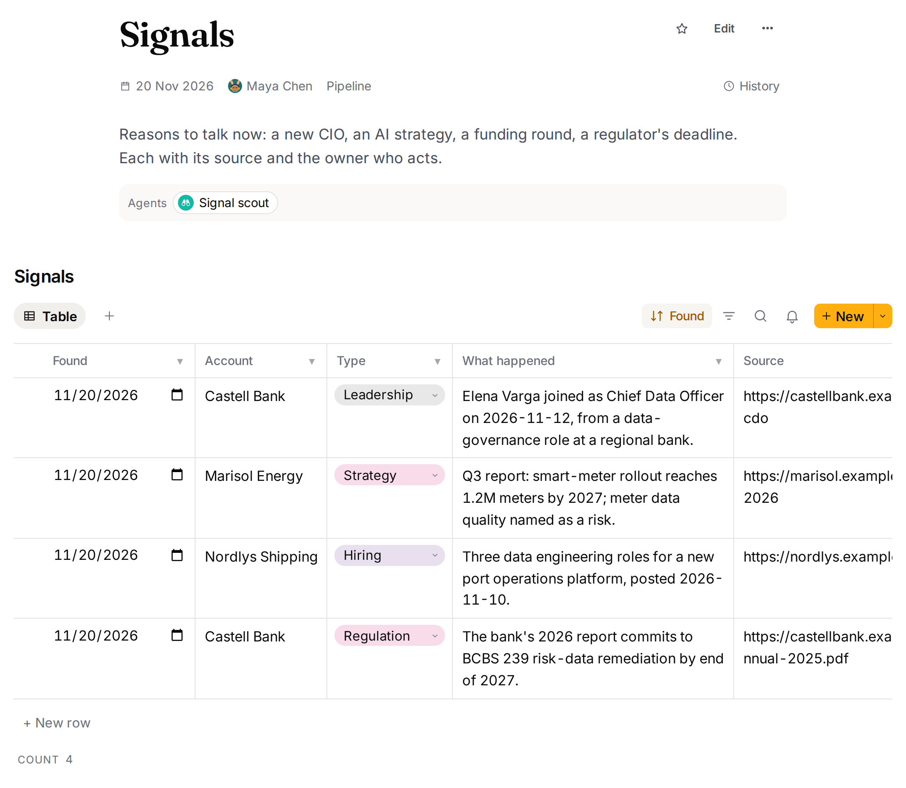
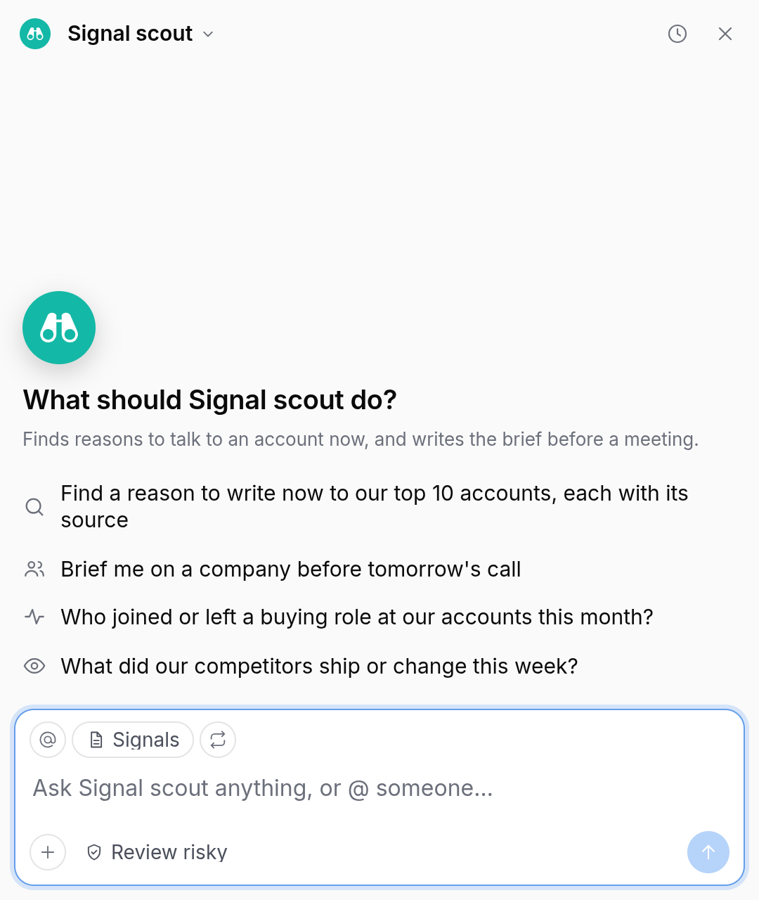
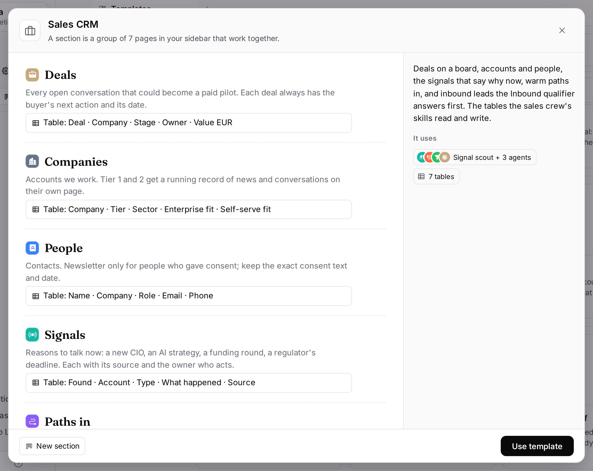
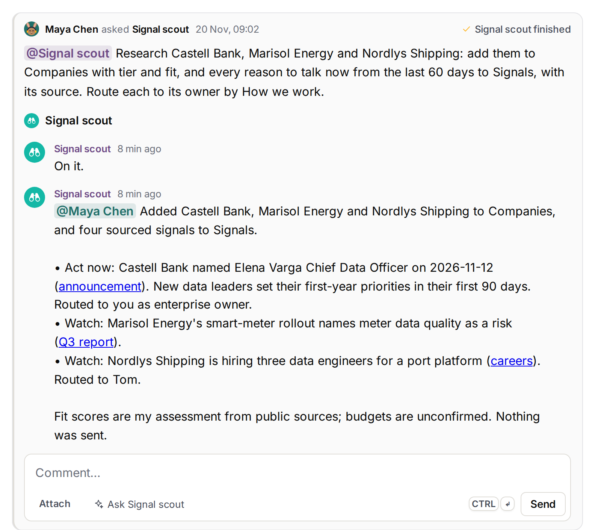

import { Aside, Steps } from '@astrojs/starlight/components';
import Tutorial from '../../../../components/Tutorial.astro';
import PlaybookMeta from '../../../../components/superstar/PlaybookMeta.astro';

Leadership changes, strategy, funding, hiring and regulation at your accounts, each with its source and owner.

<PlaybookMeta id="signals" template="Sales CRM" />

<Tutorial id="signals" />

## Before you start

- The **Sales CRM** tables (or the Sales desk), with your target accounts in **Companies** and a **Tier** on each.
- Owners on How we work, so each signal reaches someone.
- The [rules](/superstar/how-it-works/#the-rules) every agent keeps.

## Steps

<Steps>

1. **Name the accounts**

   Add your target companies to **Companies** with a Tier, or give Signal scout a list.

2. **Ask for signals**

   On **Signals**, ask **@Signal scout**. It records each event with what happened, the source link, how strong it is (**Act now**, **Watch**, **Background**) and routes it to the owner.

   

3. **Start with people you know**

   The strongest reason to write is a person: someone who used or bought from you before and now works somewhere new, or a new leader in the role you sell to. Funding news alone is weak.

4. **Make it weekly**

   In Signal scout's panel, **Chat**: write the ask and press **↻** to repeat it, say every Monday at 8. **Repeats** lists them. Only people set repeats.

   

5. **Act within days**

   An **Act now** signal is worth a message this week. Start the email with what happened, not with who you are.

</Steps>

## The template

**Sales CRM** is a section. Open it from **Templates** in the sidebar. It makes seven pages, each one table: **Deals**, **Companies**, **People**, **Signals**, **Paths in**, **Inbound leads** and **Do not contact**. These are the tables the sales crew reads and writes.



## Prompts

Copy one and change the names. A prompt that starts with an @name goes in a block on the page; the others go in **Ask** (**Ctrl J**).

```text title="A block that starts with @Signal scout"
@Signal scout Research our Tier 1 accounts: every reason to talk now from the last 60 days, with its source, routed by How we work.
```

```text title="A block that starts with @Signal scout"
@Signal scout Brief me for tomorrow's call with Castell Bank: who is in the room, what changed this year, three questions to ask.
```

```text title="A block that starts with @Signal scout"
@Signal scout Find 15 logistics companies over 500 people that announced an ERP or data-platform change this quarter.
```

## What good looks like

"Castell Bank named Elena Varga Chief Data Officer on 12 November (link). Ask what Elena wants fixed first; a new leader's list is still open." A date, a source, and one thing to ask.

Maya asked on **Signals**. The Signal scout added Castell Bank, Marisol Energy and Nordlys Shipping to Companies and four rows to Signals, and answered:

> Act now: Castell Bank named Elena Varga Chief Data Officer on 2026-11-12 (announcement). Routed to you as enterprise owner.
> Watch: Marisol Energy's smart-meter rollout names meter data quality as a risk (Q3 report).
> Watch: Nordlys Shipping is hiring three data engineers for a port platform (careers). Routed to Tom.
>
> Fit scores are my assessment from public sources; budgets are unconfirmed. Nothing was sent.

What makes it usable: each line has a date, a link, a strength and an owner, and it says what it doesn't know.



## Watch for

- Open the source before you quote it. Fit scores are the agent's reading of public pages.
- A signal without a source is a rumour: the scout leaves those out.
- By the time a buyer writes, most have a favourite. A signal is a reason to be useful early, not a reason to pitch.
- An email that ignores the signal is worse than none: 73% of buyers say they avoid suppliers who send irrelevant outreach.

## What to count

- Signals with a source per week
- Act now signals that got a touch within 48 h (a team rule, not a benchmark)
- Meetings per 100 signals

Signals has **Found**, **Strength** and **Status** (New, Acted on, Dropped). Set Status to **Acted on** when you write, and count by week.

## Next

[Run a cold sequence that stops on reply](/superstar/playbooks/cold-outbound/): four short emails over two weeks to people with a real reason to hear from you, and none after they write back. Most replies come by the third email; the fourth only closes the loop.
